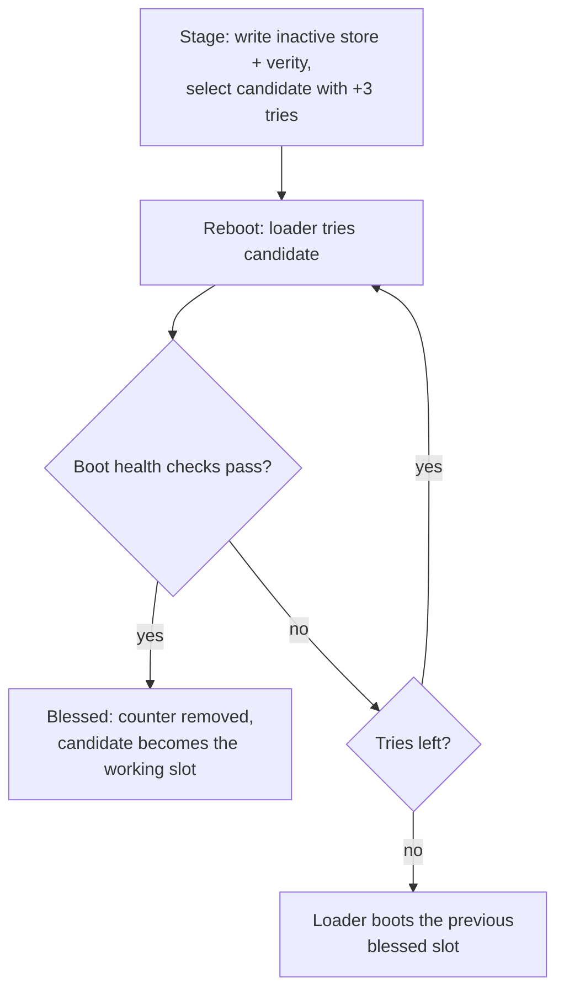

# How A/B boot selection works

<a id="ab-update-slots"></a>

The updater writes the inactive system slot. Each slot pairs a read-only store with its verity tree. Configuration lives on a separate writable data partition.

<a id="which-image-am-i-running"></a>

## Read the boot state

```sh
sentinel show version
bootctl status
```

On the running appliance, identify the current slot and boot entry before staging a replacement.

<a id="partition-layout"></a><a id="boot-counting-automatic-boot-assessment"></a><a id="what-sentinel-update-does"></a>

## Follow an update

| Phase | What changes |
|---|---|
| Stage | Write the inactive store and its verification data, then select the candidate for a counted boot. |
| Reboot | The loader attempts the selected candidate. The previous working slot remains available. |
| Accept or fall back | A successful boot can be marked good. A candidate that exhausts its counted attempts yields to the previous entry. |



| Partition | 1 | 2 | 3 | 4 | 5 | 6 |
|---|---|---|---|---|---|---|
| Content | ESP | verity A | store A | verity B | store B | data |

The boot mechanism protects against a candidate failing to boot. An operator still has to check management connectivity and forwarding after startup. See the [update runbook](../operations/update.md).

<a id="verifying-it"></a>

## Run the fallback check

```sh
nix build .#checks.x86_64-linux.bootfallback -L
```

Run on a KVM-enabled build host.

## Safety boundaries

Fallback needs a previously bootable, blessed slot; a fresh installation with no working predecessor cannot promise automatic recovery. Keep a console and verify the actual selected entry, not only a configured default.

`--allow-unsigned` permits only an explicitly trusted Community source. It does not bypass active-disk, boot-selection or identical-active-GUID refusal. Native Enterprise appliances reject the Community image writer; use their signed channel workflow.
