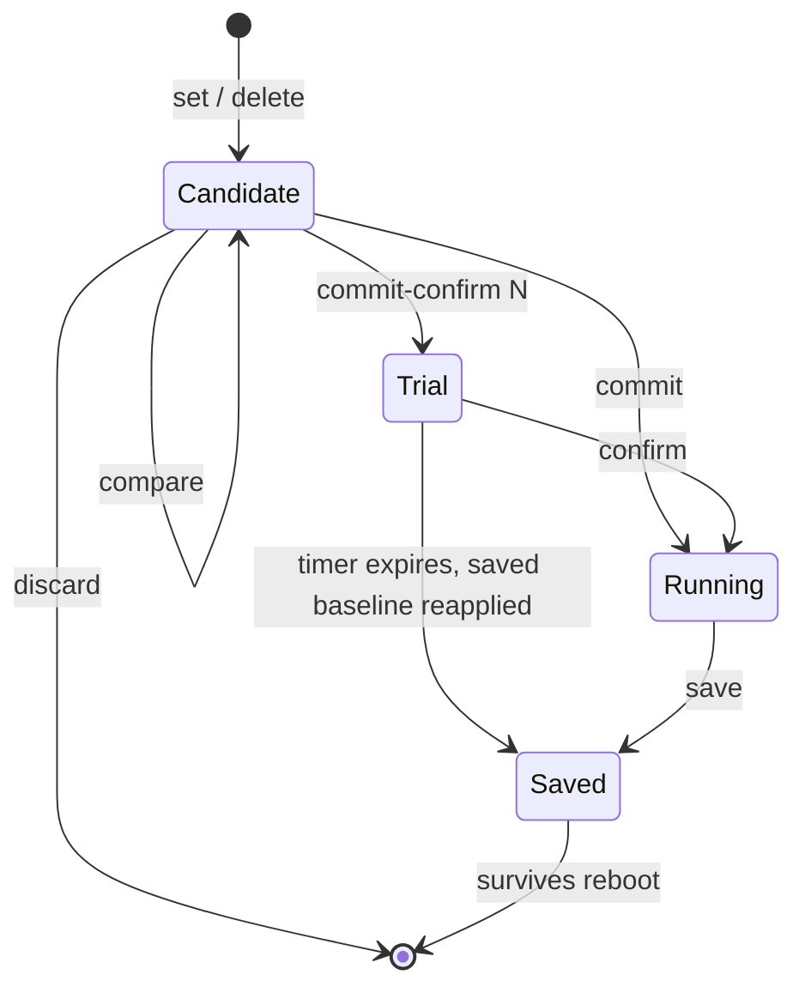

# What commit, confirm and save do

<a id="the-commit-model-runtime-apply"></a>

A configuration change reconciles running services without rebuilding or rebooting the OS.

<a id="undo-and-safety-nets"></a>

## Apply a reversible change

```text
set system hostname branch-a
compare
commit-confirm 2
```

Run these in a configuration session with a saved baseline. Verify management access from a second session, then `confirm` before the timer expires and `save`.



<a id="commit-vs-save"></a><a id="how-it-persists-across-reboot"></a>

## Choose the correct operation

| Operation | Effect |
|---|---|
| `compare` | Inspect pending changes before applying. |
| `commit` | Apply to running services. A future boot still reads the saved file. |
| `commit-confirm N` | Apply provisionally for N minutes, with a saved baseline for recovery. |
| `confirm`, then `save` | Cancel the CLI rollback timer, then persist the running configuration. |
| `discard` | Drop candidate edits that have not been committed. |
| `rollback N` | Apply and persist an archived revision. `0` is the newest. |

<a id="what-a-commit-reconciles"></a><a id="atomicity-and-rollback"></a><a id="privilege-path"></a>

## State and privilege boundaries

| Topic | Rule |
|---|---|
| What reads show | The last successfully applied snapshot (the saved file before the first live commit), not an open session's candidate. A stale candidate must not overwrite a newer applied snapshot. |
| Offline editing | `--no-apply` requires an explicit configuration file. |
| Piped input | Stops on the first refusal; it does not undo earlier successful commits. |
| API batches | Validated before the provisional transaction opens. |
| CLI vs API | They share the compiler, not one transaction journal. CLI `commit` does not save; an API provisional apply persists its trial under its own recovery protocol. Do not infer one interface's persistence behavior from the other. |

A local `read-write` group grants administrator access, including passwordless sudo. Read-only and ordinary ungrouped users do not receive it; the explicitly configured, ungrouped built-in `admin` is a bootstrap exception. Account removal or demotion terminates existing sessions and jobs. Keep an independent administrator or recovery console.

## Recover a partial apply

Sentinel compiles the candidate before applying it and serializes concurrent applies. The firewall, routing and hostname stages track undo actions. A later service-stage failure can leave a mixed state: read the failure, retain console access and restore a known saved revision. See the [operator walkthrough](../operations/configure.md).

<a id="verifying-it"></a>

## Validate in a VM

```sh
nix build .#checks.x86_64-linux.commit -L
```

This check verifies live apply and persistence across reboot.
