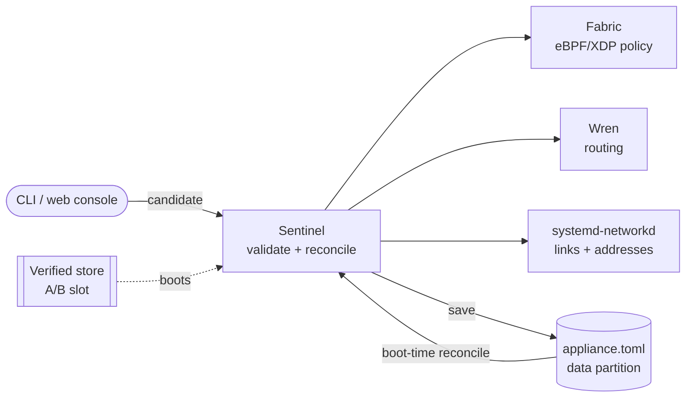

# What runs on the appliance

Sentinel separates day-to-day configuration from the image that boots the box.

## Follow a configuration change

| Component | Responsibility |
|---|---|
| Sentinel | Validates the candidate and reconciles the running services. |
| Fabric | Loads eBPF/XDP policy for filtering, NAT and packet forwarding. |
| Wren | Exchanges routes and tracks routing state. |
| systemd-networkd | Configures links and addresses from generated units. |

`sentinel show interfaces` shows live addresses. `sentinel show ip route` shows routing state. [Trace a packet](../handbook/firewall.md#asking-before-you-send-packet-trace) to inspect the static forwarding decision.

## Follow a reboot

The appliance reads its saved configuration from `/var/lib/sentinel/appliance.toml`. A boot-time reconcile restores the running services. System software boots from a [verified store](verified-boot.md); an [A/B update](ab-updates.md) prepares the inactive slot.
