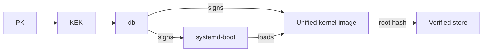

# Verify the UEFI boot chain

<a id="secure-boot"></a>

Sentinel signs systemd-boot and the unified kernel image at image-build time. Firmware enrollment determines which signer the machine trusts.



<a id="verifying-enforcement"></a>

## Inspect firmware enforcement

```sh
bootctl status
```

Look for the Secure Boot state. Use a signed appliance image and firmware with the intended keys enrolled. A signed file alone cannot prove the firmware enforced a signature.

<a id="why-build-time-sbsign-not-lanzaboote"></a><a id="what-gets-signed-and-how"></a><a id="why-the-uki-is-signed-after-the-build"></a><a id="the-keys-are-demo-keys--override-them-for-production"></a>

## Choose the signing identity

| Build | Keys | Enrollment payloads in `/loader/keys/sentinel/` |
|---|---|---|
| Public source build | Development PK, KEK and db; private keys readable in the Nix store. Demonstration identities, not production secrets. | None, only a README, unless a lab sets `velstra.appliance.secureBoot.developmentEnrollment`. |
| Signed release | Not the development keys. | Installs its own payloads there. |

> **Warning:** The public module does not provide a complete supported production key-custody, rotation and revocation workflow. Do not put production private keys in a derivation, repository, store path or appliance image. Production needs a separately reviewed signing boundary, protected custody, public-key enrollment and a tested revocation/recovery plan.

The OTA signing identity is separate from the firmware identity. The image builders sign the final UKI after its contents are assembled. Preserve firmware recovery access before changing enrolled keys; an OVMF pass with test keys does not qualify production key custody.

## Exercise the signed image

```sh
nix build .#checks.x86_64-linux.secureboot -L
```

This fixture enrolls the test keys in OVMF and boots the signed image with enforcement. [Verify the store](verified-boot.md).
