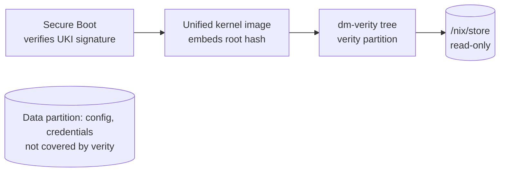

# Verify the operating-system store

<a id="verified-boot-dm-verity"></a>

The kernel reads the immutable Nix store through dm-verity. A root hash embedded in the unified kernel image anchors the verification tree.



## Inspect a booted image

```sh
sentinel show version
findmnt /nix/store
lsblk -f
```

Check the boot identity, the read-only store and the separately mounted data partition. A development VM has a different boot path.

<a id="how-its-assembled"></a><a id="the-filesystem-layout-at-runtime"></a>

## Know what is protected

dm-verity checks the contents of the system store as they are read. Configuration, credentials and certificates live on the writable data filesystem. Protect data at rest with [installer encryption](../operations/install.md#disk-encryption-luks2). [Secure Boot](secure-boot.md) verifies the code and kernel image upstream of the root hash.

<a id="gotchas-that-cost-real-debugging"></a><a id="verifying-it-boots"></a>

## Validate the image

```sh
nix build .#checks.x86_64-linux.verified-boot -L
```

The fixture boots the image under QEMU/OVMF and checks the verified system reaches multi-user operation.
