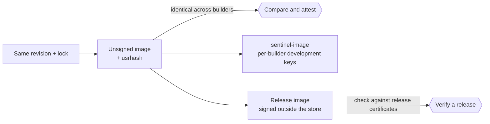

# Reproduce a build

<a id="reproducibility--pinned-hashes"></a>

Use the same repository revision, lock file and pinned build inputs when comparing appliance artifacts.

<a id="the-pins-and-where-they-live-all-in-flakenix"></a>

## Record your inputs

```sh
git rev-parse HEAD
nix flake metadata --json --no-write-lock-file > sentinel-flake-metadata.json
```

The Git revision identifies local build definitions; the lock file identifies external inputs. Keep both with your build record.

<a id="why-nightly-must-match-llvm-20"></a><a id="updating-a-hash-the-fakehash-dance"></a><a id="what-is-not-committed"></a>

## Build the pinned image

```sh
nix build .#sentinel-image --no-write-lock-file --print-out-paths
```

Record the resulting store path. The eBPF object also depends on the pinned Rust nightly, build tools and fixed-output hashes. If a dependency changes, review the expected sources before updating hashes.

<a id="airgapped-builds"></a>

## Build offline

Populate or copy the required store paths and fixed-output sources first. A source checkout alone cannot satisfy network fetches on an air-gapped builder. See the [flake outputs](../reference/flake-outputs.md).

## What pinning does not prove

Pinned inputs improve repeatability; they do not by themselves prove byte-for-byte reproducibility. Compare independently built artifacts, record their hashes and account for signing and other variable inputs.

## Compare the unsigned image, not the signed one

```sh
nix build .#sentinel-image-unsigned --print-out-paths
```

Compare and attest the **unsigned** verity image and its `usrhash` (the dm-verity root hash on the kernel command line, which binds the whole store partition). The unsigned image carries an unsigned systemd-boot and UKI, so it does not depend on any key.



| Artifact | Same across builds? |
|---|---|
| `nix build .#sentinel-image-unsigned`, `usrhash` | Yes, for the same revision. |
| `nix build .#sentinel-image`, same builder and keys | Signatures reproduce (fixed signing time 2025-01-01 00:00:00 UTC), but a handful of FAT directory-entry timestamp bytes on the ESP differ (measured: 10 bytes). |
| `nix build .#sentinel-image`, different builder | No: each builder has different keys and so different signatures. |

`nix build .#sentinel-image` signs systemd-boot and the UKI with [development PK/KEK/db keys](../architecture/secure-boot.md#choose-the-signing-identity) that each builder generates for itself inside a derivation; no enrollment payloads (`PK.auth`, `KEK.auth`, `db.auth`) ship for them unless a lab opts in.

Release images are signed afterwards, outside the store, with the release identity (`scripts/community_release.py sign` in the release workflow), which replaces every development signature and installs the release's enrollment payloads. To verify a release, compare its `usrhash` and unsigned payload with your own build, then check the signatures against the published release certificates.

<details><summary>Hashes, toolchain and offline claims</summary>

A fixed-output derivation can reuse an older cached object when its expected output hash is unchanged, even if a source revision changed. Verify the measured object and its ABI against the intended userspace cohort before accepting new hashes. Development ABI guards or a fixture's pins are not proof that the published appliance integrates them.

Keep the eBPF Rust nightly and LLVM versions compatible. An offline-build claim requires the complete closure and a successful build with network access disabled, not merely a populated source cache.

Ignore rules are not a secret scan or a history rewrite. Review tracked files, release artifacts and reachable history separately.

</details>
