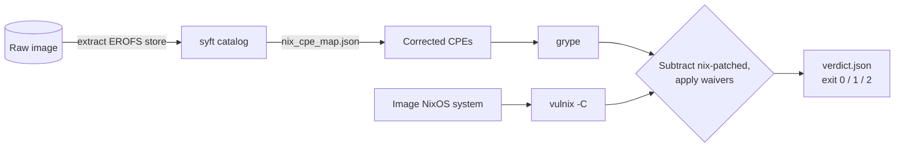

# Scan the image for known vulnerabilities

The release gate scans the **built disk image**, not the source tree. It reads slot A's store partition straight from the raw image, so it judges the bytes that ship.



## Run the gate

Run it on a machine that built the image, so the image's NixOS system and its derivations are in the local Nix store:

```sh
nix build .#sentinel-image -o result-image
grype db update
python3 scripts/image_cve_gate.py run \
  --image result-image/velstra-sentinel_1.0.0.raw \
  --out /tmp/sentinel-cve-scan \
  --vulnix "$(nix build --inputs-from . nixpkgs#vulnix --print-out-paths --no-link)/bin/vulnix" \
  --fsck-erofs "$(nix build --inputs-from . nixpkgs#erofs-utils.out --print-out-paths --no-link)/bin/fsck.erofs"
```

You also need `syft`, `grype`, `nix` and `sfdisk` on `PATH`. Besides the steps in the diagram, the gate collects the CVE ids that nixpkgs patch files name.

| Exit status | Meaning |
|---|---|
| 0 | Pass. |
| 1 | Fail. |
| 2 | The gate could not judge, for example because a scanner or the system's derivations are missing. |

The output directory keeps every intermediate file and `verdict.json`. The table on stdout counts open findings per package. To re-judge saved scanner output without rescanning, run `image_cve_gate.py evaluate`; its `--help` lists the inputs.

## What fails the gate

| # | Failure | Rule |
|---|---|---|
| 1 | **Coverage** | A critical package ships, but the SBOM has no CPE that grype can match. The critical packages are the kernel, glibc, openssh, openssl, curl, systemd, sudo, dnsmasq and strongswan. The gate also fails if the package is missing from the SBOM entirely, or if the kernel cataloger found no kernel. "0 CVEs" is not believable for an unmatched package, so the gate never accepts it. |
| 2 | **A fixable finding** | At or above the threshold (default High), grype knows a fixed version, and the finding is neither patched nor waived. |
| 3 | **A vulnix finding at or above the threshold** | vulnix is an independent second source with its own name matching. It has no fix data, so a vulnix-only finding blocks until it is fixed, patched or waived. The verdict reports grype-only, vulnix-only and shared findings separately. |
| 4 | **An invalid waiver** | Expired, missing a field, valid more than 90 days after its review, stale (matches no finding), or a pattern instead of one exact identifier. |

A finding is subtracted as `nix-patched` only when a patch file of **that package's** derivation names the CVE, for example nixpkgs' `CVE-2026-96512_1.patch` for sudo. A grype finding with no known fix is reported as `no-fix` and does not block.

## Waivers

Generate an entry from a verdict instead of typing it:

```sh
python3 scripts/image_cve_gate.py waive --verdict /tmp/sentinel-cve-scan/verdict.json \
  --cve CVE-2026-12345 --reason "…" --reviewer release-review --days 30
```

`scripts/cve-waivers.json` holds the per-CVE decisions:

```json
{"schema": "velstra-cve-waivers/1", "waivers": [
  {"id": "CVE-2026-12345", "package": "curl",
   "reason": "HTTP/3 is compiled out; the vulnerable code is not in the binary",
   "reviewed-by": "release-review", "reviewed": "2026-11-19", "expires": "2026-12-19"}
]}
```

The entry is valid for at most 90 days, and `package` limits it to one package. There is no wildcard and no severity-wide or package-wide ignore.

### Proposed waivers

An entry may be committed as a proposal: its `reason` carries the analysis and `reviewed-by` and `reviewed` stay empty. The gate rejects such an entry ("missing reviewed-by"), so a proposal can never pass a release by itself. To accept one, a reviewer checks the analysis against the advisory, fills `reviewed-by` and `reviewed` (the review date), and keeps `expires` within 90 days of it. Replace a waiver with a fix as soon as one ships.

## The kernel

Grype matches the kernel against NVD's upstream version ranges. Those ranges often do not record the stable-branch backports, so an unfiltered kernel count is an upper bound, not a list of open holes. The gate splits kernel findings in two:

| Kind | Example and remedy |
|---|---|
| **Same-branch fix** | One of the fixed versions is newer and on the shipped branch, for example 6.12.114 for a 6.12.113 kernel. This blocks like any other fixable finding. The remedy is a newer 6.12 kernel: a nixpkgs bump, or between bumps `nix/kernel.nix`, which builds the pin's own 6.12 recipe from a newer stable source. |
| **Unresolved** | No fix is known on the shipped branch in grype's data. Review these against the kernel CNA's per-branch records (`vulns.git`, `cve/published/<year>/<id>.dyad`), which often show a stable-branch fix grype does not know. The waiver file then needs a `kernel-baseline` that names every one of them. |

```json
"kernel-baseline": {"kernel-version": "6.12.118",
  "reviewed-cves": {"open-no-branch-fix": ["CVE-2026-23102", "…"],
                    "no-cna-record": ["CVE-2023-6610", "…"],
                    "fixed-on-branch": ["CVE-2026-…", "…"],
                    "not-in-branch": ["CVE-2025-39905", "…"]},
  "triage": "vulns.git <commit>: how each group was decided",
  "reason": "…", "reviewed-by": "release-review", "reviewed": "2026-11-22", "expires": "2026-12-31"}
```

The baseline is a reviewed list, not an ignore:

- It names the exact kernel version, so any kernel change forces a new review.
- It expires on the same 90-day rule as a waiver.
- A kernel CVE it does not name fails the gate, and a CVE it names that no finding carries fails it as stale. A new kernel CVE can therefore not slip in under an old review. A count ceiling (`max-unresolved`) is refused: it accepted whatever CVEs filled the count.

Use per-CVE waivers for single kernel CVEs that you have checked.

## The security floor

`checks.image-security-floor` proves that the fixes the image claims are the ones it ships. It reads the store paths of the image's system closure (`scripts/check_security_floor.py`) and fails when:

- a package in `nix/security-floor.json` ships below its floor (the kernel, HAProxy, glibc, gzip, krb5, hostapd, SQLite, libcap, Suricata), or does not ship at all: a floor that matches nothing must be removed;
- a `nix/security-backports.nix` replacement did not take (the replaced store path still ships) or is inert (no output by the replacement's name ships);
- the `sqlite3` shell or libressl's `ocspcheck` is in a `bin/` directory. Their CVEs are in the programs, not in the libraries the image needs.

A same-version backport (a CVE patch on GLib, sudo or Net-SNMP) has no version to check; the replacement half of the check covers it, and the patch file name carries the CVE id that the gate's `patched` step subtracts.

A Go program carries its own copy of the standard library, which no dependency rewrite reaches: the Go programs the image ships (lego, dnsproxy, libcap's captree) are rebuilt with the backported Go toolchain instead.

<details><summary>Why Sentinel rewrites bare store hashes</summary>

Upstream `system.replaceDependencies` rewrites store paths by their full base name. A binary that embeds its own store hash in another form keeps the original path alive, together with whatever that path depends on. GLib does: it builds `<glib>/lib/charset.alias` from overlapping 16-byte constants, so its `.rodata` holds `<hash>-glib-glib-<version>`, and with a replaced glibc the original GLib kept the old glibc in the closure. Sentinel therefore rewrites the bare store hash after the whole base name (`nix/replace-direct-dependencies.nix`, applied by an overlay; `nix/security-backports.nix` refuses to evaluate without it). The order matters: a version backport changes the name too, and a hash-only rewrite of `<hash>-glibc-2.42-103/lib/ld-linux-x86-64.so.2` names a path that does not exist, and the replacement half of the floor check is what proves that no replaced path survives.

</details>

## The closure check

```sh
nix path-info -r "$(nix eval --raw .#nixosConfigurations.sentinel-image.config.system.build.toplevel)" \
  | python3 scripts/check_image_closure.py -
```

`scripts/check_image_closure.py` reads one store path per line and fails when the shipped closure contains a build toolchain: gcc or clang (other than their runtime `lib`/`libgcc` outputs), binutils, kernel or libc headers, and any `-dev` output. The 1.0.0 image shipped about 514 MiB of these through rsyslog's MongoDB output.

## Why the gate corrects CPEs

Syft's Nix cataloger names every Nix package `cpe:2.3:a:<name>:<name>:<version>`. NVD uses other vendor and product names (`gnu:glibc`, `openbsd:openssh`, `haxx:curl`). With the generated names, grype matched nothing for glibc, openssh, curl, suricata, unbound or python3, so a gate built on them reports a clean image whatever it contains. The 1.0.0 audit measured glibc 0 → 112 and openssh 0 → 40 raw matches once the names were corrected.

`scripts/nix_cpe_map.json` maps each Nix package name to its NVD vendor and product:

| Key | Purpose |
|---|---|
| `aliases` | Folds variants (`systemd-minimal`, `util-linux-minimal`, `coreutils-full`) onto one package. |
| `first-party` | Lists Velstra's own binaries. Their guessed CPEs only match unrelated products of the same name (the audit's two false "wren" Highs), so the gate drops them. Their Rust dependencies are still scanned from the cargo-auditable data. |
| `version-rules` | Handles Nix-only version suffixes. glibc's `2.42-100` (100 release-branch commits) becomes `2.42`, so glibc's branch backports are **not** credited: check a glibc match against the 2.42 branch before you waive it. openssh `10.5p1` and sudo `1.9.17p2` keep the portable suffix, which grype orders correctly. |
| (kernel) | Never mapped from a Nix name. It must come from syft's linux-kernel cataloger, which reads the version from the bzImage. |

To add a package, add one entry under `packages` and run the unit tests.

## Shared with the enterprise pipeline

The enterprise pipeline reads `nix_cpe_map.json` from the Sentinel source it pins, not from its own copy. It checks that `schema` is `velstra-nix-cpe-map/1` before it uses the file. When the two repositories need different packages, add the entry here.
