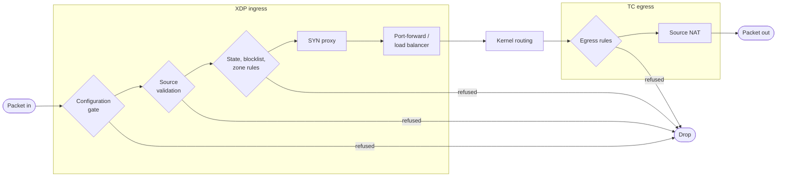
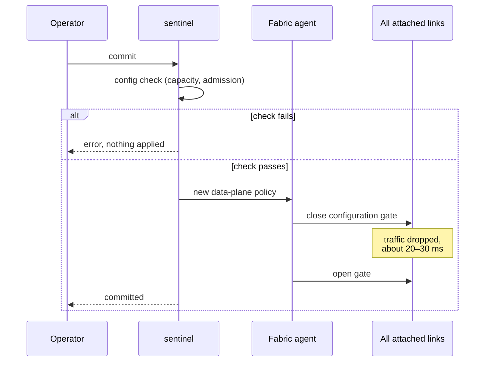

# Firewall, NAT and packet tracing

<a id="firewall--nat"></a>

A deny-by-default edge in one session (run inside `sentinel configure`):

```text
set interface eth0 zone wan
set interface eth0 address dhcp
set interface eth1 zone lan
set interface eth1 address 10.0.0.1/24

set firewall global default-action drop        # deny by default
set firewall global stateful true
set firewall zone lan default-action accept    # trust the LAN

set firewall rule no-smtp from lan             # ...except direct mail
set firewall rule no-smtp proto tcp
set firewall rule no-smtp port 25
set firewall rule no-smtp action drop

set nat source wan-masq zone wan               # masquerade everything leaving wan
compare
commit-confirm 2
```

Zones label interfaces, each zone has a default action, rules narrow it, and NAT rewrites addresses on the way through.

## How a packet is judged



Zone rules judge the packet as it arrived, before destination NAT; a configured port-forward admits its own traffic. The gate closes while a commit installs a new policy ([below](#what-a-policy-commit-does-to-traffic)).

> **Note:** see the [support matrix](../reference/dataplane-support.md) for qualified features and known limits (IPv6 fragments are not translated, the SYN proxy is port-scoped and IPv4-only). Routed traffic uses kernel forwarding plus TC egress, not an established-flow XDP redirect fast path.

## Asking before you send (packet trace)

Can a guest on `lan0` reach SSH on a DMZ server? With a guest-deny rule in place:

```text
$ sentinel trace --in lan0 tcp 10.0.0.200 10.9.0.10 22
...
verdict:   drop (no-ssh-from-guests)
```

The trace shows the ingress zone, route, NAT translations and matched rule above the verdict. It reads the saved configuration; test a candidate file with `--config`, and get the intermediate steps as JSON with `--json`:

```sh
sentinel trace --config ./candidate.toml --json --in lan0 tcp 10.0.0.200 10.9.0.10 22
```

It models compiled configuration only: established state, dynamic routes and current multi-WAN health need live inspection. The console has the same walk under **Policy → Packet trace**.

## Zones & posture

```text
set firewall global default-action drop        # deny by default
set firewall global stateful true
set firewall zone wan block-icmp true          # quiet on the WAN
set firewall zone lan default-action accept    # trust the LAN
```

Assign interfaces to zones first, then override only the zones that differ from the global default.

- **`block-icmp`** refuses new inbound ICMP, even where a rule accepts it. Answers still arrive: echo replies to pings the firewall or a LAN host sent, and ICMP errors about a tracked connection (packet-too-big and fragmentation-needed included, so path-MTU discovery works). Outbound ICMP is not affected.
- **IPv6 neighbour discovery and MLD** always pass on every zone, whatever its default action, rules or `block-icmp`; a zone needs no ICMPv6 rule for IPv6 to work.
- **TCP/UDP with IPv4 options** is dropped on stateful zones: it cannot be tracked, proxied or translated (RFC 7126 practice). A stateless zone judges it by its rules.
- **Address family:** an IPv4 address rule applies to IPv4 only, an IPv6 one to IPv6 only; a rule with no address applies to both unless `family` limits it.

## Rules

```text
set firewall zone firewall local true
set firewall rule mgmt-ssh from mgmt
set firewall rule mgmt-ssh to firewall
set firewall rule mgmt-ssh proto tcp
set firewall rule mgmt-ssh port 22
set firewall rule mgmt-ssh action accept
```

`firewall` is not a reserved name: `local true` makes a zone mean "this appliance". A rule's `from` zone is where the packet **arrives**:

| `direction` | Applies to |
|---|---|
| (not set) | traffic arriving through the zone |
| `out` | traffic leaving through the zone's links, including traffic this appliance sends |
| `both` | both |

So `from wan proto tcp port 25 action drop` keeps SMTP out without stopping LAN hosts from sending mail.

**A rule without `proto` is a zone default**, not a data-plane rule: `from lan action accept` sets zone `lan`'s default to accept. It cannot be narrowed (`source`, `destination`, groups, `family`, `direction` and `log` on it are refused), and it is refused itself when the zone sets `default-action` explicitly.

**Overlapping rules** on the same zone, protocol, port and address hold one verdict: the stricter wins (`reject`, then `drop`, then `accept`), in either order, and `sentinel trace` reports that rule. Where the winner's `family` or `direction` does not cover the other's, `config check` says which part is not enforced.

<details><summary>Zone policy IDs and upgrades</summary>

Zone policy IDs are derived from the zone name, so adding, removing or renaming one zone does not reset the connections of the others. The first commit after upgrading from an image that numbered zones by their sorted names changes every ID once and resets connection state once; on an HA pair, the two members report "policy differs" while they run different images during a rolling upgrade.

</details>

### The destination zone

A **local** zone matches the addresses the appliance holds at run time: static addresses, DHCP and DHCPv6 leases, SLAAC addresses, and a VRRP address while this member holds it. So a DHCP management port is reachable by `to firewall` rules, and the rule never widens to other destinations. `sentinel trace` knows only configured addresses and says so when a destination could be a run-time address.

Any other destination zone binds its configured connected prefixes, not the eventual outgoing interface; routed prefixes behind it are not automatically included.

<details><summary>When a <code>to</code> zone is not enforced</summary>

A source-constrained port rule matches one address end, so its `to` label is not also enforced; broad rules set ingress posture, not a destination restriction. Read every advisory and verify the actual destination match.

</details>

> **Warning:** a zone label is not an egress ACL. Admission refuses new or changed unsafe destination-zone deny rules, but this does not retroactively make unchanged legacy policy safe, and accept-rule advisories stay nonfatal. Use explicit destination matches for management isolation.

### Rate limits

New flows per second (`limit`) with a short peak (`burst`):

```text
set firewall rule ssh-in from wan
set firewall rule ssh-in proto tcp
set firewall rule ssh-in port 22
set firewall rule ssh-in action accept
set firewall rule ssh-in limit 5
set firewall rule ssh-in burst 10
```

### Time-based rules

```text
set firewall rule guest-wifi from guest
set firewall rule guest-wifi proto tcp
set firewall rule guest-wifi port 0-65535
set firewall rule guest-wifi action accept
set firewall rule guest-wifi schedule days mon,tue,wed,thu,fri
set firewall rule guest-wifi schedule start 09:00
set firewall rule guest-wifi schedule end 17:00
```

The schedule uses the appliance's local timezone. Rules are re-applied at every window boundary and whenever the clock is stepped (for example when NTP first synchronises after boot) or the time zone changes.

### ICMP message types

```text
# Answer pings from the management network, and nowhere else.
set firewall rule ping-mgmt from mgmt
set firewall rule ping-mgmt to firewall
set firewall rule ping-mgmt proto icmp
set firewall rule ping-mgmt icmp-type echo-request
set firewall rule ping-mgmt action accept

# Path MTU discovery has to work, whatever else is refused.
set firewall rule pmtu from wan
set firewall rule pmtu proto icmpv6
set firewall rule pmtu icmp-type packet-too-big
set firewall rule pmtu action accept
```

## Protocols a rule can match

Tab completion lists the accepted names. Set the protocol before ports.

```text
set firewall rule ping from wan
set firewall rule ping proto icmp
set firewall rule ping action accept
```

### One rule for both protocols

```text
set firewall rule dns-in proto tcp_udp
set firewall rule dns-in port 53
```

## Blocking by country (GeoIP)

```text
set firewall zone wan geoip-block CN,RU
```

Countries select prefixes from the GeoIP database in the image; review its coverage and freshness. A zone's blocklist and GeoIP countries name **sources**:

- **Stopped:** hosts in a listed country connecting in, and their packets to connections they started.
- **Not stopped:** LAN hosts reaching listed addresses; the answers are let back in. There is no outbound blocklist in this release: use `direction out` rules for the protocols and ports concerned.
- **Newly listed** addresses lose the connections they opened at once, but keep answering ones opened towards them. On a `stateful false` zone there is no connection to answer, so they cannot answer anything.

The global blocklist (`set firewall blocklist`) works the same on every zone. Each zone's policy carries its own copy of the global blocklist and global GeoIP countries, so a global entry costs one data-plane entry per zone plus one; `config check` refuses a total over the [blocklist capacity](#inspect-state-map-occupancy).

## Source validation (anti-spoofing)

Check routing symmetry before choosing `strict`.

```text
set firewall zone wan source-validation strict
```

## IPv6 and extension headers

A family-specific source prefix matches only within its family; test both families.

## Groups (aliases)

Name a reused address, interface or port set once and refer to it from rules.

### Some of a zone, not all of it

```text
set firewall group interface-group trusted interface eth0,eth1
set firewall rule ssh-trusted from lan
set firewall rule ssh-trusted proto tcp
set firewall rule ssh-trusted port 22
set firewall rule ssh-trusted action accept
set firewall rule ssh-trusted interface-group trusted
```

### Devices, not addresses

A MAC group classifies devices on the local segment; a MAC address does not authenticate them.

```text
set firewall group mac-group printers mac aa:bb:cc:dd:ee:ff,aa:bb:cc:dd:ee:01
set firewall rule no-printers from lan
set firewall rule no-printers source-mac-group printers
set firewall rule no-printers action drop
```

### Domain groups

Names resolve to addresses; recheck them when a service changes endpoints.

```text
set firewall group domain-group trackers domain ads.example.com,metrics.example.net

set firewall rule no-trackers from lan
set firewall rule no-trackers proto tcp
set firewall rule no-trackers port 443
set firewall rule no-trackers action drop
set firewall rule no-trackers destination-group trackers
```

## Groups whose members are decided elsewhere

Know who owns the membership, how it refreshes and what an empty group means.

### Published lists

```text
set firewall group feed-group bogons url https://example.org/bogons.txt
set firewall rule drop-bogons from wan
set firewall rule drop-bogons source-group bogons
set firewall rule drop-bogons proto tcp
set firewall rule drop-bogons port 22,443
set firewall rule drop-bogons action drop
```

A feed is matched by port rules, so it needs a `proto` (and ports for TCP/UDP); to block a source on every protocol, use the zone `blocklist`. Each member costs one data-plane entry per port and protocol, so keep port sets narrow. Every commit and refresh checks the merged feed against capacity and, if it no longer fits, keeps the running policy with an error.

### People

Members are authenticated users, not addresses.

```text
set firewall group user-group admins user alice,bob
set firewall rule admin-ssh from lan
set firewall rule admin-ssh source-group admins
set firewall rule admin-ssh proto tcp
set firewall rule admin-ssh port 22
set firewall rule admin-ssh action accept
```

## NAT

### Source NAT (masquerade)

```text
set nat source wan-masq zone wan            # masquerade everything leaving wan
```

Masquerade uses the uplink's current IPv4 address, including a DHCP lease. Plan for roughly **31,000 concurrent connections from one public address to one remote ip:port**; across different remotes the state tables are the limit, not ports.

<details><summary>How public ports are allocated, and when they run out</summary>

Each connection gets its own public source port. Ports are scarce only between connections to the **same** remote address and port: each such endpoint has the whole 32768-port range (32768–65535) of the public address to itself, and connections to different endpoints never compete.

A new connection examines a fixed window of 128 candidate ports, so opening it costs the same however busy the box has been. If all 128 are taken, the opening packet is dropped and counted as `egress_nat_no_candidate` in `sentinel show firewall statistics`; the client's retransmission tries again:

| Concurrent connections to one remote ip:port, per public address | Share of the range | New connections refused |
| ---: | ---: | ---: |
| up to ~29,500 | 90 % | none measurable |
| ~31,100 | 95 % | about 0.15 % |
| ~32,400 | 99 % | about 27 % |

No NAT can exceed 32,768. A closed connection keeps its port for the closing timeout (30 s by default), so one public address sustains roughly a thousand connections per second from fresh client ports to one remote service.

When `egress_nat_no_candidate` grows, the remedy is more public addresses. In 1.0 masquerade translates to the one address of each uplink and has no address pool, so in practice: spread the traffic over another masquerading uplink. Logical expiry does not guarantee immediate physical reclamation; do not infer a supported connection limit from configured map sizes.

</details>

#### Deterministic CGNAT

Each internal address gets a known port block; check pool size against subscriber count.

```text
set nat source wan-masq zone wan
set nat source wan-masq cgnat-block-size 512      # ports per internal address
set nat source wan-masq cgnat-base-port 32768     # optional; this is the default
```

### Destination NAT (port-forward)

```text
set nat destination web zone wan
set nat destination web proto tcp               # tcp, udp or tcp_udp
set nat destination web port 443
set nat destination web to 10.0.0.10:8443
set nat destination web hairpin true
```

Hairpin needs a static IPv4 address on the external zone; on a DHCP or PPPoE uplink `config check` warns that it has no effect.

### NAT64 / NPTv6

NAT64 translates between address families with a prefix and pool; NPTv6 translates between IPv6 prefixes.

```text
set nat nat64 enabled true
set nat nat64 prefix 64:ff9b::/96
set nat nat64 pool 100.64.0.0/24
set nat nat64 interface eth1
set nat nat64 dns64 true
```

## Load-balanced services

```text
set load-balancer web zone wan
set load-balancer web vip 203.0.113.10
set load-balancer web proto tcp                 # tcp, udp or tcp_udp
set load-balancer web port 443
set load-balancer web backend 10.0.0.11:8443
set load-balancer web backend 10.0.0.12
```

## Application-layer gateways: there are none

The data plane rewrites no protocol payloads. Use explicit application ports, passive endpoints or NAT traversal.

## SYN-flood protection (SYN proxy)

```text
set firewall syn-protect 443
set firewall syn-protect 8080 mss 1400
delete firewall syn-protect 443
```

Protect only the TCP ports that need it. A protected port is proxied on the zones that **admit** it: an accept rule for that TCP port on arriving traffic, a TCP port-forward of it, or a load balancer on it (a hairpin reflection does not count). Connections other zones open to that port elsewhere, such as LAN clients' outbound HTTPS under `syn-protect 443`, are not proxied. If no zone admits the port that way (the service sits behind a zone whose default action accepts), the proxy answers every IPv4 SYN to that port on any zone. `config check` says so, and names the zones a port is proxied on.

| Topic | Behaviour |
|---|---|
| IPv6 | Not proxied in 1.0. `config check` names zones where a protected port is reachable over IPv6 (a zone with an IPv6 address whose rules admit it, or any IPv6 zone when the port is proxied everywhere). |
| TCP options | Proxied connections lose window scaling, SACK and timestamps. |
| Zone | Must be stateful; `config check` refuses `syn-protect` on `stateful false`. |
| Port-forwards | Work, including port-changing ones (`port 8080 to 192.0.2.10:80` with `syn-protect 8080`). |
| Servers that speak first | SMTP, FTP, POP, IMAP and SSH work. |
| A SYN flood | Costs one cookie reply per SYN and no connection state, so it does not displace protected connections. |

<details><summary>How long a proxied connection lives, and two consequences</summary>

**A proxied connection lives exactly as long as its connection state**, like every other connection through the box. The proxy keeps one record per proxied connection (its sequence offset), and the agent removes it once no live firewall or NAT state claims it: within about 30 s of that state ending, and only on the active member of an HA pair. So a proxied connection ends when its state does: idle longer than `tcp-established` (`set firewall global conntrack tcp-established`, 24 h by default), half-closed and idle longer than the half-close allowance (at least 120 s), or evicted when the state table is full. Idle proxied connections keep their records however many others come and go. Ending records costs the agent a pass over the connection-state tables every few seconds while a port is SYN-proxied.

- **A client reusing a source port too soon.** After a connection ends, its record stays until the agent removes it: at once plus up to about 30 s after a reset, the closing timeout (`set firewall global conntrack tcp-closing`, 30 s by default) plus that after a normal close, or the half-close allowance (at least 120 s) when the box recorded only one side's FIN, as it does for a connection through a port-forward. A new connection from the same client address and port, inside that window, to a protected service whose server uses the same port (the same service, or another one forwarded to that port) is not admitted, and its own attempts keep the old record claimed while they last; the client's next attempt after that succeeds.
- **Half-closed connections after an HA failover.** A proxied connection that one side had half-closed (sent its FIN while the other kept sending) is treated as closing with the ordinary closing timeout instead of the longer half-close allowance, because the FIN history does not replicate. If it then idles longer than that, the new active member ends it. Fully open connections are not affected.

</details>

## Stateful tracking and idle deadlines

Timeouts in seconds; check existing flows before shortening one.

```text
set firewall global conntrack tcp-syn 30
set firewall global conntrack tcp-established 86400
set firewall global conntrack tcp-closing 30
set firewall global conntrack udp 30
set firewall global conntrack udp-stream 180
set firewall global conntrack icmp 10
```

## A packet the filter cannot parse

An explicit fail-closed posture drops packets the data plane cannot classify. Check the configured default and the drop counters before changing it.

## Inspect state-map occupancy

```text
show firewall states
show firewall capacity
show firewall counters
show firewall events
```

Rule capacity is checked before anything is applied; `config check` names the map, the count and the rules that fill it.

| Map | Holds |
|---|---|
| each rule trie | 8,192 entries (every port of a range, every group member and each protocol of `tcp_udp` is one entry) |
| rate-limited entries | 127 in total |
| blocklist | 262,144 entries per address family, across all zones |

`capacity` counts raw `CONNTRACK`, `FW_FLOWS` and `SYN_FLOWS` entries, including expired entries: not an active-connection count or a supported limit.

<details><summary>Reading <code>show firewall capacity</code></summary>

A complete consistent sample warns at 80%; failed/changing samples report `unknown` and include sampling age. Matching scans remain non-atomic, so `observed-below-threshold` is not a health guarantee. Eviction counts are unavailable, and old agents report the query unavailable.

</details>

## What a policy commit does to traffic



Only a commit that changes the data-plane policy closes the gate. The pause is about 20–30 ms for up to 4,500 changed rule entries in our tests, on every attached link, the HA sync link included. On an HA owner the commit therefore also costs about one witness renewal; the owner keeps its lease ([HA handbook](ha.md)).

## Seeing what is on the wire

```text
show flows                 # the live state table, with per-flow packets/bytes
show top-talkers           # hosts ranked by the volume attributed to them
show firewall hits         # rule-hit counters
```

## Which rules are doing anything

`show firewall hits` (above) while ordinary traffic runs; `sentinel trace` for the decision behind one packet.

## What was already refused (firewall log)

```text
show firewall log            # the last fifty lines
show firewall log 500        # a deeper read, up to 5000
show firewall log since 6h   # a period instead of a count
```

| `log true` on | Records |
|---|---|
| a zone (`set firewall zone <zone> log true`) or everywhere (`set firewall global log true`) | every packet the firewall drops or rejects, with the reason |
| a rule (`set firewall rule <name> log true`) | that rule's drops, and for an accepting rule each new flow it admits |

Packets of already admitted flows are never logged: forwarding, NAT and tunnelling are counted in `show firewall statistics`. A counter reason can be shared by several rules; a trace finds the candidates.

<details><summary>Log rationing and the console's live view</summary>

The journal is rationed: the agent writes at most a burst of 100 such lines and then 10 a second, and for every 10 s in which it held lines back one `suppressed N data-plane log record(s)` warning says how many. The drop counters still count every packet, and `show firewall statistics` reports the held-back total as `log_lines_suppressed`. A flood of logged drops therefore costs log lines, never the firewall's speed or the rest of the journal.

The console's live view is a different stream: on a logging zone or policy it shows every packet, accepted ones included. It is bounded and lossy (under load it skips packets) and it never reaches the journal.

</details>

## Check the result

```sh
sentinel show firewall statistics
sentinel show firewall log
sentinel show nat
```

Compare counters and logs from normal traffic on an isolated test segment with the traced decision.
