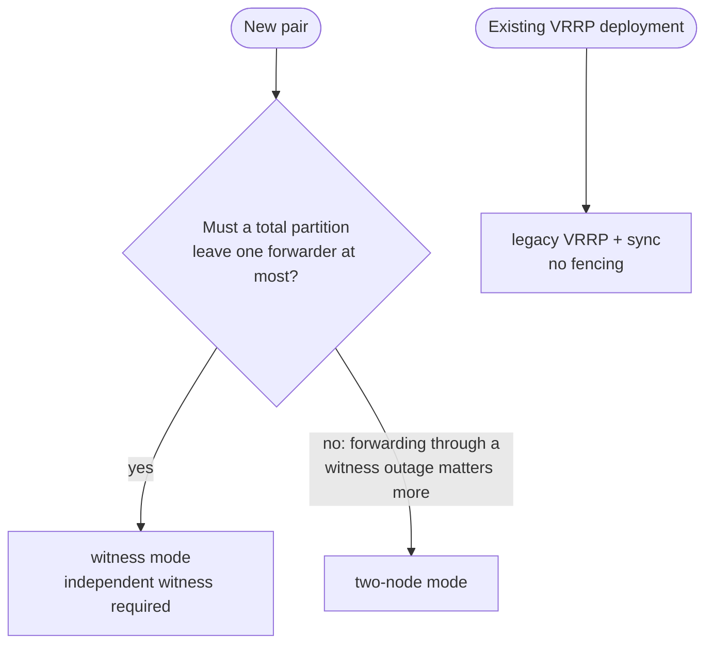
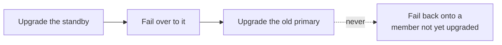
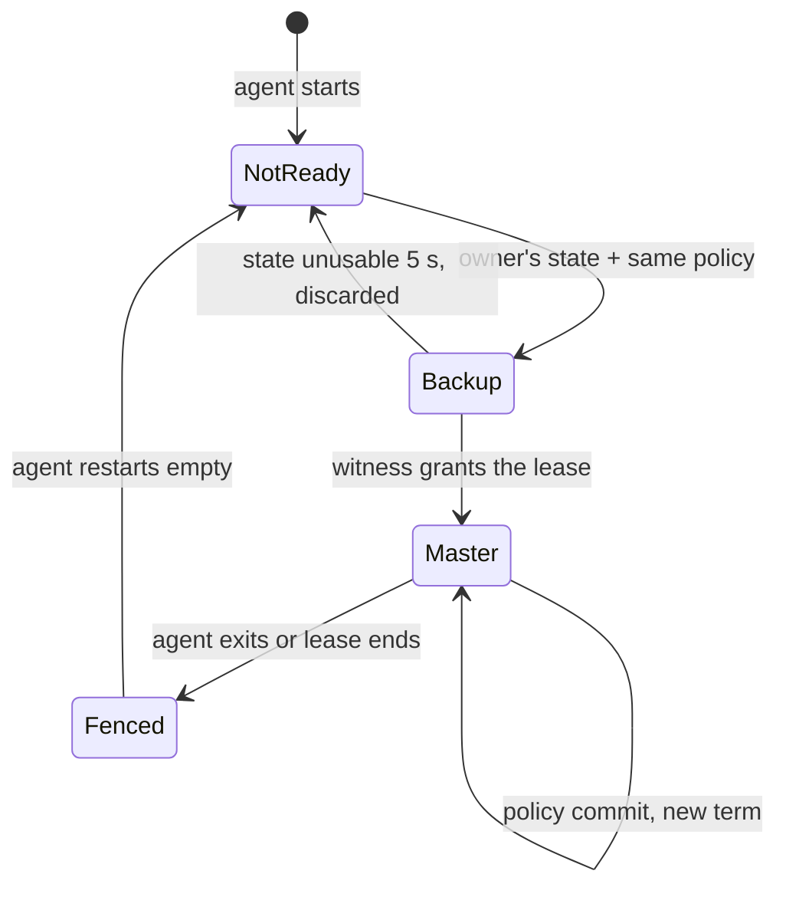
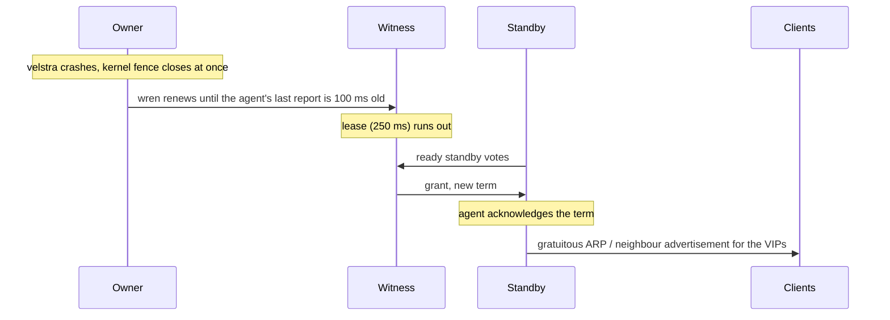

# High availability and config sync

> **Warning:** HA is **experimental.** Use a dedicated lab with console access
> to both members. The existing pairing, state-sync and flow-failover tests are
> not complete HA qualification or a rolling-upgrade guarantee.

```sh
# on the primary, once both members are prepared (below)
sentinel ha pair 10.3.0.2:8080 --witness 10.3.0.3:5440
sentinel show ha
```

## Choose the failure model



| Mode | Authority | Important limitation |
| --- | --- | --- |
| `witness` | An independent witness grants short forwarding leases to one member. | The witness is a single point of failure for forwarding: losing it stops forwarding on both members within one lease, even when both appliances are healthy (see [Witness loss](#witness-loss-is-a-single-point-of-failure)). |
| `two-node` | Two appliances exchange authenticated heartbeats without a witness. | A total partition can promote both members. Independent heartbeat paths reduce, but do not remove, that risk. |
| Legacy VRRP and sync | VRRP election and separately configured synchronization. | Not equivalent to fenced pairing; do not infer split-brain protection from a shared VIP. |

Do not mix these models, and do not assume two-node mode has witness-mode
fencing. No mode is production-certified while release acceptance and the open
HA failure cases remain unresolved.

## Prepare two members

```sh
sentinel ha secret generate        # 32 random bytes as 64 hex digits
```

On the secondary (`10.3.0.1` on the primary):

```text
sentinel configure
set services web listen-address 10.3.0.2
set services ntp upstream pool.ntp.org
set system config-sync secret <the generated value>
commit
save
```

1. **Same image.** Install the same reviewed image on both. Save each
   configuration and verify console recovery before changing HA.
2. **Control path.** Distinct, static control addresses, e.g. `10.3.0.1/24`
   and `10.3.0.2/24`. The route to the peer endpoint must use an explicitly
   declared control interface, not a shared/fenced data link. Match logical
   data-interface names; keep hardware bindings member-specific.
3. **Management.** A separate unzoned management NIC on an isolated network,
   with each node's own management IP and SSH bind address. Address binding
   alone is **not** cross-interface access isolation.
4. **Policy on the primary.** Configure firewall, NAT, routing and VRRP VIP
   policy there. The peer must already declare its own local addresses. A new
   static link needs explicit peer identity facts, not an address copied from
   the primary.
5. **Listener and secret.** On **each member**, bind
   `services web listen-address` to its own control address and keep TLS
   enabled. Set the secondary's `system config-sync secret` from
   `sentinel ha secret generate`. A short or patterned secret is refused at
   commit: anybody who reaches the management port can test guesses against the
   enrollment proof offline.
6. **Verify endpoints.** The secret starts the HTTPS machine API even with the
   web console disabled, but never widens its listener: an unset address stays
   `127.0.0.1`, also when web and sync are both enabled. A custom
   `services web port` must appear in the peer endpoint. Save both
   configurations and check the real endpoints before pairing. Keep the
   credential out of shell arguments, public logs and screenshots.
7. **NTP on both** (`services ntp upstream`). Certificate checks, one-time
   passwords, log timestamps and update freshness read the wall clock.

<details><summary>How NTP and takeovers keep the clock right</summary>

With HA WireGuard a member also aligns its clock with its predecessor's at a
takeover (see [VM pause and the clock](#vm-pause-and-the-clock)), but only
within bounds; NTP keeps it right. The appliance's chrony steps any offset over
one second as soon as it measures it (`makestep 1.0 -1`), so a member resumed
from a VM pause is corrected at its next poll.

Without NTP on either member, repeated pauses and takeovers can carry both
clocks ahead of real time by up to about 5 s per cycle; NTP removes that drift.
Between two NTP-synchronised members the step is capped at 60 seconds: a
standby paused longer than that while its kernel still reports synchronised is
not stepped, and its tunnels follow once NTP corrects it. That is the accepted
price of not following a faulty "synchronised" peer.

</details>

Do not activate an incomplete election by setting `system.ha.enabled = true`
by hand. Pairing validates and records the member profiles.

## Pair without a witness

```sh
sentinel ha pair 10.3.0.2:8080 --mode two-node
```

Run this on the primary and enter the secondary's credential at the hidden
prompt. For automation use `--secret-stdin` from a protected source, never
`--secret` or a token in argv. An explicit cluster identifier must agree
between the prepared members.

Pairing authenticates the peer with a fresh TLS-bound challenge, captures local
identities and applies both documents. A partial attempt leaves
`/var/lib/sentinel/ha-pair.json`; retry with the same endpoint, mode and
credential to resume. Do not delete a pending plan to bypass a reported
conflict.

Pairing refuses a default or explicit loopback listener before it writes a
local plan or enrolls a peer. An explicit wildcard is permitted, not required;
prefer the intended control address plus an explicit ingress ACL.

## Pair with a witness

```sh
sentinel ha witness-key            # same credential, hidden prompt; add --cluster <id> if set
sentinel ha pair 10.3.0.2:8080 --witness 10.3.0.3:5440
```

Put the printed `cluster` and `key` into the independent witness's
`system.ha-witness` configuration, set its listen endpoint and restrict
`member` to the two control IPs. The witness never needs the machine enrollment
token.

A reachable TCP port does not prove the witness will authorize the right
cluster/key/member pair: verify authority, standby readiness and real traffic
first. Do not upgrade the witness and the members independently unless that
exact mixed-version combination has a passing test.

## Verify policy, identity and traffic

On **each** member:

```sh
sentinel show ha
sentinel show vrrp
sentinel show interfaces
sentinel show ip route
systemctl --failed --no-pager
journalctl -u sentinel-configsync.service -u wren.service -u velstra.service
```

A healthy witness pair (values vary):

```text
HA Master
  configured mode witness
  node 1  cluster lab-a  term 7  owner 1
  lease remaining 212 ms
```

```text
HA Backup
  configured mode witness
  node 2  cluster lab-a  term 7  owner 1
  last complete state update 40 ms ago
```

Check one owner, a ready standby, the expected VIP, local addresses and SSH on
both management NICs. Hold one real TCP connection through the VIP open across
a controlled lab failover. A role label or matching saved files do not prove
forwarding or established-flow continuity.

Shared changes go through a durable sync outbox. Member identity (local
interfaces, management/control endpoints, local SSH settings) stays per member:
never replace the secondary's whole configuration with the primary's file. A
new static link can need `--peer-identity` at initial pairing. Concurrent edits
can be refused as conflicts instead of one side being overwritten: inspect
`sentinel-configsync.service` and the sync state, choose the change to keep,
and resolve the competing revision deliberately.

Timing is a safety parameter, not a latency claim. Witness defaults are a
250 ms lease and an 80 ms exchange budget; the lease must cover
`2 × io-timeout-ms + 45 ms`. Measure under load and test loss/recovery before
changing them. A longer lease also lets an old owner keep authority longer.
Never tune away a failure by making the guard less conservative.

## What a member trusts its peer with

The shared secret is the **peer credential**: not an administrator login and
not the member's machine token.

| A peer holding it can | It cannot |
| --- | --- |
| read what a read-only account reads (the stack view, enrollment) | replace a member's whole configuration through the ordinary API |
| push the shared configuration (`PUT /api/v1/config-sync`) | post `configure` lines, stage updates, or confirm or revert a commit-confirm window |
| complete a pairing (`POST /api/v1/ha/pair`) | post a different pairing to an already paired member (that needs the member's machine token, or unpairing first; repeating the applied pairing works) |

Pushes and pairings never change who manages the receiver. Its accounts (with
SSH keys, password hashes and TOTP secrets), groups, AAA servers, update
channels and keys, SSH server and serial console stay its own: configure them
on **each** member.

The peer *can* change the shared policy (firewall, NAT, routing, VPN, services)
and, through pairing, the HA identity. So whoever obtains the secret, or
controls a member, controls what both members forward.

- Keep the secret to the two members.
- Rotate it if either is suspect: set a new generated value on both; the outbox
  delivers the rotation with the old credential.
- Treat a compromised member as a compromised pair.

Enrollment hands the peer the receiver's configuration without its accounts,
AAA servers and update channels; the shared policy secrets in it (VPN keys,
PSKs) belong to the pair anyway.

Each source address may request ten enrollment proofs per ten minutes (a flood
of fresh addresses can delay pairing; retry). After thirty invalid bearers a
source's further invalid ones get `429` for five minutes. Every non-read use of
the peer credential or machine token is logged with its source address
(`journalctl -u sentinel-api`).

### Upgrading a pair with a weak secret

A member upgraded with a secret now considered weak still boots, keeps its
pairing and serves its API, but warns at every apply, hands out no enrollment
proof, and refuses every configuration change until the secret is rotated.
Descriptive strings such as `ha-test-credential-…` count as weak. Rotate with
`sentinel ha secret generate` on both members, one commit each.

The new image's first boot also replaces `/var/lib/sentinel/api-token` if an
earlier release wrote the secret (current or since removed) into it; read the
new machine token from that file. A token you placed there yourself is kept.

### Mixed versions during an upgrade



Pairing and config-sync work between an updated and a not-yet-updated member:
both understand the proof, the bearer and a push's base revisions. Until both
run the same version, do not change accounts, AAA, update, SSH, console, BGP
update-source or PPPoE local-address settings on either member. The updated
member keeps its own, the older one still sends and adopts them, their shared
revisions diverge, and the next push is held as a conflict (resolve it like any
conflict). Pushes from the updated member still replace these settings on the
older one, as before the upgrade. Finish the upgrade promptly.

Order: the standby, then fail over to it, then the old primary. **Never fail
back onto a member that is not yet upgraded.** A masqueraded connection owned
by an upgraded (1.0) member does not survive a takeover by a pre-1.0 peer: the
older allocator looks for its public port elsewhere, assigns a new one, and the
connection breaks. Between members whose readiness digests agree (from 1.0
on), the other direction works: connections the older member owns survive the
switch to the upgraded one (`checks.ha-napt-mixed-version`).

Members whose images compute the shared policy differently (the compiler
numbers zones or encodes rules differently) never agree on the readiness
digest. Across such a change the standby stays not ready, no state crosses, and
the switch-over is an outage with connection loss, not a warm failover. That is
why an upgrade from 0.4 is not hitless: 1.0's members compute a different
digest.

## SYN-proxied connections in a pair

A SYN-proxied connection lives as long as its connection state; the member that
owns that state ends its proxy record.

| Deployment | Who ends proxy records |
| --- | --- |
| With a lease (`witness` or `two-node`) | Only the lease owner. The standby keeps imported records and applies the owner's removals. |
| Without a lease (legacy VRRP with `system conntrack-sync`) | Each member ends the records it created once its own copy of their state expires; it never ends one imported from its peer. |

Without a lease the copy stops following the peer after a failover, so a
proxied connection carried across one lives at most `tcp-established` (24 h by
default) after it, even while active. Records imported from a peer that never
returns stay until the table reclaims its least recently used entries.

## Standby readiness

On the standby, `sentinel show ha` must read plain `HA Backup`. A reason in
parentheses means the witness would refuse it authority right now: a failure of
the active member would not fail over.

| Reason | Meaning |
| --- | --- |
| `policy differs from the owner's; awaiting configuration sync` | A commit has not reached this member, or the shared policy differs. |
| `fresh agent has no state snapshot yet` | The agent just started. It imports the owner's state within a second. |
| `no complete state snapshot from the owner` / `state snapshot is stale` | State sync from the owner is not arriving. |
| `stale state discarded; awaiting a state snapshot` | State stayed unusable for 5 s and was dropped, see below. |



`NotReady` is shown as `HA Backup (not ready: …)`.

The readiness digest covers the shared policy only. Per-member addresses are
deliberately left out: a rule `to firewall` is symbolic (each agent expands it
to its own addresses, DHCP leases and held VRRP addresses), and a
captive-portal gate names each member's own address. So two members with the
same shared configuration agree. A standby still showing "policy differs from
the owner's" after configuration sync has delivered really has a different
shared policy; compare both configurations. A state-sync refusal for that
reason is logged as a warning (once a minute).

A standby whose replicated state stays unusable for 5 s (stale, or imported
under a policy it no longer holds) discards it and votes as an empty member.
That breaks a deadlock: if the active agent crashed meanwhile, it restarts empty
too, and two empty members let the witness open a new epoch. Established
connections do not survive that path; new ones do.

## Failure behaviour (witness mode)

### How long a failover takes

A takeover runs from the first packet a client loses to the new owner's first
VIP announcement:

| What failed on the owner | Takeover, by design | Takeover, measured |
|---|---|---|
| `velstra` killed (agent crash, OOM) | at most 0.675 s | 0.43–0.52 s |
| `wren` killed | at most 0.32 s | 0.17–0.27 s |
| the member's VM paused | at most 0.47 s | 0.32–0.41 s |
| its data links lost | at most 0.495 s | not measured (derived) |



An agent crash takes longest: the owner is fenced at once, but its `wren`
renews the lease until the dead agent's last report is 100 ms old, and the
standby then waits for that lease (250 ms) to end. After a `wren` crash the
owner forwards until its own lease ends, so clients lose nothing before that.

An established TCP connection resumes on its next retransmission of the lost
packet, not when the takeover ends. Retransmissions come about 0.2, 0.6 and
1.4 s after the loss (0.2 s timeout, doubling). So a connection typically
resumes 0.8–1.1 s after the fault, and up to about 1.7 s when the takeover ends
just after a retransmission. Through HA WireGuard a client may also wait for
one handshake retry (about 5 s).

### What each failure does

`checks.ha-witness-failover` exercises these cases.

| Failure | What happens |
| --- | --- |
| **Data-plane agent crash on the active member** (`velstra` killed, OOM) | The kernel fence closes the old member at once; the ready standby takes over and established flows continue (table above). The crashed member restarts empty, imports the new owner's state and rejoins. |
| **Routing daemon crash** (`wren` killed) | The lease lapses and the standby takes over the same way. |
| **Data-plane agent stalled or ineligible** (`velstra` stopped or wedged, or reporting itself not ready) | `wren` renews only while the agent's report is fresh (100 ms) and eligible, so it stops. The member gives up its VIPs when that lease ends: at most 100 ms plus one lease (250 ms) after the last fresh report. |
| **VM pause, suspend or live migration** | A resumed member catches up from the current owner by itself and is eligible again; the next failure still fails over. See [VM pause and the clock](#vm-pause-and-the-clock). |
| **Agent crash while the witness is away** | Neither member can use its state; when the witness returns, the pair opens a new epoch on its own (see [Standby readiness](#standby-readiness)). Expect a short outage and new connections. |

For a stalled or ineligible agent the data plane does not wait for the lease:
an exited agent is fenced at once, an ineligible one closes its own kernel
deadline, a wedged one stops extending it. One late report does not move the
VIPs; only the lease does.

**A takeover does not pause the new owner's data plane.** Every VRRP virtual
address is a local destination (rules `to firewall`) on both members, held or
not, so taking the VIPs changes no rule: the new owner only records the address
for its own sockets and keeps its configuration gate open. (A commit still
closes that gate; while closed, every attached link drops everything, the
member's own witness exchanges included.) This holds in witness, two-node and
plain VRRP mode. Exception: a VIP whose prefix length the interface does not
already carry (a `/32` VIP, or one outside the interface's subnets) still takes
the full rewrite at a takeover, and the new owner's data plane pauses for that
rewrite.

**Failback** (`preempt = true` on the higher-priority member): a recovered
member takes ownership back only after the new owner has held it for 10 s, so
expect the VIPs back about 10 s after a failover. Failover itself does not
wait. The hold is fixed in 1.0, not a setting. The witness enforces it, so it
applies once the witness runs 1.0, even while the members run different
versions; members talking to an older witness fail back without it. Two-node
mode has its own election and no such hold.

<details><summary>Why failback waits 10 s</summary>

Without the hold, a restarted `wren` took the pair back 3 to 4 s after the
fault, as soon as its agent held the successor's state. A WireGuard takeover
still waiting for a handshake retry then lost the pair before it forwarded: one
fault, two handovers.

</details>

#### VM pause and the clock

A paused VM's clock stops with it, so for up to one lease (250 ms by default)
after resuming, its data plane can still consider its old lease valid while the
witness has already granted the peer. **Drain or demote an active member before
migrating or suspending it.**

Its wall clock also lags by the pause until NTP corrects it. Both members
answer WireGuard peers with one shared identity, and a peer accepts a handshake
from it only with a newer timestamp than the last. So a member taking over with
HA WireGuard interfaces steps its wall clock forward to its predecessor's once
it holds the VIPs, before it reconfigures WireGuard and starts handshakes. The
owner replicates its clock over the authenticated state stream to standbys that
announce they understand it. Tunnels then follow the takeover in about a second
(`checks.ha-wireguard-failover`, including preemption by a formerly paused
member).

The step is logged with old and new time and never goes backward. It is
refused when:

- the lag exceeds 10 minutes;
- both clocks claim NTP synchronisation and disagree by more than 60 seconds
  (one of them is faulty);
- this member's clock is NTP-synchronised and its predecessor's is not;
- this boot's steps would exceed 10 minutes in total.

A refused or failed step still takes over, and `sentinel show health` reports
`ha-clock-behind-peer`; tunnels may stall for up to the clock offset. The report
clears when NTP synchronises a clock that was unsynchronised at the takeover, or
when a later takeover steps or finds the clock in step on a fresh reading. A
missing or stale peer reading is logged at the takeover; it is not reported
itself and does not clear an earlier report.

<details><summary>Who steps the clock</summary>

Not Wren: a small socket-activated helper, `wren-ha-clock-step`, holding
`CAP_SYS_TIME` and nothing else, and taking no amount or time from Wren. It
reads the predecessor's clock from `/run/velstra/ha-clock`, where the agent
publishes it, and keeps its lock, step budget and decisions in
`/run/velstra-ha-clock-step`. Wren's unit cannot see either directory, so Wren
can trigger a decision on the agent's reading but can neither forge the reading
nor touch the budget. Requests are served one at a time, under a lock, on a
freshly read clock.

</details>

### Witness loss is a single point of failure

Losing the witness stops forwarding on both members within one lease. That is
the price of split-brain protection, not a defect a setting can tune away: the
active member cannot tell "the witness is down" from "I am cut off from the
witness and the peer is not". In the second case the witness grants the peer
when the lease runs out, so a member still forwarding on its own would forward
alongside its successor. When the witness returns, the previous owner is
granted again from its retained state and forwarding resumes.

Run the witness on independent power and network and monitor it. Prefer
`two-node` mode only if availability through a witness outage matters more than
exclusive ownership through a partition.

<details><summary>Why the peer cannot vote instead</summary>

Forwarding through a witness outage would be safe only with the peer as a
second vote: the active member keeps forwarding only on the peer's fresh,
authenticated promise not to seek authority itself, and a returning witness
waits out every such promise. Sentinel does not implement that protocol.

</details>

## Configuration writes on either member

Master/Backup describes forwarding ownership, not configuration permissions.
An authorized commit on either member, Backup included, can replicate to its
peer. Use one management session at a time for shared policy; the standby is
not a private sandbox. Conflicting concurrent revisions are rejected and stay
pending for operator resolution.

A CLI `commit` on a member that is not the forwarding owner (HA Backup or
Fenced) ends with a warning naming this member, the current owner and the term;
the commit still applies and replicates. If the role cannot be read first, the
warning says so. Check the role and pending sync state before changing policy.

A commit on the owner that changes the firewall policy:

| Effect | How long |
| --- | --- |
| Starts a new authority term: the witness grants the owner a new term for the new policy and the owner re-announces its VIPs (gratuitous ARP and neighbour advertisements). Expected; ownership does not move. | — |
| Closes the member's configuration gate for the data-plane transaction. Every attached link drops traffic, the HA sync link included: a few packets and about one witness renewal. The owner keeps its lease. | about 20–30 ms for up to 4,500 changed rule entries in our tests |
| Leaves the pair without failover until the standby has the new policy and the owner's state for the new term. | about 1–3 s in our tests |

## Regression entry points

```sh
nix build .#checks.x86_64-linux.ha-pair -L
nix build .#checks.x86_64-linux.ha-two-node -L
nix build .#checks.x86_64-linux.ha-two-node-flow -L
nix build .#checks.x86_64-linux.ha-witness-failover -L
nix build .#checks.x86_64-linux.ha-napt-mixed-version -L
nix build .#checks.x86_64-linux.configsync -L
```

See the [test inventory](../reference/tests.md) for scope and evidence rules.
Legacy vocabulary is under [system synchronization](system.md#ha-config-sync);
it is not the recommended way to build a new fenced pair.

## Migrate legacy state sync

```text
sentinel configure
delete system conntrack-sync
commit
save
```

Unauthenticated UDP state replication is no longer supported. An enabled
`system.conntrack-sync` block needs explicit state peers and a shared, random
32–1024-byte `system.config-sync.secret` on both members. Listen-only
replication is rejected. No credential or management listener is configured
automatically.

Before an image upgrade, save both configurations and review the intended
pairing mode. Build a new fenced pair with the authenticated pairing above; do
not silently turn a legacy VRRP deployment into a different failure model.
Provision the shared credential through a protected configuration or hidden
prompt, not command-line arguments or public logs. Configuration sync delivers
policy over HTTPS; the separate VCS2 TCP state transport authenticates flow
updates but does not encrypt them.

To retire legacy state replication, run the block above on **both** members
before upgrading. That disables state transfer; it is not an HA migration and
does not guarantee that existing connections survive failover. Re-test real
traffic and established flows on the same upgraded image. Rejection of an
unsigned legacy configuration proves only the negative safety check, not
positive HA acceptance.
