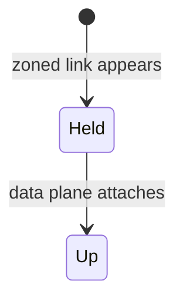

# Interfaces and addressing

<a id="interfaces"></a>

A DHCP WAN and a statically addressed LAN:

```text
set interface eth0 zone wan
set interface eth0 address dhcp
set interface eth1 zone lan
set interface eth1 address 10.0.0.1/24
set interface eth1 address6 2001:db8:0:1::1/64
```

Set addresses and zones on the discovered device names (`sentinel show interfaces`). Keep the serial console or a separately connected management port available before moving a live link into a zone.

## Bind physical identity before assigning zones

Predictable names can change after device replacement, firmware changes or VM hot-plug; a new device that inherits a name must not silently inherit a trust decision. Match the NIC's permanent MAC and cable role (`sentinel show interfaces`, `ip -details link show`), then pin each physical role:

```text
set interface wan0 hw-id 52:54:00:10:00:01
set interface wan0 zone wan
set interface wan0 address dhcp
```

`hw-id` creates a `.link` name binding when the device appears; it is **not** MAC cloning, and a commit does not guarantee an immediate rename of an already active NIC. Keep console access and verify the binding after a controlled reboot before relying on it.

> **Warning:** bind the management NIC separately on each HA member. Do not copy the primary's physical MAC bindings to the secondary.

## Common fields

Inspect the discovered NIC names before assigning zones, addresses or MTU. The example at the top of this page sets the common fields for a DHCP WAN and a static LAN.

## Zoned links stay down until the firewall has them



Sentinel holds a zoned data interface down until the data plane attaches; `sentinel show interfaces` gives the reason. Restore the data plane from the serial console or an independent management path before treating a held port as a cabling problem.

### Keep a way in that does not depend on the data plane

Keep a local or serial console, or a physically independent management interface, while changing data-plane attachment.

An unzoned management interface is outside the zoned dataplane hold, not an automatic security boundary. Bind SSH and the console to its tested address and isolate the network. A local listen address does not restrict ingress: Linux can route traffic from another interface to it. Verify explicit management ACLs from every untrusted segment, including on the standby; see [management ingress](system.md#ssh-daemon).

## VLANs (802.1Q / QinQ)

A name such as `eth1.20` infers the parent and VLAN. Set the protocol explicitly for an 802.1ad service tag.

```text
set interface eth1.20 zone iot          # infers parent eth1, vlan 20
set interface eth1.20 address 10.0.20.1/24
```

## Virtual interface types

Set the `type` and its parent or members. Build bridges, bonds, tagged interfaces and tunnels one end-to-end hop at a time.

### Bridges & bonds

A bridge joins L2 ports; a bond groups physical links into one logical interface (configure the switch to match its mode).

```text
set interface br0 type bridge
set interface br0 member eth1
set interface br0 member eth2
set interface br0 zone lan
set interface br0 address 10.0.0.1/24

set interface bond0 type bond
set interface bond0 bond-mode 802.3ad      # or active-backup, balance-rr, …
set interface bond0 member eth3
set interface bond0 member eth4
```

### Tunnels

Local and remote endpoints plus the tunnel link's address. Check underlay reachability first.

```text
set interface gre1 type gre
set interface gre1 local 203.0.113.1
set interface gre1 remote 198.51.100.1
set interface gre1 key 42                  # gre/gretap only
set interface gre1 zone tunnel
set interface gre1 address 10.255.0.1/30
```

## PPPoE (VDSL / fibre)

The session runs over a physical parent with the ISP-assigned credentials; put zone and address on the appropriate logical interface.

```text
set interface wan0 type pppoe
set interface wan0 parent eth0             # the raw NIC the session runs over
set interface wan0 zone wan
set interface wan0 pppoe username user@isp
set interface wan0 pppoe password <isp-password>
set interface wan0 mtu 1492
```

## IPv6 addressing & prefix delegation

Request a delegated prefix upstream, carve a downstream subnet, and check the advertised prefix on a LAN client.

```text
set interface wan0 address6 dhcp
set interface wan0 pd-from wan0            # request a prefix on the WAN
set interface eth1 pd-from wan0            # …carve a /64 for the LAN
set interface eth1 pd-subnet 1
```

## Serving the LAN: DHCP & Router Advertisements

DHCP pool and router advertisements on the LAN interface. Keep the appliance's own address outside the dynamic pool.

```text
set interface eth1 dhcp-server enable
set interface eth1 dhcp-server pool-offset 100
set interface eth1 dhcp-server pool-size 100
set interface eth1 dhcp-server dns 10.0.0.1
set interface eth1 dhcp-server static-mapping printer mac 52:54:00:aa:bb:cc ip 10.0.0.5

set interface eth1 router-advert enable
set interface eth1 router-advert prefix 2001:db8:0:1::/64
```

## Egress QoS (bufferbloat)

Set the shaper bandwidth from the measured uplink rate, and compare latency under background traffic before and after enabling CAKE.

```text
set interface wan0 qos discipline cake
set interface wan0 qos bandwidth 100mbit
set interface wan0 qos rtt internet
```

## MACsec

Parent, peer identity and matching keys on both ends, with unique keys from the site's credential procedure. Tab completion under `set interface <name>` lists the required MACsec fields.

## Clamping TCP MSS

An explicit MSS, or path-MTU mode, on an encapsulated path. Test large TCP transfers, not only small probes.

```text
set interface tun0 mss 1360
set interface tun0 mss pmtu
```

## Offload

Check the NIC driver's capabilities first and the active state after applying.

```text
set interface eth0 offload gro true
set interface eth0 offload rxhash true
```

## Router advertisements

Configure the advertised prefix, preference and lifetimes on the downstream link.

```text
set interface eth0 router-advert enable
set interface eth0 router-advert prefix 2001:db8:1::/64
set interface eth0 router-advert managed true
set interface eth0 router-advert dhcp6-pool start 2001:db8:1::1000
set interface eth0 router-advert dhcp6-pool end   2001:db8:1::2000
```

## DHCP reservations

A stable client MAC gets a reserved address; confirm the client renews the intended lease.

```text
set interface eth0 dhcp-server static-mapping printer mac 00:11:22:33:44:55
set interface eth0 dhcp-server static-mapping printer ip 10.0.0.9
```

## NIC hardware

Only settings the NIC and driver support; check the resulting link settings.

```text
set interface eth3 ethernet speed 1000
set interface eth3 ethernet duplex full
set interface eth3 ethernet rx-ring 4096
set interface eth3 ethernet tx-ring 4096
set interface eth3 ethernet rx-usecs 50
set interface eth3 ethernet adaptive-tx true
```

## Bridge detail

Configure the bridge and member-specific VLAN behaviour together. Confirm tagged and untagged endpoints reach the expected segment.

```text
set interface br0 bridge stp true
set interface br0 bridge priority 4096
set interface br0 bridge hello-time 2
set interface br0 bridge max-age 20
set interface br0 bridge forward-delay 15
set interface br0 bridge ageing-time 300
set interface br0 bridge igmp-snooping true
set interface br0 bridge igmp-querier true
```

### As a port of a bridge

Per-port settings go on the member; the L3 address stays on the bridge.

```text
set interface eth5 bridge-port cost 100
set interface eth5 bridge-port priority 32
set interface eth5 bridge-port learning false
```

## Bond detail

Match LACP or static bond parameters on the appliance and the switch.

```text
set interface bond0 bond hash-policy layer3+4
set interface bond0 bond lacp-rate fast
set interface bond0 bond min-links 2
set interface bond0 bond primary eth3
set interface bond0 bond mii-interval 100
set interface bond0 bond arp-interval 2000
set interface bond0 bond arp-target 10.0.0.1
```

## Cellular (`wwan`)

The carrier's APN and IP type. Test with a management path independent of the cellular link.

```text
set interface wwan0 type wwan
set interface wwan0 zone wan
set interface wwan0 address dhcp
set interface wwan0 wwan apn internet
set interface wwan0 wwan ip-type ipv4v6
```

### What is not verified here

Stubbed modem tests validate configuration rendering only. Check registration, carrier addressing and reconnection with the actual modem.

## Wireless

Radio role and local regulatory settings. Validate with the physical adapter and intended client.

```text
set interface wlan0 type wireless
set interface wlan0 zone lan
set interface wlan0 address 10.0.10.1/24
set interface wlan0 wireless mode access-point
set interface wlan0 wireless ssid velstra
set interface wlan0 wireless country DE
set interface wlan0 wireless channel 6
set interface wlan0 wireless band n
set interface wlan0 wireless wpa mode wpa2+wpa3
set interface wlan0 wireless wpa passphrase <pre-shared-key>
```

### What is not here

Radio settings depend on hardware, firmware, driver and regulatory support. A rendered configuration does not validate RF behavior.

## Route-based IPsec (`vti`)

Pair the VTI with its IPsec connection, then route the protected subnet over it ([VPN recipe](vpn.md#route-based-tunnels-vti)).

```text
set interface vti0 type vti
set interface vti0 vti-key 42
set interface vti0 zone vpn
set interface vti0 address 10.255.0.1/30
set interface vti0 mss pmtu
```

## Per-link IPv4 and IPv6 behaviour

Family-specific settings per interface. Check both addresses and the effective routes afterwards.

```text
set interface eth0 ip disable-forwarding true
set interface eth0 ip proxy-arp true
set interface eth0 ip arp-cache-timeout 30
set interface eth0 ipv6 disable-forwarding true
set interface eth0 ipv6 no-link-local true
set interface eth0 ipv6 dad-transmits 2
set interface eth0 ipv6 accept-dad 2
```

### The ARP block

Only where the link topology requires it; check neighbour resolution from both sides.

```text
set interface eth0 ip arp-filter true      # only answer for an address on this link
set interface eth0 ip arp-ignore true      # the reply half of the same rule
set interface eth0 ip arp-announce true    # source from an address on the target's subnet
set interface eth0 ip arp-accept true      # learn from gratuitous ARP (faster failover)
```

## DHCP client options

Set on the interface that requests the lease; check the values the server actually returns.

```text
set interface wan0 address dhcp
set interface wan0 dhcp client-id mac
set interface wan0 dhcp host-name fw
set interface wan0 dhcp vendor-class-id sentinel
set interface wan0 dhcp user-class residential
set interface wan0 dhcp no-default-route true
set interface wan0 dhcp default-route-distance 210
set interface wan0 dhcp reject 192.0.2.9
```

## Port mirroring

Name source and monitor ports explicitly; the monitor should receive the traffic without disturbing forwarding.

```text
set interface eth1 mirror-ingress mon0
set interface eth1 mirror-egress mon0
```

## Check the result

```sh
sentinel show interfaces
sentinel show ipv6 route
```

Match the observed names, addresses and link states to your intended topology. Verify tagging on both ends before changing a trunk.
