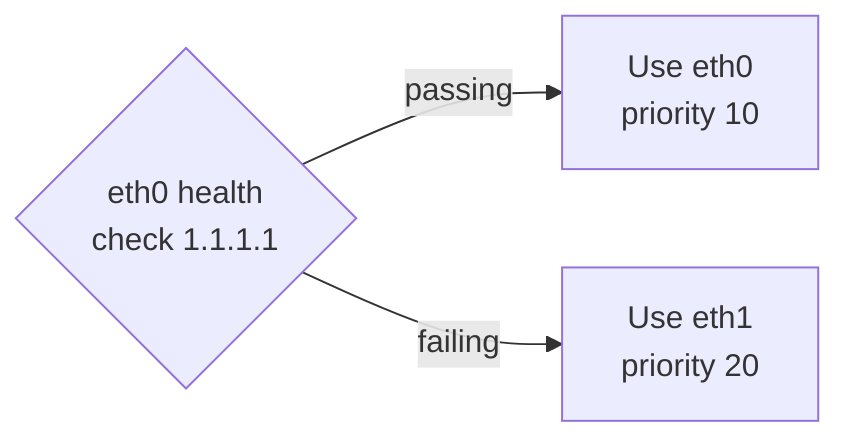

# Multi-WAN and traffic steering

<a id="multi-wan--updates"></a>

Declare each WAN interface, gateway and health target, then choose how the router selects a path. Use targets reachable independently through each uplink.

## Multi-WAN

This example gives a DHCP uplink priority over a statically addressed backup. Both interfaces must already have the intended zones and outbound NAT.

```text
set multiwan mode failover
set multiwan uplink eth0 priority 10
set multiwan uplink eth0 gateway dhcp
set multiwan uplink eth0 check target 1.1.1.1
set multiwan uplink eth1 priority 20
set multiwan uplink eth1 gateway 192.0.2.1
set multiwan uplink eth1 check target 9.9.9.9
```



## Software updates

Update channels are a separate lifecycle. See [review and stage an appliance update](../operations/update.md) to check trust, inspect a specific offer and verify the new boot slot.

## SD-WAN: steering, not just failover

A steering policy matches traffic and tries uplinks in preference order. Link-health thresholds can distinguish a reachable link from one that meets the latency and loss budget.

### Out of SLA is not the same as down

Configure latency, jitter or loss thresholds on the intended uplink. Check measured samples as well as basic reachability.

```text
set multiwan uplink eth1 check target 9.9.9.9
set multiwan uplink eth1 check latency 80
set multiwan uplink eth1 check loss 2
```

### Steering policies

Match a traffic class and specify the uplinks in the order it should try. Check the behavior of strict mode before applying.

```text
set multiwan policy voip proto udp
set multiwan policy voip destination-port 5060
set multiwan policy voip uplink eth1,eth2
set multiwan policy voip strict true
```

### Seeing it

Inspect the selected uplink and the recent health observations for each configured policy.

```text
show multiwan
```

## Check the result

```sh
sentinel show multiwan
sentinel show ip route
```

Check the preferred uplink, its recent measurements and the selected route. Test one policy in a lab before introducing an SLA threshold.
