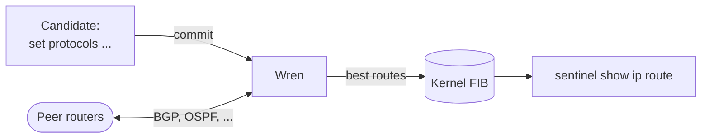
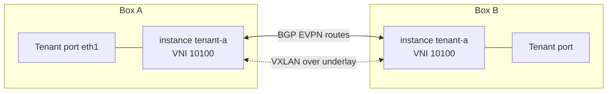

# Routing protocols

```text
set protocols static 192.168.50.0/24 via 10.0.0.254
set protocols bgp local-as 65001
set protocols bgp router-id 10.0.0.1
set protocols bgp network 10.0.0.0/24
set protocols bgp neighbor 10.0.0.2 remote-as 65002
compare
commit-confirm 2
```



Reach the directly attached peer first, then bring up the session. Review import and export policy before advertising production prefixes.

## Qualification status

Sentinel is under development, not a qualified production release.

| Scope | Protocols |
|---|---|
| Core routing qualification | static routes, base BGP, OSPFv2, BFD, VRRP |
| **Experimental** | OSPFv3, RIP/RIPng, Babel, IS-IS, multicast, EVPN, extended BGP address families/features |

Core scope does not mean every option or peer combination has passed, and acceptance or a Wren-to-Wren adjacency is not third-party interoperability certification. The [test inventory](../reference/tests.md) reproduces specific checks. HA pairing is also experimental, with [failure-mode limits](ha.md); ordinary VRRP is not split-brain fencing.

> **Warning:**
>
> - The IGMP/MLD proxy signals membership, but its forwarding-cache hook is not implemented: do not rely on it to deliver multicast data between interfaces.
> - PIM `spt-threshold` is accepted but drives no runtime source-tree threshold: do not use it for traffic engineering.

## Static routes

The next hop must be reachable on the chosen link.

```text
set protocols static 192.168.50.0/24 via 10.0.0.254
set protocols static 2001:db8:50::/48 via 2001:db8:0:1::254
```

## BGP

Match AS numbers with the peer; exchange only explicitly selected prefixes and policies (example at the top).

## OSPF (v2) & OSPFv3 (IPv6)

Area, timers and network type must match on both ends.

```text
set protocols ospf interface eth1 area 0.0.0.0
set protocols ospf network-type point-to-point
set protocols ospf redistribute static

set protocols ospf3 interface eth1 area 0.0.0.0     # IPv6
```

## RIP / RIPng / Babel / IS-IS

Limit it to the intended interfaces. Babel on a transit link:

```text
set protocols babel interface eth1
set protocols babel network 10.0.0.0/24
```

## VRRP (first-hop redundancy) {#vrrp}

Same VRID and virtual address on both members, distinct priorities. Witness-backed HA has additional authority requirements.

```text
set protocols vrrp lan-vip interface eth1
set protocols vrrp lan-vip vrid 20
set protocols vrrp lan-vip priority 200         # 100 on the backup
set protocols vrrp lan-vip virtual-address 10.0.0.1
set protocols vrrp lan-vip prefix-length 24
```

## BFD

Match the session on both ends; confirm its state before coupling it to route withdrawal.

## VRFs, multicast & policy

Use a VRF when address space overlaps; prefix lists and route maps control redistribution and advertisements.

## Routes that go nowhere

```text
set protocols static 203.0.113.0/24 blackhole true
set protocols static 203.0.113.0/24 distance 254
```

## Policy routing

```text
set policy route guests-out source 10.9.0.0/24
set policy route guests-out table 100
```

## Sending a route somewhere else

```text
set policy route-map to-transit rule 10 set next-hop 2001:db8::1
```

## What may be redistributed

Limit redistribution to the configured source protocols and filters.

## Multicast and VRFs

```text
set protocols multicast enabled true
set protocols multicast igmp true
set protocols multicast interface eth0 role downstream

set protocols vrf tenant-a table 100
set protocols vrf tenant-a interface eth1

show multicast          # the kernel's forwarding cache
show vrf                # the instances that are running
```

### Between segments: PIM-SM

Experimental, on a separate kernel multicast-routing path; it does not complete the proxy's data forwarding. Test real sender-to-receiver delivery, not only a commit or `show multicast`.

```text
set protocols multicast interface eth0 role querier
set protocols multicast interface eth1 role upstream
set protocols multicast pim enabled true
set protocols multicast pim rp-address 10.0.0.9
set protocols multicast pim interface eth0
set protocols multicast pim interface eth1
```

## BGP: aggregates, authorisations, confederation, RPKI

```text
set protocols bgp aggregate 10.0.0.0/8 summary-only true
set protocols bgp roa 192.0.2.0/24 origin-as 64500
set protocols bgp confederation id 65000
set protocols bgp rpki rtr 192.0.2.1:3323
```

## EVPN: one tenant network across several boxes

```text
set protocols bgp local-as 65001
set protocols bgp neighbor 10.0.0.2 remote-as 65001
set protocols bgp neighbor 10.0.0.2 evpn true

set evpn vtep-ip 10.0.0.1
set evpn underlay-interface eth0
set evpn encapsulation vxlan

set evpn instance tenant-a evi 100
set evpn instance tenant-a vni 10100
set evpn instance tenant-a rt-import rt:65001:100
set evpn instance tenant-a rt-export rt:65001:100
set evpn instance tenant-a interface eth1
```



### Segments and tenants

An `instance` is a layer-2 segment: a VNI, its route targets and its local ports. An `ip-vrf` adds routed (type-5) tenant prefixes:

```text
set protocols vrf blue table 100
set evpn ip-vrf blue l3-vni 10999
set evpn ip-vrf blue advertise-prefix 10.20.0.0/24
set evpn ip-vrf blue router-mac 02:00:00:00:00:01
```

### What is refused, and why

- no BGP router;
- a route target that is not `rt:asn:value` (such as the bare `65001:100`);
- a tenant port that is also the underlay;
- two segments sharing a VNI, or an `ip-vrf` whose `l3-vni` collides with one;
- an `ip-vrf` naming a VRF that does not exist.

<details><summary>Why each is refused</summary>

| Refused | Why |
|---|---|
| No BGP router | EVPN's control plane *is* BGP; without one the overlay would carry frames toward peers nobody ever announced. |
| A route target that is not `rt:asn:value` | The routing daemon refuses it; accepting it would commit a configuration that does not start. |
| A tenant port that is also the underlay | An interface cannot be both inside and outside the tunnel. |
| A shared VNI | The VNI is the data plane's segment id; sharing it puts two tenants on one wire. |
| A missing VRF | A type-5 route is imported into a routing table, which has to exist for the routes to land. |

</details>

## Check the result

```sh
sentinel show ip bgp summary
sentinel show ip route
sentinel show ipv6 route
```

A healthy session does not mean the import policy accepted the route: check the learned prefix and next hop too.
