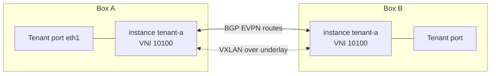

# Routing protocols

```text
set protocols static 192.168.50.0/24 via 10.0.0.254
set protocols bgp local-as 65001
set protocols bgp router-id 10.0.0.1
set protocols bgp network 10.0.0.0/24
set protocols bgp neighbor 10.0.0.2 remote-as 65002
compare
commit-confirm 2
```

Routing runs in Wren, configured through Sentinel's candidate session. Get reachability between directly attached peer addresses first, then bring up the session. Review import and export policy before advertising production prefixes.


## Qualification status

Sentinel is under development, not a qualified production release.

| Scope | Protocols |
|---|---|
| Core routing qualification | static routes, base BGP, OSPFv2, BFD, VRRP |
| **Experimental** | OSPFv3, RIP/RIPng, Babel, IS-IS, multicast, EVPN, extended BGP address families/features |

Core scope is not a guarantee that every advertised option or peer combination has passed. Configuration acceptance or an adjacency between two Wren instances is not third-party interoperability certification. Use [the test inventory](../reference/tests.md) to reproduce specific checks and verify learned routes in the kernel with `sentinel show ip route`. HA pairing is also experimental and has additional [failure-mode limits](ha.md); ordinary VRRP is not split-brain fencing.

> **Warning:** two multicast options need particular care.
>
> - IGMP/MLD proxy membership signaling exists, but its proxy forwarding-cache hook is not implemented. Do not rely on it to deliver multicast data between interfaces.
> - PIM `spt-threshold` is accepted as configuration but does not drive a runtime source-tree threshold. It must not be used as a traffic-engineering control.

## Static routes

Give a next hop or outgoing device; the next hop must be reachable on the chosen link.

```text
set protocols static 192.168.50.0/24 via 10.0.0.254
set protocols static 2001:db8:50::/48 via 2001:db8:0:1::254
```

## BGP

Match local and remote AS numbers with the peer, then explicitly select the prefixes and policies to exchange.

```text
set protocols bgp local-as 65001
set protocols bgp router-id 10.0.0.1
set protocols bgp network 10.0.0.0/24
set protocols bgp neighbor 10.0.0.2 remote-as 65002
```

## OSPF (v2) & OSPFv3 (IPv6)

Both ends of the transit link need the same area and compatible timers and network type.

```text
set protocols ospf interface eth1 area 0.0.0.0
set protocols ospf network-type point-to-point
set protocols ospf redistribute static

set protocols ospf3 interface eth1 area 0.0.0.0     # IPv6
```

## RIP / RIPng / Babel / IS-IS

Use the neighbour's protocol and limit it to the intended interfaces. Babel on a transit link:

```text
set protocols babel interface eth1
set protocols babel network 10.0.0.0/24
```

## VRRP (first-hop redundancy) {#vrrp}

A common virtual router ID and virtual address, distinct priorities and real member addresses. Witness-backed HA has additional authority requirements.

```text
set protocols vrrp lan-vip interface eth1
set protocols vrrp lan-vip vrid 20
set protocols vrrp lan-vip priority 200         # 100 on the backup
set protocols vrrp lan-vip virtual-address 10.0.0.1
set protocols vrrp lan-vip prefix-length 24
```

## BFD

Enable a matched BFD session on both ends and confirm its state before coupling it to route withdrawal.

## VRFs, multicast & policy

Use a routing instance (VRF) when address space overlaps, and prefix lists and route maps to control redistribution and advertisements. Check the route in the correct VRF.

## Routes that go nowhere

A discard route holds an aggregate or terminates a prefix on purpose. Check its administrative distance and scope.

```text
set protocols static 203.0.113.0/24 blackhole true
set protocols static 203.0.113.0/24 distance 254
```

## Policy routing

Send a traffic class to its own routing table, then test the egress with traffic from that class.

```text
set policy route guests-out source 10.9.0.0/24
set policy route guests-out table 100
```

## Sending a route somewhere else

Constrain export and redistribution, and check the announcement on the receiving peer.

```text
set policy route-map to-transit rule 10 set next-hop 2001:db8::1
```

## What may be redistributed

Limit redistribution to the configured source protocols and filters.

## Multicast and VRFs

Check state in the right VRF and multicast interface set for an isolated routing domain.

```text
set protocols multicast enabled true
set protocols multicast igmp true
set protocols multicast interface eth0 role downstream

set protocols vrf tenant-a table 100
set protocols vrf tenant-a interface eth1

show multicast          # the kernel's forwarding cache
show vrf                # the instances that are running
```

### Between segments: PIM-SM

Experimental PIM-SM uses a separate kernel multicast-routing path; it does not complete the IGMP/MLD proxy's data forwarding (whose forwarding-cache hook is not implemented). Verify actual sender-to-receiver delivery, not only a successful commit or `show multicast`. PIM `spt-threshold` is accepted but has no runtime threshold behavior.

```text
set protocols multicast interface eth0 role querier
set protocols multicast interface eth1 role upstream
set protocols multicast pim enabled true
set protocols multicast pim rp-address 10.0.0.9
set protocols multicast pim interface eth0
set protocols multicast pim interface eth1
```

## BGP: aggregates, authorisations, confederation, RPKI

Only when they match the routing design:

```text
set protocols bgp aggregate 10.0.0.0/8 summary-only true
set protocols bgp roa 192.0.2.0/24 origin-as 64500
set protocols bgp confederation id 65000
set protocols bgp rpki rtr 192.0.2.1:3323
```

## EVPN: one tenant network across several boxes

```text
set protocols bgp local-as 65001
set protocols bgp neighbor 10.0.0.2 remote-as 65001
set protocols bgp neighbor 10.0.0.2 evpn true

set evpn vtep-ip 10.0.0.1
set evpn underlay-interface eth0
set evpn encapsulation vxlan

set evpn instance tenant-a evi 100
set evpn instance tenant-a vni 10100
set evpn instance tenant-a rt-import rt:65001:100
set evpn instance tenant-a rt-export rt:65001:100
set evpn instance tenant-a interface eth1
```

Check that the tenant routes reach the EVPN peers and attach to the correct tenant network.



### Segments and tenants

An `instance` is a layer-2 segment: a VNI, the route targets that decide what it exchanges, and the local ports on it. An `ip-vrf` adds routed (type-5) tenant prefixes:

```text
set protocols vrf blue table 100
set evpn ip-vrf blue l3-vni 10999
set evpn ip-vrf blue advertise-prefix 10.20.0.0/24
set evpn ip-vrf blue router-mac 02:00:00:00:00:01
```

### What is refused, and why

| Refused | Why |
|---|---|
| **No BGP router** | EVPN's control plane *is* BGP; without one the overlay would carry frames toward peers nobody ever announced. |
| **A route target that is not `rt:asn:value`** | The bare `65001:100` other vendors accept is refused because the routing daemon refuses it; accepting it here would give a configuration that commits and does not start. |
| **A tenant port that is also the underlay** | The same interface cannot be both inside and outside the tunnel. |
| **Two segments sharing a VNI**, or an `ip-vrf` whose `l3-vni` collides with one | The VNI is the data plane's segment id; sharing it puts two tenants on one wire. |
| **An `ip-vrf` naming a VRF that does not exist** | A type-5 route is imported into a routing table, and the table has to be there for the routes to land. |

## Check the result

```sh
sentinel show ip bgp summary
sentinel show ip route
sentinel show ipv6 route
```

Check the session state first, then the learned prefix and next hop. A healthy session alone does not establish that an import policy accepted the route.
