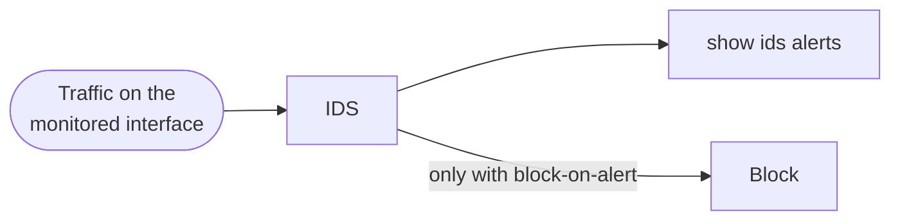

# Network services

<a id="services"></a>

A LAN resolver and time server on `eth1`:

```text
set services dns upstream 9.9.9.9,1.1.1.1
set services dns serve-on eth1
set services ntp upstream pool.ntp.org
set services ntp serve-on eth1
compare
commit-confirm 2
```

Bind every service to the intended interfaces and addresses. The examples use lab endpoints: substitute your actual resolver, management networks and credentials.

| Service | Section |
|---|---|
| DNS resolver, encrypted upstreams, client limits | [DNS](#dns-lan-resolver) |
| NTP, LLDP, SNMP, mDNS | [NTP](#ntp-server), [discovery](#lldp-snmp-mdns) |
| Web console and API TLS | [Web console](#web-console) |
| DHCP relay, UDP broadcast relay | [DHCP relay](#dhcp-relay), [broadcast relay](#udp-broadcast-relay) |
| Reverse proxy, dynamic DNS | [Reverse proxy](#reverse-proxy--l7-load-balancer), [dynamic DNS](#dynamic-dns) |
| Syslog, alerts, IPFIX | [Syslog](#remote-syslog), [alerts](#alert-notifications), [IPFIX](#flow-export-ipfix) |
| IDS, SNI refusal | [Intrusion detection](#intrusion-detection) |
| Captive portal, NAT-PMP | [Captive portal](#captive-portal), [NAT-PMP](#port-mapping-nat-pmp) |

## DNS (LAN resolver)

Serve the trusted LAN only, with explicit upstream servers. Check the result from a client on that interface.

```text
set services dns upstream 9.9.9.9,1.1.1.1
set services dns serve-on eth1
set services dns host-override nas.home 10.0.0.5
set services dns blocklist ads.example.com
```

## Encrypted DNS upstreams

Choose TLS or HTTPS upstreams the resolver trusts and can reach.

```text
set services dns upstream 9.9.9.9
set services dns secure-upstream tls://dns.quad9.net
set services dns secure-upstream https://dns.quad9.net/dns-query
```

## Who may ask, and what is never asked

Constrain the allowed client networks, and name zones never forwarded upstream.

```text
set services dns allow-from 10.0.0.0/8,fd00::/8
set services dns dont-query 168.192.in-addr.arpa
```

## NTP server

Select upstream clocks and serve only the intended links. Confirm the appliance clock is synchronized.

```text
set services ntp upstream pool.ntp.org
set services ntp serve-on eth1
```

## LLDP, SNMP, mDNS

Limit discovery and monitoring to trusted interfaces; a collector should reach only the services it needs.

```text
set services lldp enable true
set services snmp community <read-only-community>
set services snmp allow 10.0.0.0/24
set services mdns interface eth1,eth2
```

## Web console

Bind the management listener to the intended address and port. Keep working local access while changing HTTPS settings.

```text
set services web enable true
set services web port 8443
set services web listen-address 10.0.0.1
```

### TLS

The console and API share the management certificate. Validate its identity from a trusted path before sending credentials.

```text
set services web tls-cert /var/lib/sentinel/pki/web/fullchain.pem
set services web tls-key  /var/lib/sentinel/pki/web/key.pem
```

## SSH log level

Pick an OpenSSH log level and check that a test connection appears in the authentication log.

```text
set services ssh loglevel VERBOSE
```

## Dynamic DNS

Set the provider, hostname and provider-specific credential under `services dyndns`. Use a scoped provider credential and check the DNS answer after the uplink address changes.

## DHCP relay

The client-facing and upstream interfaces, and the authoritative DHCP server:

```text
set services dhcp-relay interface eth1,eth0     # client + upstream links
set services dhcp-relay server  10.0.100.10     # IPv4 upstream (uses the link's giaddr)
set services dhcp-relay server6 2001:db8:100::10 # IPv6 upstream (or ff05::1:3, the relay multicast)
```

## UDP broadcast relay

Relay only the required UDP port between the selected segments; unrelated broadcasts should stay local.

```text
set services broadcast-relay wol port 9
set services broadcast-relay wol interface lan
set services broadcast-relay wol interface guest
```

## Reverse proxy / L7 load balancer

The listening port, certificate and backend endpoints. Test the certificate and each backend's response.

```text
set services reverse-proxy web port 443
set services reverse-proxy web certificate site-cert
set services reverse-proxy web backends 10.0.0.10:8080,10.0.0.11:8080
```

## Remote syslog

Choose the collector's transport, port and level, and check receipt on the collector.

```text
set services syslog target 10.0.0.9
set services syslog target logs.example.com port 6514
set services syslog target logs.example.com proto tcp
set services syslog target logs.example.com level warning
```

## Syslog facilities

Send only selected facilities to a restricted collector, or keep the full stream on your primary log service.

```text
set services syslog target 10.0.0.9 facility auth,local7
```

## Alert notifications

Pick the event destination and send a test notification over your organization's approved channel.

```text
set services alerts webhook https://hooks.example.com/sentinel
set services alerts mail to noc@example.com
set services alerts mail relay smtp.example.com
set services alerts mail user fw@example.com
set services alerts mail password <secret>
```

## Flow export (IPFIX)

Send IPFIX accounting records to a collector, and check it sees the expected interfaces and flows.

```text
set services flow-export collector 10.0.0.50:4739
set services flow-export interval 30
set services flow-export domain 7
```

## Intrusion detection



Select the monitored interface and read IDS events before enabling any automatic blocking. Keep a site-specific exception list for management systems.

### It detects, it does not block

By default IDS alerts are for monitoring; blocking is opt-in. Observe the expected workload first.

### Reading alerts

Check recent events and their timestamps; forward relevant ones to your log collector.

```text
show ids                  # what is watched, and whether the detector runs
show ids alerts           # the 20 most recent
show ids alerts 100
```

### Acting on an alert

Review normal traffic and alert quality before enabling `block-on-alert`. Keep critical management addresses in the configured exclusion list.

### Refusing a server by name (SNI)

An SNI match needs a visible server name in the handshake. Account for encrypted or absent names when assessing coverage.

```text
set services ids interface eth0
set services ids block-on-alert true
set services ids sni-block example.com
```

## Captive portal

Bind the portal to a guest zone and provision a unique local passphrase through your credential process. The operator console shows the portal and its authenticated sessions.

### What holds the zone

The portal applies to the designated guest zone. Check that address assignment, DNS and the portal itself work before admission.

### How a device finds the page

DHCP can advertise the captive-portal URI with option 114. Test with a client that implements captive-portal discovery.

### Seeing it

Compare the current sessions with a freshly admitted test client.

```text
show portal
show portal sessions
```

### What a portal is not

Portal admission is not device authentication. Treat a MAC address as a local identifier.

## Port mapping (NAT-PMP)

Enable NAT-PMP only on a trusted client zone, and constrain the mapping lifetime and the external zone.

```text
set services port-mapping zone lan
set services port-mapping wan-zone wan
set services port-mapping max-lifetime 7200
```

### What a mapping is

Check a live mapping's owner and expiration on the appliance.

### What is refused

Read the current mappings before clearing one, and clear only the intended mapping.

```text
show port-mapping
clear port-mapping            # close every mapping hosts opened
clear port-mapping tcp 51820  # or just one
```

### NAT-PMP, not UPnP

This service speaks NAT-PMP. Clients that need UPnP IGD need another integration.

## Check the result

```sh
sentinel show interfaces
sentinel show version
```

From an authorized LAN client, query the resolver and open the configured HTTPS address. Check the appliance clock before relying on TLS expiry or log timestamps.
