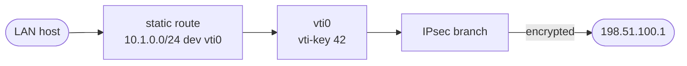

# VPN and certificates

<a id="vpn--pki"></a>

A site-to-site IKEv2 tunnel between `10.0.0.0/24` and `10.1.0.0/24`:

```text
set vpn ipsec branch local 203.0.113.1
set vpn ipsec branch remote 198.51.100.1
set vpn ipsec branch local-subnet 10.0.0.0/24
set vpn ipsec branch remote-subnet 10.1.0.0/24
set vpn ipsec branch psk <pre-shared-key>
compare
commit-confirm 2
```

Assign addresses, routing policy and firewall zones explicitly: a successful handshake alone does not establish forwarding to a protected subnet.

## Which VPNs this appliance carries, and which it will not

| Use case | Choose |
|---|---|
| a key-based peer | [WireGuard](#wireguard) |
| IPsec interoperability | [IKEv2](#ipsec-site-to-site-ikev2), policy- or [route-based](#route-based-tunnels-vti) |
| a compatible TLS remote-access client | [OpenConnect](#openconnect-road-warrior) |

## IPsec (site-to-site, IKEv2)

Match the two IKEv2 endpoints and the protected subnets at both ends (the example above). Provision independent site credentials through an approved local process.

### Route-based tunnels (VTI)



Bind a VTI to its IPsec tunnel, then route the remote networks over the VTI.

```text
set interface vti0 type vti
set interface vti0 vti-key 42
set interface vti0 zone vpn
set interface vti0 address 10.255.0.1/30
set interface vti0 mss pmtu

set vpn ipsec branch local 203.0.113.1
set vpn ipsec branch remote 198.51.100.1
set vpn ipsec branch psk <pre-shared-key>
set vpn ipsec branch vti vti0

set protocols static 10.1.0.0/24 dev vti0
```

## WireGuard

The interface, its tunnel address, and each peer's public key and allowed prefixes. The peer endpoint must be reachable through the underlay.

```text
set interface wg0 type wireguard
set interface wg0 zone vpn
set interface wg0 address 10.9.0.1/24
set vpn wireguard wg0 private-key generate
set vpn wireguard wg0 listen-port 51820
set vpn wireguard wg0 peer <peer-pubkey> allowed-ips 10.9.0.2/32
set vpn wireguard wg0 peer <peer-pubkey> endpoint peer.example.com:51820
set vpn wireguard wg0 peer <peer-pubkey> keepalive 25
```

## OpenConnect (road-warrior)

The server certificate, client address pool, DNS and permitted routes. Give each user a separate credential.

```text
set vpn openconnect certificate vpn-cert
set vpn openconnect pool 10.99.0.0/24
set vpn openconnect zone vpn
set vpn openconnect dns 10.0.0.1
set vpn openconnect routes 10.0.0.0/24
set vpn openconnect user alice password <secret>
```

## PKI

A local CA and a certificate with the intended subject, alternate names and usage. Review issuance and expiry with `sentinel show pki`. For a public ACME service, use the separately documented ACME path.

```text
set pki ca lab-ca common-name "Lab CA"
set pki certificate vpn-cert ca lab-ca
set pki certificate vpn-cert common-name vpn.example.com
set pki certificate vpn-cert subject-alt-name DNS:vpn.example.com
set pki certificate vpn-cert usage server
```

### ACME issuance

The challenge host must be reachable; check the certificate's names and expiry after issuance. For an internal CA, distribute the issuing CA through your own trust policy.

```text
set firewall rule acme-challenge from wan
set firewall rule acme-challenge action accept
set firewall rule acme-challenge proto tcp
set firewall rule acme-challenge port 80
```

## Check the result

```sh
sentinel show vpn ipsec sas
sentinel show pki
sentinel show ip route
```

For IPsec, check the active security associations and reach the remote subnet from an authorized client. Check certificate expiry for TLS-based services.
