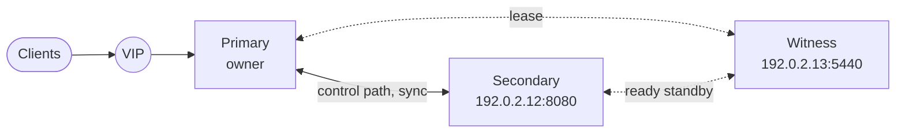

# Choose an HA election mode

HA is experimental. Read the [safety and migration guide](../handbook/ha.md) and qualify failover on the exact image before relying on the pair.

Two Sentinel appliances can form an active/standby pair on their own. Add an independent witness when a complete break between the peers must still leave at most one member authorized to forward.

| Mode | Who grants forwarding authority? | If the two members lose every path to each other |
|---|---|---|
| Two-node | The peers elect the active member using authenticated heartbeats. | Each can conclude that the other is down. Both can become active. Independent heartbeat paths reduce this risk. |
| Witness | A third system grants a time-limited lease to one member. | A member needs a valid lease to keep forwarding. The kernel blocks its guarded data interfaces after expiry. If neither member can reach the witness, both can end up fenced. |



Two-node mode is the same picture without the witness.

## Prepare the control path

Use two matching appliances with distinct control addresses, matching logical data-interface names, and working console access. Keep the control path out of the fenced data interfaces and their underlying links. Configure the secondary’s HTTPS management endpoint and enrollment credential.

The examples use secondary `192.0.2.12:8080` and witness `192.0.2.13:5440`. Replace them with your own endpoints. Run **one** pairing command on the primary. It prompts for the secondary’s credential.

## Pair two nodes without a witness

Leave the witness address unset on the prepared primary. Select two-node mode explicitly:

```sh
sentinel ha pair 192.0.2.12:8080 --mode two-node
sentinel show ha
```

Check the mode and role on **both** members, and make sure the backup is ready. Under normal connectivity, expect one master and one backup. If every heartbeat path fails, neither peer can distinguish a failed partner from a network partition.

<a id="verify-witness-backed-ha"></a>

## Enroll the witness and pair the members

Witness is the default mode for a newly configured pair. For this mode, first run `sentinel ha witness-key` on a member and enter the enrollment credential. Configure the independent witness with the derived cluster ID and key, allow both members’ control addresses, and start the witness. [Witness configuration and timing](ha-reference.md).

```sh
sentinel ha pair 192.0.2.12:8080 --mode witness --witness 192.0.2.13:5440
sentinel show ha
```

Check the owner and remaining lease on the master and readiness on the backup. The witness grants authority. The member’s kernel enforces the deadline even if its control process is paused.

## Observe the owner, then verify a failover

On both members, run `sentinel show ha` for authority and readiness and `sentinel show vrrp` for virtual-address state. In an isolated evaluation network, follow a continuous test flow across failover. Session continuity depends on the workload and replica state.

## Run the multi-VM acceptance test

On a KVM-enabled x86-64 build host, choose the fixture for your deployment:

```sh
nix build .#checks.x86_64-linux.ha-two-node -L
nix build .#checks.x86_64-linux.ha-witness-failover -L
```

The first fixture runs a pair without a witness. The second pauses the former active process while its kernel remains alive and checks that the old path stops forwarding after its authority expires.
