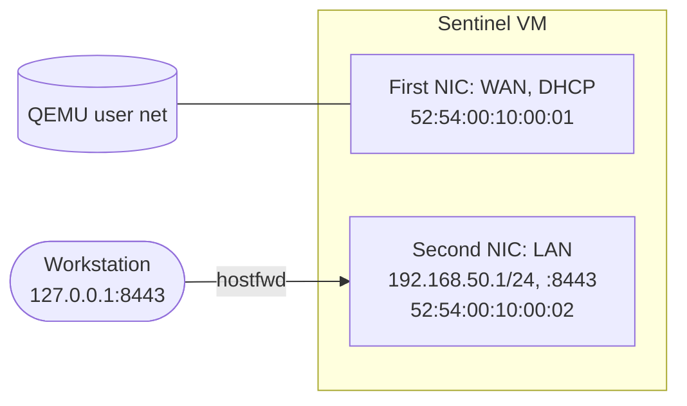

# Start a Sentinel VM

<a id="vm-quickstart"></a>

Choose a development VM for the CLI, or an installed appliance for the real UEFI boot, persistence and A/B update path. Run the build steps on an x86-64 Linux workstation with Nix flakes and writable /dev/kvm.

## Try the CLI in a development VM

```sh
git clone https://github.com/Velstra/sentinel.git
cd sentinel
nix run .#vm
```

At the appliance console, run `sentinel show version` and `sentinel show interfaces`. Use the next procedure when evaluating boot, disk installation, or A/B updates.

## Build and boot

Run these commands at the root of a fresh checkout with QEMU installed. Check that neither the VM disk nor the firmware variables file already exists.

```sh
nix build .#sentinel-iso --out-link result-iso
firmware=$(nix build .#qemu-firmware --no-link --print-out-paths)
qemu-img create -f qcow2 sentinel.qcow2 32G
cp "$firmware/FV/OVMF_VARS.fd" sentinel-vars.fd
chmod u+w sentinel-vars.fd
qemu-system-x86_64 -enable-kvm -machine q35 -cpu host -smp 2 -m 4096 \
  -drive if=pflash,format=raw,readonly=on,file="$firmware/FV/OVMF_CODE.fd" \
  -drive if=pflash,format=raw,file=sentinel-vars.fd \
  -drive file=sentinel.qcow2,if=virtio,format=qcow2 \
  -cdrom result-iso/iso/velstra-sentinel-installer.iso -boot order=d \
  -netdev user,id=wan -device virtio-net-pci,netdev=wan,mac=52:54:00:10:00:01 \
  -netdev user,id=lan,net=192.168.50.0/24,host=192.168.50.2,hostfwd=tcp:127.0.0.1:8443-192.168.50.1:8443 \
  -device virtio-net-pci,netdev=lan,mac=52:54:00:10:00:02
```

In the installer, choose the new empty virtual disk, create an administrator, set the first NIC to DHCP and the second to `192.168.50.1/24`. Check the device before confirming erasure. Eject the ISO, remove the `-cdrom` option and boot the same VM with `-boot order=c`. For Proxmox, use q35/OVMF, two VirtIO NICs, a 32 GiB disk and 4 GiB RAM.



## Configure WAN, LAN and management

On the appliance, compare the NIC addresses with the MACs in the QEMU command. Transfer the [quickstart command file](https://github.com/Velstra/sentinel/blob/main/examples/quickstart.cli) to the appliance; adapt `eth0` and `eth1` to the names you observed. Apply it from the local console to preserve the installer-created accounts.

```sh
sentinel configure < quickstart.cli
sentinel config check /var/lib/sentinel/appliance.toml
sentinel show interfaces
sentinel show nat
```

Open `https://localhost:8443/` through QEMU forwarding or `https://192.168.50.1:8443/` on a directly attached LAN. Verify the certificate identity against `journalctl -u sentinel-api.service` and use the administrator you created. Record a working baseline before trying a [remote configuration change](configure.md).

Binding the console to the LAN address selects its destination IP, not allowed ingress interfaces. Verify management isolation from every other segment. HA is experimental; follow the [HA safety guide](../handbook/ha.md) with independent recovery access before forming a pair.
