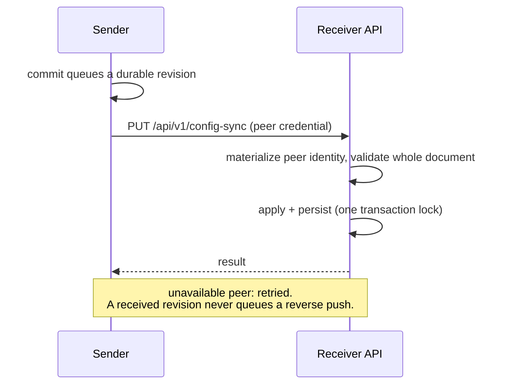
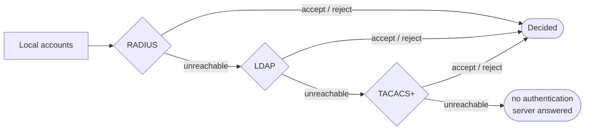

# Authentication and synchronization safety

Source-level security contracts, not final-image release acceptance. Start with the [system tasks](../handbook/system.md); test a separate administrator session and retain console recovery.

```text
set system login alice ssh-key ssh-ed25519 AAAAC3Nz…I alice@laptop
set system login alice hashed-password $y$j9T$<salt>$<digest>
set system login alice totp generate
set system aaa radius 10.0.0.50 secret a-shared-secret
set system aaa default-group operators
commit-confirm 2
```

A local account (SSH key, imported password hash, TOTP second factor) plus a RADIUS server whose users land in `operators`. The sections below give each piece's limits.

## Persistent logs

Installed images retain `/var/log` on the data partition. The journal is bounded to 128 MiB, keeps 256 MiB free and expires entries after 14 days. Before an update or when diagnosing an earlier boot:

```sh
journalctl --list-boots --merge
journalctl --merge -u velstra.service -u wren.service
```

`--merge` includes retained logs from earlier machine IDs on an unprovisioned, stateless test VM. It does not retrieve logs from remote cluster members.

## Hostname

```text
set system hostname fw-a
```

Applied live on commit and shown in the prompt.

## Login accounts

`system login <user>` defines a local account, created on commit, with SSH public keys and an optional login password.

| Command | Meaning |
|---|---|
| `set system login <user> ssh-key <openssh-key>` | An OpenSSH public key allowed to log in as this user (repeatable). |
| `set system login <user> password <password>` | Hash a new local password with yescrypt; do not put plaintext commands in shell history or scripts. |
| `set system login <user> hashed-password <hash>` | Import a supported crypt(3) hash, never a plaintext password. |
| `set system login <user> totp <base32-secret>` | A one-time-code secret. The account then needs a code as well as a password. |

To import a hash generated off-box, use an interactive password prompt:

```text
$ mkpasswd --method=yescrypt --rounds=5

admin@fw-a# set system login alice ssh-key ssh-ed25519 AAAAC3Nz…I alice@laptop
admin@fw-a# set system login alice ssh-key ssh-ed25519 AAAAC3Nz…J alice@phone
admin@fw-a# set system login alice hashed-password $y$j9T$<salt>$<digest>
```

**SSH stays key-only** unless you also enable password auth on the daemon ([below](#ssh-daemon)).

| Account | Administrator access (incl. passwordless sudo) |
|---|---|
| in a local `read-write` group | yes |
| read-only, or an ordinary ungrouped user | no |
| the configured, ungrouped built-in `admin` | yes, as a bootstrap exception in both CLI and API; explicitly assigning it a read-only group removes the exception. Other ungrouped accounts get nothing from it. |

Removing a managed account locks it, removes its managed SSH keys and administrator group, and terminates its existing login sessions and user jobs; homes are not deleted. Demotion also expires old sessions. Use another administrator or a recovery console when removing or demoting your own account.

### Password hashes

| Topic | Rule |
|---|---|
| New local passwords | yescrypt cost 5 (16 MiB), random salt. |
| Length | 8–511 bytes, no NUL or line break (local Unix/API accounts). |
| Imported yescrypt | cost bounded, up to 32 MiB (local Unix/API accounts). |
| Existing MD5-, SHA-256-, SHA-512-crypt | still verifiable by the API; no automatic rehash. Rotate legacy local passwords to migrate them. |
| OS/PAM login | policy unchanged: imported MD5 and SHA-256 hashes do not grant password-based SSH/console access. Reset those passwords to yescrypt before relying on OS login. The API's compatibility helper does not weaken the system-wide crypt policy. |
| OpenConnect VPN credentials | rendered with cost-5 yescrypt, but keep their existing non-empty password-length compatibility. The root-private runtime credential file reuses an unchanged password's validated hash; a legacy SHA-512 hash migrates on apply. Tunnel/restart acceptance still needs the final image's VM results. |

<details><summary>Stable account IDs across boots and upgrades</summary>

The persistent, root-private `/var/lib/sentinel/login-accounts.json` registry keeps each managed local UID stable across boots and reserves retired UIDs. Retired `admin` accounts are not silently recreated with bootstrap privileges. Do not delete the registry to reset an account: corruption or UID drift fails closed.

When upgrading an appliance without this registry, only currently configured accounts are adopted: manually review Unix users removed before the upgrade. These lifecycle changes still require the final image's VM login/SSH acceptance results before release qualification.

</details>

## SSH daemon

`services ssh` tunes the OpenSSH daemon. It is on and key-only by default; the keys come from `system login`.

| Field | Meaning |
|---|---|
| `enable` | Run the SSH daemon (`true`/`false`; default `true`). |
| `port` | TCP port sshd listens on (default 22). |
| `listen-address` | Restrict sshd to one local address (default: all). |
| `password-authentication` | Allow password logins over SSH (default `false`, key-only). |

```text
set services ssh port 2222
set services ssh listen-address 10.0.0.1
```

> **Warning:** a listen address selects the destination IP, not an allowed ingress interface. Linux can deliver traffic arriving on another interface to that local IP. An unzoned management NIC is deliberately unfiltered; its address is **not** an implicit management-only boundary. The same applies to the web console's listen address and HA's receiving management API.

To deny SSH and HTTPS to management address `10.0.0.1` from an existing `lan` zone, while keeping direct access on the separate management NIC and forwarding to other hosts on those ports:

```text
set firewall rule deny-lan-management from lan
set firewall rule deny-lan-management proto tcp
set firewall rule deny-lan-management port 22,8080
set firewall rule deny-lan-management destination 10.0.0.1/32
set firewall rule deny-lan-management family ipv4
set firewall rule deny-lan-management action drop
commit-confirm 2
```

- Use the actual service ports and management IP.
- Repeat for **each untrusted ingress zone** and every exposed management address.
- IPv6 needs a separate rule with `family ipv6` and the exact host `/128`.
- Use a destination match, not a broad `to` rule or a combined source/destination rule.
- Verify both management access and the intended denial before `confirm` and `save`; keep a local recovery console.

This is opt-in network policy, not automatic interface isolation.

## HA config sync

HA is **experimental**. Fenced pairing has witness and witnessless `two-node` modes with different partition behavior; neither is equivalent to legacy VRRP plus config sync. Follow the current [HA pairing and recovery guide](../handbook/ha.md) before using `sentinel ha pair <peer-endpoint>`, review its known failure modes and retain an independent management/console recovery path.

The pairing token is read from stdin with `--secret-stdin`, or prompted for without echo. Pairing authenticates the first TLS connection before sending the bearer and records both member profiles in canonical `appliance.toml`.



`system config-sync` delivers desired policy through the management API. CLI commits and API updates queue a durable revision, with retries for an unavailable peer; a received revision never queues a reverse push. Apply and persist share one transaction lock. Paired revisions materialize the explicit peer identity, including management/control endpoints and interface addresses, then validate and apply the complete peer-adjusted document. New static links need their peer facts in `system.ha.peer-identity` rather than an inferred address.

| Field | Meaning |
|---|---|
| `peer` | Receiver endpoint, `host` or `host:port` (default port 8080). Leased HA uses exactly one peer. |
| `secret` | Shared enrollment and config-sync credential (the *peer credential*). At least 32 random bytes; generate it with `sentinel ha secret generate`. It also enables the receiving HTTPS API. |
| `peer-fingerprint` | Base64 SHA-256 management TLS public-key pin. Pairing records the authenticated peer pin. |

The receiving API always honors `services.web.listen-address` and `port`, even when `services.web.enable = false`. A secret alone leaves the default listener on `127.0.0.1:8080`; it does not expose every address. Set a reachable control address explicitly on **each** peer before remote synchronization or pairing. Address binding is not ingress-interface isolation; apply the explicit [management ACL](#ssh-daemon) where required.

### What the peer credential may do

The config-sync secret is **not** the machine token. The API accepts it as the peer credential:

| May | May not |
|---|---|
| read what a read-only account reads (the stack view uses `status`, `show`, `telemetry/snapshot` and `system/health`; pairing uses `GET /api/v1/ha/enrollment`) | `PUT /api/v1/config` or post `configure` lines |
| push `PUT /api/v1/config-sync` | stage updates or end a commit-confirm window |
| complete `POST /api/v1/ha/pair` | on an already paired member, post a *different* pairing (a repeat of the applied one is answered as applied) |

Enrollment hands the peer the member's configuration without accounts, AAA servers and update channels, so no password hash or TOTP secret reaches a peer. The root-only machine token in `/var/lib/sentinel/api-token` stays the local full-access credential. Sentinel records the digest of every token it mints beside it (`api-token.minted`).

<details><summary>Upgrading from a release that wrote the secret into the token file</summary>

Releases before this one wrote the secret into the token file. At the first apply after the upgrade, a token that is the configured secret, or that any archived configuration names (a secret since removed), is replaced by a fresh random token. Any other unrecorded token (an earlier release's own, or one an operator placed there) is kept and recorded.

</details>

**What a push never changes.** A received push or pairing never changes who manages the receiver: its accounts (`system login`, with their keys, hashes and TOTP), `system group`, `system aaa`, `update` channels and keys, `services ssh` and `system console` stay the receiver's own. Configure them on each member.

> **Warning:** everything else a push carries is shared policy, applied as sent: **a peer that holds the secret can set the pair's firewall, NAT, routing and VPN policy**, and through pairing its HA identity. Treat the secret as the authority to change the traffic policy of every member, and keep it to the members.

### Secret strength and throttling

The secret must be at least 32 bytes and estimate at 128 bits or more. The estimate is deliberately pessimistic about anything composed: words, runs of one letter case, sequences (`abcd`, `1234`) and repeats count for little, so a long passphrase is refused; 64 random hex digits (what `sentinel ha secret generate` prints) or 32 random bytes in base64 pass. The reason: the unauthenticated HA proof lets anybody who can reach the management port test guesses against it offline, so a dictionary word is a lost pair.

| Situation | Result |
|---|---|
| weak secret at admission (commit, API, received push or pairing, `config check`) | refused |
| box upgraded with a weak secret | still boots and keeps its pairing, warns at every apply, hands out no enrollment proof (`409`), and accepts no change until the secret is rotated on both members |
| enrollment proofs | limited to ten per source address per ten minutes |
| thirty invalid bearers from one source in ten minutes | that source's further invalid ones get `429` (with `Retry-After`) for five minutes; a valid credential is still served, except the peer credential while the secret is weak |
| sign-out with a bearer that is not a session | the same `401`, counted |
| any non-read use of the machine token or peer credential | logged with its source address |

### Legacy config sync and rolling upgrades

<details><summary>What legacy config sync preserves on the receiver</summary>

Outside leased HA, legacy config sync can target multiple receivers. It preserves the receiver's web listen address/port, existing local address/identity facts, router ID, VRRP priorities, the source address of each BGP neighbour it already has (`update-source`) and its PPPoE server `local-address`, as well as the management trust above; other web settings, including TLS, remain synchronized policy. A new static interface must already have its receiver facts declared. Drive changes from one node to avoid competing desired states. Legacy VRRP/config-sync alone does not provide the witness's split-brain fencing guarantees.

</details>

During a rolling upgrade a push names each base revision in two forms, the current one and the one an older member computes, so updated and not-yet-updated members keep synchronizing in both directions. Do not change accounts, AAA, update, SSH or console settings on the older member during that window: an older sender still pushes them, the updated receiver keeps its own, and the older sender's next push is then refused as a conflict.

Before upgrading an existing legacy-sync pair, reconcile outstanding changes and verify delivery on both members, then upgrade both to the same reviewed version. The new endpoint-aware shared revision can reject a queued old base as a conflict. Preserve its outbox and receive-journal evidence for recovery; never delete participation fences to force an otherwise refused first synchronization.

## HA conntrack sync

Config sync and conntrack sync are separate services:

| | Config sync | Conntrack sync |
|---|---|---|
| Carries | desired policy | flow state |
| Transport | HTTPS (management API) | mutually authenticated framed TCP |
| Credential | `system.config-sync.secret` | derived from that same secret |

Conntrack sync requires an explicit 32–1024-byte `system.config-sync.secret` and at least one state peer. Sentinel never selects unauthenticated UDP, invents a credential or widens a management bind. The explicitly configured secret activates the shared API with the listener settings above, including in state-only configurations.

| Field | Meaning |
|---|---|
| `listen` | Local state endpoint, numeric `IP:port` in leased HA (default port `5429`). |
| `peer` | Explicit state receiver endpoint. At least one is required; leased HA requires exactly one. |
| `interval` | Optional poll interval in seconds; omit it in leased mode to use 50ms. |

<details><summary>How flow state is transferred, and WireGuard promotion</summary>

The TCP transport polls every 50ms by default and transfers complete snapshots, updates and deletions for NAT, dual-stack firewall and SYN-proxy splice state. Kernel reads are batched; configuration/policy generations fence incompatible state. Leased HA also binds every transfer to the current witness authority. A former master imports authoritative successor state before preemption; an incomplete map installation does not advertise readiness.

WireGuard promotion uses the shared long-term VPN identity and authenticated learned public endpoints to initiate new handshakes. Ephemeral kernel session keys are not copied. The dedicated control tunnel remains member-specific and needs an independent declared underlay outside the fenced data links.

</details>

Legacy unsigned UDP and listen-only state replication are disabled. Before upgrading, [migrate both members or remove the old state-sync block](../handbook/ha.md#migrate-legacy-state-sync) deliberately; an incompatible saved configuration is rejected, not downgraded.

> **Warning:** authenticated TCP protects integrity, not confidentiality. Use an isolated HA network or a dedicated control WireGuard tunnel when flow metadata must remain private. Credential validation and transport selection alone do not establish successful HA flow-failover qualification.

## A second factor

```text
set system login alice totp generate
```

`generate` makes the secret, prints the `otpauth://` URI a QR code encodes, and prints **the code that is current right now**. Check the phone agrees before you walk away: a wrong enrollment shows here, not at the next sign-in.


| Property | Value |
|---|---|
| Code | six digits, RFC 6238, thirty-second steps, one step of tolerance either side (a code typed as it rolls over still works) |
| New secrets | 160 bits (32 base32 characters). Treat the printed secret and URI as credentials; keep them out of screenshots and issue attachments. |
| Order | checked **after** the password and never instead of it, so a wrong password and a wrong code are the same refusal from outside |
| Replay | an accepted code's counter is durably consumed before a session is issued, so it cannot be reused on that appliance after an API restart or reboot while its persistent state is retained. Wait for the next 30-second code for another login. |
| Scope | **per appliance**, not a cluster-global replay guarantee. Keep time synchronized on every member. |

The private replay state fails closed if corrupt or unwritable; deleting it is not a safe login workaround.

Two places have no second factor, deliberately. The **serial console**: it is the port you reach for when the network this box manages is broken. **SSH**: that belongs to sshd's own configuration.

## Web sign-in limits

Sign-in attempts are budgeted three ways, each over a ten-minute window:

| Budget | Attempts | Notes |
|---|---|---|
| per origin, over all accounts (IPv6: per /64) | 10 | then a 15-minute lockout |
| per account, per origin | 10 | then a 15-minute lockout |
| per account, from origins that never signed it in | 100 | bounds a guess distributed over many addresses |

An origin that has signed an account in before (in the last 30 days, while the API has been running) is exempt from the last budget: guessing `admin` from elsewhere locks the guessers' addresses, not the administrator's workstation. A new origin can still be refused while such a guess is running; keep an independent SSH or serial recovery path.

When the table of tracked addresses is full of lockouts, new addresses share a small overflow budget instead of being refused outright. Successful sign-in clears its origin's and its pair's counts. Throttled answers are `429` with `Retry-After`.

> **Note:** these limits are held in memory and reset when the API restarts; they are not cluster-wide or persistent protection.

### Sessions and connections

| Limit | Value |
|---|---|
| Session lifetime | 30 idle minutes, 12 hours in all |
| Sessions | at most 16 per account (signing in again ends the least recently used one), 1024 per appliance |
| Clock skew | a session stamped more than five minutes in the future (minted while the clock was wrong) is not trusted once the clock is corrected |
| Open connections, checked before any request is read | 32 per source address (IPv6 /64), 256 per network (IPv4 /24, IPv6 /48), 4096 in all; a connection over a cap is closed as soon as it is accepted |
| Request head | must arrive whole within ten seconds |
| Request body (after authentication, and for the sign-in form) | within 30 seconds, or `408` |
| HTTP/2 | connections are pinged and closed when the peer stops answering |

Responses carry `Strict-Transport-Security` (browsers ignore it over plaintext and over a certificate they warned about).

## Where a password is checked

`system aaa` says where a password is checked when it is not checked here, so the directory stays the one account list instead of a local shadow copy nobody remembers to remove people from.



**The order is deliberate and not configurable: local first, then the servers in the order given.** A box whose directory is unreachable must still be enterable by the account written on it, and that is precisely when the directory is likely to be unreachable. When more than one kind of server is configured, they are consulted in a fixed order (RADIUS, then LDAP, then TACACS+) after the local account list, and the first server that answers decides. A refusal names the protocol that refused.

### RADIUS

| Field | Meaning |
|---|---|
| `secret` | The shared secret (required). |
| `port` | Server port (default 1812). |
| `timeout` | Seconds to wait (default 3). A login is a person waiting. |

```text
set system aaa radius 10.0.0.50 secret a-shared-secret
set system aaa radius 10.0.0.50 timeout 2
```

The client uses PAP with a mandatory Message-Authenticator (attribute 80, HMAC-MD5). The server must include a valid Message-Authenticator in every Access-Accept and Access-Reject; missing, duplicate or invalid authenticators are refused. There is no legacy unsigned-response downgrade. Configure the RADIUS server accordingly before relying on it for access.

> **Warning:** RADIUS/UDP password hiding and integrity checks do not provide modern transport confidentiality. Use an isolated trusted network or a protected tunnel; do not expose this exchange on an untrusted network.

### LDAP

A **simple bind as the user**, not search-then-bind: searching first needs a service account whose password would then live on the firewall.

| Field | Meaning |
|---|---|
| `base-dn` | Where the accounts live (required). The bind DN is `<user-attribute>=<username>,<base-dn>`. |
| `user-attribute` | The attribute naming an account (default `uid`; Active Directory usually wants `sAMAccountName`). |
| `tls` | `ldaps` (default), `starttls`, or `none`. |
| `port` | Default 636 for `ldaps`, else 389. |
| `timeout` | Seconds to wait (default 5). |

```text
set system aaa ldap dir.example.com base-dn ou=people,dc=example,dc=com
set system aaa ldap dir.example.com user-attribute sAMAccountName
```

`starttls` demands the upgrade and **fails rather than falling back** to plaintext. `none` is allowed (a directory on a wire you already control is a real deployment), but `commit` says out loud that the bind password crosses in the clear.

The username is escaped into the DN (RFC 4514), so a name containing a comma cannot turn into a different DN chosen by whoever typed it.

### TACACS+

For AAA on a TACACS+ server (RFC 8907). The appliance speaks the ASCII authentication flow over TCP: is this username and password good? Authorization and accounting are not implemented; what an account may do here is decided by its group, not by the server.

| Field | Meaning |
|---|---|
| `secret` | The shared secret (required). |
| `port` | Server port (default 49, TCP). |
| `timeout` | Seconds to wait (default 3). A login is a person waiting. |

```text
set system aaa tacacs 10.0.0.49 secret a-shared-secret
set system aaa tacacs 10.0.0.49 timeout 2
```

> **Warning:** RFC 8907 XORs the packet body against an MD5 chain over the shared secret; the RFC itself calls that **obfuscation, not encryption**. A TACACS+ server belongs on a segment you already trust, exactly like a RADIUS server.

### Who gets in, and what they may do

A directory account still needs a local `system login` entry naming its group, **unless** `default-group` is set:

```text
set system aaa default-group operators
```

Without that rule, configuring one server would hand management access to everybody in the directory.

| Server answer | Next step |
|---|---|
| **rejects** | it has answered; no other server is asked |
| cannot be **reached** | the next server is tried |
| none answers at all | sign-in fails with "no authentication server answered", not "wrong password" |

Treating an unreachable directory as a bad password would lock everybody out at exactly the moment the network is already broken.
