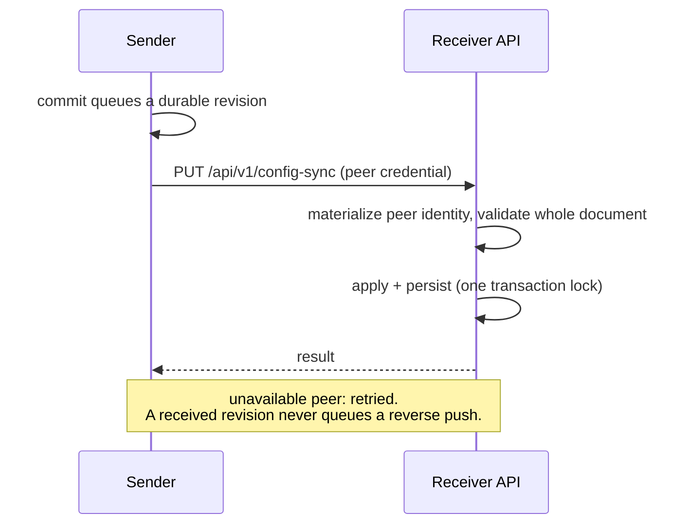
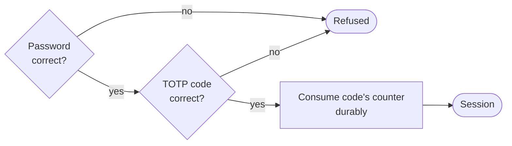

# Authentication and synchronization safety

Source-level security contracts, not final-image release acceptance. Start with the [system tasks](../handbook/system.md); test a separate administrator session and retain console recovery.

```text
set system login alice ssh-key ssh-ed25519 AAAAC3Nz…I alice@laptop
set system login alice hashed-password $y$j9T$<salt>$<digest>
set system login alice totp generate
set system aaa radius 10.0.0.50 secret a-shared-secret
set system aaa default-group operators
commit-confirm 2
```

## Persistent logs

Before an update, or to diagnose an earlier boot:

```sh
journalctl --list-boots --merge
journalctl --merge -u velstra.service -u wren.service
```

Installed images retain `/var/log` on the data partition: the journal is bounded to 128 MiB, keeps 256 MiB free and expires entries after 14 days. `--merge` does not retrieve logs from remote cluster members.

<details><summary>What <code>--merge</code> adds</summary>

`--merge` includes retained logs from earlier machine IDs on an unprovisioned, stateless test VM.

</details>

## Hostname

```text
set system hostname fw-a
```

Applied live on commit and shown in the prompt.

## Login accounts

Created on commit:

| Command | Meaning |
|---|---|
| `set system login <user> ssh-key <openssh-key>` | An OpenSSH public key allowed to log in as this user (repeatable). |
| `set system login <user> password <password>` | Hash a new local password with yescrypt; do not put plaintext commands in shell history or scripts. |
| `set system login <user> hashed-password <hash>` | Import a supported crypt(3) hash, never a plaintext password. |
| `set system login <user> totp <base32-secret>` | A one-time-code secret: the account then needs a code as well as a password. |

To import a hash generated off-box, use an interactive password prompt:

```text
$ mkpasswd --method=yescrypt --rounds=5

admin@fw-a# set system login alice ssh-key ssh-ed25519 AAAAC3Nz…I alice@laptop
admin@fw-a# set system login alice ssh-key ssh-ed25519 AAAAC3Nz…J alice@phone
admin@fw-a# set system login alice hashed-password $y$j9T$<salt>$<digest>
```

**SSH stays key-only** unless the [daemon](#ssh-daemon) enables password auth.

| Account | Administrator access (incl. passwordless sudo) |
|---|---|
| in a local `read-write` group | yes |
| read-only, or an ordinary ungrouped user | no |
| the configured, ungrouped built-in `admin` | yes, a bootstrap exception in both CLI and API, removed by explicitly assigning it a read-only group; it grants nothing to other ungrouped accounts |

Removing a managed account locks it, removes its managed SSH keys and administrator group, and terminates its login sessions and user jobs; homes are not deleted. Demotion also expires old sessions. Keep another administrator or a recovery console when removing or demoting your own account.

### Password hashes

New local passwords use yescrypt cost 5 (16 MiB) with a random salt. Local Unix/API passwords must be 8–511 bytes with no NUL or line break.

> **Warning:** imported MD5 and SHA-256 hashes do not grant password-based SSH/console access (the OS/PAM policy is unchanged). Reset those passwords to yescrypt before relying on OS login.

<details><summary>Legacy hashes, imported costs and OpenConnect credentials</summary>

Existing MD5-, SHA-256- and SHA-512-crypt hashes remain verifiable by the API; there is no automatic rehash, and the API's compatibility helper does not weaken the system-wide crypt policy. Rotate legacy local passwords to migrate them. Imported yescrypt costs are bounded (up to 32 MiB) for local Unix/API accounts.

Rendered OpenConnect VPN credentials also use cost-5 yescrypt, but retain their existing non-empty password-length compatibility. The root-private runtime credential file reuses an unchanged password's validated hash; a legacy SHA-512 hash migrates on apply. OpenConnect tunnel/restart acceptance still needs the final image's VM results.

</details>

<details><summary>Stable account IDs across boots and upgrades</summary>

The persistent, root-private `/var/lib/sentinel/login-accounts.json` registry keeps each managed local UID stable across boots and reserves retired UIDs. Retired `admin` accounts are not silently recreated with bootstrap privileges. Do not delete the registry to reset an account: corruption or UID drift fails closed.

When upgrading an appliance without this registry, only currently configured accounts are adopted: manually review Unix users removed before the upgrade. These lifecycle changes still require the final image's VM login/SSH acceptance results before release qualification.

</details>

## SSH daemon

| Field | Meaning |
|---|---|
| `enable` | Run the SSH daemon (`true`/`false`; default `true`). |
| `port` | TCP port sshd listens on (default 22). |
| `listen-address` | Restrict sshd to one local address (default: all). |
| `password-authentication` | Allow password logins over SSH (default `false`, key-only). |

```text
set services ssh port 2222
set services ssh listen-address 10.0.0.1
```

> **Warning:** a listen address selects the destination IP, not an ingress interface; Linux can deliver traffic from another interface to it. An unzoned management NIC is deliberately unfiltered, so its address is **not** a management-only boundary. Likewise for the web console and HA's receiving API.

Isolation is opt-in policy, never automatic. Deny SSH and HTTPS to management address `10.0.0.1` from zone `lan`, keeping access on the management NIC and forwarding to other hosts on those ports:

```text
set firewall rule deny-lan-management from lan
set firewall rule deny-lan-management proto tcp
set firewall rule deny-lan-management port 22,8080
set firewall rule deny-lan-management destination 10.0.0.1/32
set firewall rule deny-lan-management family ipv4
set firewall rule deny-lan-management action drop
commit-confirm 2
```

Repeat it for **each untrusted ingress zone** and every exposed management address; IPv6 needs its own rule with `family ipv6` and the exact `/128`. Use a destination match, not a broad `to` rule or a combined source/destination rule. Verify access and denial before `confirm` and `save`; keep a local recovery console.

## HA config sync

HA is **experimental**. Fenced pairing has witness and witnessless `two-node` modes with different partition behavior; neither is equivalent to legacy VRRP plus config sync. Read the [HA pairing and recovery guide](../handbook/ha.md) and its known failure modes before `sentinel ha pair <peer-endpoint>`. The pairing token is read with `--secret-stdin` or prompted for without echo.

<details><summary>How pairing authenticates</summary>

Pairing authenticates the first TLS connection before sending the bearer and records both member profiles in canonical `appliance.toml`.

</details>



CLI commits and API updates both queue revisions. The peer identity materialized for a paired revision includes management/control endpoints and interface addresses; new static links need their peer facts in `system.ha.peer-identity`, not an inferred address.

| Field | Meaning |
|---|---|
| `peer` | Receiver endpoint, `host` or `host:port` (default port 8080). Leased HA uses exactly one peer. |
| `secret` | Shared enrollment and config-sync credential (the *peer credential*). At least 32 random bytes; generate it with `sentinel ha secret generate`. It also enables the receiving HTTPS API. |
| `peer-fingerprint` | Base64 SHA-256 management TLS public-key pin. Pairing records the authenticated peer pin. |

The receiving API honors `services.web.listen-address` and `port` even when `services.web.enable = false`. A secret alone leaves the default listener on `127.0.0.1:8080`, so set a reachable control address explicitly on **each** peer; binding is not ingress isolation (see the [management ACL](#ssh-daemon)).

### What the peer credential may do

The config-sync secret is **not** the machine token; the API accepts it as the peer credential.

| May | May not |
|---|---|
| read what a read-only account reads (the stack view uses `status`, `show`, `telemetry/snapshot` and `system/health`; pairing uses `GET /api/v1/ha/enrollment`) | `PUT /api/v1/config` or post `configure` lines |
| push `PUT /api/v1/config-sync` | stage updates or end a commit-confirm window |
| complete `POST /api/v1/ha/pair` | on an already paired member, post a *different* pairing (a repeat of the applied one is answered as applied) |

Enrollment hands over the configuration without accounts, AAA servers and update channels, so no password hash or TOTP secret reaches a peer. The root-only machine token `/var/lib/sentinel/api-token` stays the local full-access credential.

<details><summary>Minted-token records, and upgrading from a release that wrote the secret into the token file</summary>

Sentinel records the digest of every token it mints beside it (`api-token.minted`). Releases before this one wrote the secret into the token file. At the first apply after the upgrade, a token that is the configured secret, or that any archived configuration names (a secret since removed), is replaced by a fresh random token. Any other unrecorded token (an earlier release's own, or one an operator placed there) is kept and recorded.

</details>

A push or pairing never changes who manages the receiver: `system login` (keys, hashes, TOTP), `system group`, `system aaa`, `update` channels and keys, `services ssh` and `system console` stay its own; configure them on each member.

> **Warning:** everything else is shared policy, applied as sent. **A peer that holds the secret can set the pair's firewall, NAT, routing and VPN policy**, and through pairing its HA identity. Keep the secret to the members.

### Secret strength and throttling

The secret must be at least 32 bytes and estimate at 128 bits or more: 64 random hex digits (what `sentinel ha secret generate` prints) or 32 random bytes in base64 pass; a long passphrase is refused.

| Situation | Result |
|---|---|
| weak secret at admission (commit, API, received push or pairing, `config check`) | refused |
| box upgraded with a weak secret | still boots and keeps its pairing, warns at every apply, hands out no enrollment proof (`409`), accepts no change until the secret is rotated on both members |

<details><summary>Why the estimate is strict, and the request limits</summary>

The estimate is deliberately pessimistic about anything composed: words, runs of one letter case, sequences (`abcd`, `1234`) and repeats count for little. The reason: the unauthenticated HA proof lets anybody who can reach the management port test guesses against it offline, so a dictionary word is a lost pair.

- The proof is limited to ten per source address per ten minutes.
- After thirty invalid bearers from one source in ten minutes, that source's further invalid ones get `429` (with `Retry-After`) for five minutes; a valid credential is still served, except the peer credential while the secret is weak.
- Sign-out answers every bearer that is not a session with the same `401` and counts it.
- Every non-read use of the machine token or the peer credential is logged with its source address.

</details>

### Rolling upgrades and legacy config sync

During a rolling upgrade a push names each base revision in two forms (current and older), so mixed members keep synchronizing both ways. **Do not change accounts, AAA, update, SSH or console settings on the older member** in that window: an older sender still pushes them, the updated receiver keeps its own, and the older sender's next push is then refused as a conflict.

> **Warning:** before upgrading a legacy-sync pair, reconcile outstanding changes, verify delivery on both members, then upgrade both to the same reviewed version. Never delete participation fences to force an otherwise refused first synchronization.

<details><summary>Legacy config sync: what it preserves, and upgrade conflicts</summary>

Outside leased HA, legacy config sync can target multiple receivers. It preserves the receiver's web listen address/port, existing local address/identity facts, router ID, VRRP priorities, the source address of each BGP neighbour it already has (`update-source`) and its PPPoE server `local-address`, as well as the management trust above; other web settings, including TLS, remain synchronized policy. A new static interface must already have its receiver facts declared. Drive changes from one node to avoid competing desired states. Legacy VRRP/config-sync alone does not provide the witness's split-brain fencing guarantees.

The new endpoint-aware shared revision can reject a queued old base as a conflict. Preserve its outbox and receive-journal evidence for recovery.

</details>

## HA conntrack sync

| | Config sync | Conntrack sync |
|---|---|---|
| Carries | desired policy | flow state |
| Transport | HTTPS (management API) | mutually authenticated framed TCP |
| Credential | `system.config-sync.secret` | derived from that same secret |

| Field | Meaning |
|---|---|
| `listen` | Local state endpoint, numeric `IP:port` in leased HA (default port `5429`). |
| `peer` | Explicit state receiver endpoint. At least one is required; leased HA requires exactly one. |
| `interval` | Optional poll interval in seconds; omit it in leased mode to use 50ms. |

The secret must be explicit and 32–1024 bytes, and at least one state peer is required. Legacy unsigned UDP and listen-only replication are disabled: before upgrading, [migrate both members or remove the old state-sync block](../handbook/ha.md#migrate-legacy-state-sync); an incompatible saved configuration is rejected, not downgraded.

> **Warning:** authenticated TCP protects integrity, not confidentiality. Use an isolated HA network or a dedicated control WireGuard tunnel when flow metadata must stay private. Credential validation and transport selection alone do not establish HA flow-failover qualification.

<details><summary>What Sentinel never does, how flow state is transferred, and WireGuard promotion</summary>

Sentinel never selects unauthenticated UDP, invents a credential or widens a management bind. The explicitly configured secret activates the shared API with the listener settings above, including in state-only configurations.

The TCP transport polls every 50ms by default and transfers complete snapshots, updates and deletions for NAT, dual-stack firewall and SYN-proxy splice state. Kernel reads are batched; configuration/policy generations fence incompatible state. Leased HA also binds every transfer to the current witness authority. A former master imports authoritative successor state before preemption; an incomplete map installation does not advertise readiness.

WireGuard promotion uses the shared long-term VPN identity and authenticated learned public endpoints to initiate new handshakes. Ephemeral kernel session keys are not copied. The dedicated control tunnel remains member-specific and needs an independent declared underlay outside the fenced data links.

</details>

## A second factor

```text
set system login alice totp generate
```

`generate` makes the secret (160 bits, 32 base32 characters), prints the `otpauth://` URI a QR code encodes, and prints **the code that is current right now**: check the phone agrees before you walk away. Treat the secret and URI as credentials; keep them out of screenshots and issue attachments.



- Six digits, RFC 6238, thirty-second steps, one step of tolerance either side.
- Wrong password and wrong code are the same refusal from outside.
- A consumed code cannot be reused on that appliance, across API restarts and reboots, while its persistent state is retained; wait for the next code to log in again. This is **per appliance**, not cluster-global: keep time synchronized on every member.
- The private replay state fails closed if corrupt or unwritable; deleting it is not a safe workaround.
- No second factor on the **serial console** (the way in when the network is broken) or **SSH** (that belongs to sshd's own configuration).

## Web sign-in limits

| Budget (ten-minute window) | Attempts | Then |
|---|---|---|
| per origin, over all accounts (IPv6: per /64) | 10 | 15-minute lockout |
| per account, per origin | 10 | 15-minute lockout |
| per account, from origins that never signed it in | 100 | refused (bounds a guess spread over many addresses) |

An origin that signed an account in during the last 30 days (while the API ran) is exempt from the last budget: a guess at `admin` from elsewhere does not lock out the administrator's workstation. A new origin can still be refused during such a guess: keep an SSH or serial recovery path. Throttled answers are `429` with `Retry-After`.

<details><summary>Clearing counts and a full tracking table</summary>

A successful sign-in clears its origin's and its pair's counts. When the table of tracked addresses is full of lockouts, new addresses share a small overflow budget instead of being refused outright.

</details>

> **Note:** these limits are held in memory and reset when the API restarts; they are not cluster-wide or persistent protection.

### Sessions and connections

| Limit | Value |
|---|---|
| Session lifetime | 30 idle minutes, 12 hours in all |
| Sessions | 16 per account (signing in again ends the least recently used one), 1024 per appliance |

<details><summary>Clock skew, connection caps and request deadlines</summary>

A session stamped more than five minutes in the future (minted while the clock was wrong) is not trusted once the clock is corrected.

Before any request is read, the listener caps open connections at 32 per source address (IPv6 /64), 256 per network (IPv4 /24, IPv6 /48) and 4096 in all; a connection over a cap is closed as soon as it is accepted. A request head must arrive whole within ten seconds, and HTTP/2 connections are pinged and closed when the peer stops answering. After authentication (and for the sign-in form), a request body must arrive within 30 seconds or the request is answered `408`. Responses carry `Strict-Transport-Security` (browsers ignore it over plaintext and over a certificate they warned about).

</details>

## Where a password is checked


**The order is fixed: local first** (so the box stays enterable when the directory is not), **then the servers in the order given**, kinds in the order RADIUS, LDAP, TACACS+. The first server that answers decides; a refusal names its protocol.

### RADIUS

| Field | Meaning |
|---|---|
| `secret` | The shared secret (required). |
| `port` | Server port (default 1812). |
| `timeout` | Seconds to wait (default 3). |

```text
set system aaa radius 10.0.0.50 secret a-shared-secret
set system aaa radius 10.0.0.50 timeout 2
```

PAP with a mandatory Message-Authenticator (attribute 80, HMAC-MD5) in every Access-Accept and Access-Reject; missing, duplicate or invalid ones are refused, with no unsigned downgrade.

> **Warning:** RADIUS/UDP password hiding and integrity checks are not modern transport confidentiality. Keep the exchange on an isolated trusted network or a protected tunnel.

### LDAP

A **simple bind as the user**, not search-then-bind, so no service-account password lives on the firewall.

| Field | Meaning |
|---|---|
| `base-dn` | Where the accounts live (required). The bind DN is `<user-attribute>=<username>,<base-dn>`. |
| `user-attribute` | The attribute naming an account (default `uid`; Active Directory usually wants `sAMAccountName`). |
| `tls` | `ldaps` (default), `starttls`, or `none`. |
| `port` | Default 636 for `ldaps`, else 389. |
| `timeout` | Seconds to wait (default 5). |

```text
set system aaa ldap dir.example.com base-dn ou=people,dc=example,dc=com
set system aaa ldap dir.example.com user-attribute sAMAccountName
```

`starttls` **fails rather than falling back** to plaintext. `none` is allowed, but `commit` warns that the bind password crosses in the clear. The username is escaped into the DN (RFC 4514), so a comma cannot turn it into a different DN.

### TACACS+

RFC 8907 ASCII authentication over TCP. Authorization and accounting are not implemented: an account's group decides what it may do.

| Field | Meaning |
|---|---|
| `secret` | The shared secret (required). |
| `port` | Server port (default 49, TCP). |
| `timeout` | Seconds to wait (default 3). |

```text
set system aaa tacacs 10.0.0.49 secret a-shared-secret
set system aaa tacacs 10.0.0.49 timeout 2
```

> **Warning:** RFC 8907 XORs the body against an MD5 chain over the shared secret, which the RFC calls **obfuscation, not encryption**. Keep the server on a trusted segment, like a RADIUS server.

### Who gets in, and what they may do

```text
set system aaa default-group operators
```

A directory account needs a local `system login` entry naming its group **unless** `default-group` is set; otherwise one server would admit everybody in the directory. A rejection ends the search; only an unreachable server passes to the next ([diagram](#where-a-password-is-checked)).
