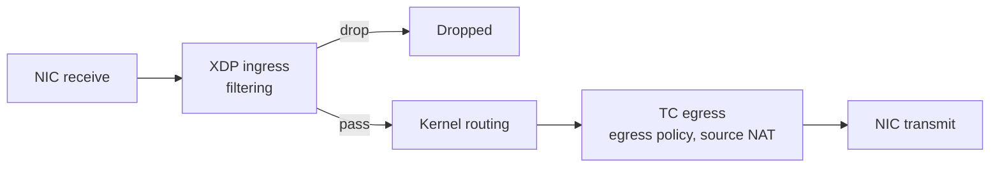
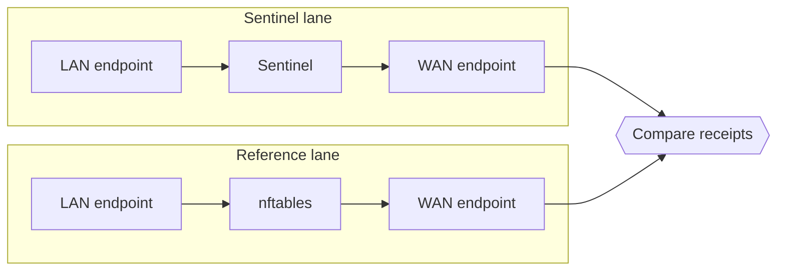

# Dataplane support and conformance

Sentinel retains Fabric's stateful eBPF firewall. This page states what the
1.0.0 data plane (the Fabric commit pinned in `flake.lock`) is qualified to do, how that was
measured, and where it stops. A passing parser, host unit test or verifier
load is not a passing packet test; every claim below names the VM check that
exercises it on the shipped object.



Routed traffic takes this path in 1.0.0; allowed traffic is **not** generally kernel-bypassed.

## Sentinel 1.0.0

| Claim | Checks | What they prove |
|---|---|---|
| **Connections** | `nat-capacity-pressure`, `nat-pressure-reference` | The gate opens 20,000 masqueraded connections and requires every one to answer a later held-connection probe; the reference runs the same load through netfilter as the oracle. Connection tables are sized from the box's memory with a floor of 16,384, and a reclaimer frees expired state. This is not a hardware throughput or connections-per-second figure. |
| **Differential conformance** | `dataplane-conformance`, `firewall-policy-conformance`, `tcp-reset-validation` | Sentinel compared with netfilter on identical topologies, fragmented UDP and echo through SNAT included; policy matching across families; out-of-window, inexact and checksum-corrupt resets leave live connections alone. |
| **Verifier** | `ebpf-verifier-6-6`, `-6-12`, `-6-18` | Every shipped program loads on 6.6, 6.12 and 6.18 and on the CI runner's 7.0 kernel, from one object. |
| **Restart and reconfigure** | `agent-restart-persist`, `agent-reconfigure-stall` | Keeps enforcing and keeps NAT state across an agent restart; bounds the traffic gate of a commit on a 120,000-entry blocklist. |

## Current boundaries

| Path | Status in 1.0.0 |
| --- | --- |
| Routed IPv4/IPv6 filtering | XDP ingress plus kernel routing and TC egress. Allowed traffic is **not** generally kernel-bypassed. |
| Stateful TCP/UDP | Sequence-aware RST validation; XMAS, NULL, FIN-only and out-of-state packets dropped on stateful zones; TCP and UDP with IPv4 options refused on stateful zones. IPv6 and data-carrying RSTs are not checksum-verified; HA-imported state has no sequence window yet. |
| IPv4 source NAT and destination NAT | Masquerade, static SNAT, DNAT, hairpin (client port rewritten) and load balancing pass their VM checks, with HA conntrack sync. GRE, ESP, SCTP and 6in4 are masqueraded; AH, ICMP timestamp and ICMP with options are dropped at WAN egress. |
| Fragmented IPv4 through NAT | Translated. Non-first fragments that arrive before the first are dropped; later fragments of a port-forward reply on a masqueraded WAN are refused. |
| ICMP errors related to flows | Delivered for tracked flows, IPv6 packet-too-big included (path-MTU discovery works). ICMPv6 errors about connections behind NPTv6, or quoting extension headers, reach the host (`v6-mss-npt-related`). |
| IPv6 | Filtering and routed forwarding; NPTv6 and NAT64 have their own checks. IPv6 SYNs are MSS-clamped like IPv4. IPv6 fragments are not NAT-translated, and the SYN proxy is IPv4 only. |
| Conntrack capacity | Sized from memory, floor 16,384 connections; expired state is reclaimed. The 20,000-connection gate is a VM regression bound, not a supported hardware limit. |
| Blocklist and GeoIP | Name sources only: they refuse what a listed address sends in, and the answers to connections the inside opened towards it pass (`blocklist-direction`). There is no outbound blocklist. The global blocklist is copied into each zone policy; `config check` refuses it past 262,144 entries in total, and there is no bulk removal command. |
| SYN proxy | IPv4 only in 1.0; IPv6 SYNs to a protected port are not proxied, and `config check` names the zones where that applies (planned for 1.1). Scoped to the zones that admit the port (see the firewall handbook). Proxied connections lose window scaling, SACK and timestamps. |
| Masquerade ports | About 31,000 concurrent connections to one remote ip:port per public address; a new connection examines a fixed 128-port window and is refused, counted in `egress_nat_no_candidate`, when it finds none (`nat-cps`). |
| Rule capacity | 8,192 rule-trie entries per address family, refused at `config check` and `commit`. |
| VLANs on native XDP | A NIC that strips 802.1Q tags in hardware (rx-vlan-offload: ixgbe, i40e, ice, igc and others) hands native XDP on the parent an untagged frame, which the parent's zone then judges before the VLAN interface's own. Not reproducible on virtio. Until the data plane reads the stripped tag, turn the offload off on such a parent (`set interface <parent> offload rxvlan false`). |
| XDP redirects | Fabric has explicit IPv4 FIB, load-balancer and overlay redirect paths. Those do **not** establish an established-flow fast path for the Sentinel router/NAT configuration. |
| Generic/SKB XDP | Driver fallback, not native-XDP performance. Native mode and each NIC driver require separate qualification. |
| HA | Experimental. The `ha-*`, `conntracksync` and `vrrp` checks cover witness and two-node election, failover with state, masquerade and SYN proxy failover; that is not clearance for every partition or witness-loss case. Rolling upgrades across a policy-digest change are not hitless (see the [1.0.0 release notes](../release-notes-1.0.0.md)). |
| Kernel compatibility | 6.12 is the appliance kernel. 6.6 / 6.12 / 6.18 checks load the same object on real guest kernels. |

An unsupported case is an open bug, not a silent success. There is no `xfail`
list in the differential gate. No Mpps-per-core figures have been established
for a Sentinel established-flow redirect path.

## Run the oracle comparison

Build workstation: Linux, Nix with flakes, writable `/dev/kvm`. Never run these
on an installed appliance or production interfaces.

```sh
python3 -B -m unittest discover -s nix/conformance -v
nix build .#checks.x86_64-linux.dataplane-conformance -L --out-link result-conformance
cat result-conformance/conformance.json
```



The six-VM topology uses separate LAN/WAN segments for nftables and Sentinel.
Both have identical addresses, policies, payloads, MTUs and kernel versions.

- The endpoints use native sockets, not Fabric's parser.
- A peer reports the actual source address and payload digest; TCP also verifies the returned payload.
- The test independently validates the oracle's expected result before comparing Sentinel.
- A failure on both sides is a setup/oracle error, **not** a pass.

The initial inventory contains 17 cases: IPv4 TCP/UDP masquerade, four-MiB
bidirectional TCP, fragmented UDP, echo and fragmented echo, RELATED ICMP
port-unreachable, IPv6 TCP/UDP forwarding, TCP/UDP DNAT, unsolicited IPv4/IPv6
drop, IPv4/IPv6 TCP reset, and a 1280-byte egress-MTU fault. This inventory is
finite: it does not yet cover overlapping/out-of-order fragments, every TCP
state, NAT exhaustion, malformed packets or full IPv6 extension-header cases.

Receipts include kernel versions, object/config hashes, nftables rules and
counters, observed payloads and the complete comparison. Packet captures remain
in the VM test driver's output. On a rejected Nix build, inspect `nix log` for
`CONFORMANCE_RECEIPT`; a failed derivation is not a registered release artifact.

<details><summary>14 November checkpoint</summary>

The 14 November targeted checkpoint passes 15 of these 17 cases, with the
netfilter reference independently meeting all 17 expectations. Fragmented UDP
SNAT and fragmented echo SNAT still fail, so the whole gate remains red. The
comparator validates both probes' expectations against its own case inventory;
matching packet loss or matching rewritten expectations cannot count as success.

</details>

## Run the kernel matrix

```sh
nix build --keep-going -L \
  .#checks.x86_64-linux.ebpf-verifier-6-6 \
  .#checks.x86_64-linux.ebpf-verifier-6-12 \
  .#checks.x86_64-linux.ebpf-verifier-6-18
```

Every lane loads all shipped entry points into the guest's kernel verifier;
receipts record the actual `uname -r`, object SHA-256 and individual programs.
CI runs each lane independently on PRs and nightly and retains failed-load logs.
No rejected kernel is silently replaced with 6.12 or marked as an expected pass.

<details><summary>Earlier verifier receipts and RELATED-ICMP results</summary>

The 14 November working-source checkpoint loads all 21 entry points on
6.6.159, 6.12.113 and 6.18.57 with the same ELF SHA-256:

```text
2af0a7e7c0d7fe66a3be34fb705147aa19c4aa3df3a62adb726b2aba64e1d411
```

That receipt qualifies only this object on those guest kernels. It does not
qualify a different locked Fabric revision, a final image, NIC drivers or
packet behavior. A subsequent hairpin repair, ELF SHA-256
`18e8bfe667fb117d7684143d478440f184e04b01f97a302e671b06868582a860`, also passes
all three kernel checks. It passes 18 targeted ICMP cases on each of ordinary
SNAT, DNAT and hairpin, plus five policy controls. The full differential gate
still fails: the reference forwards two malformed error variants that Sentinel
rejects on all three paths. A subsequent test-only extension also proves
rejection after deleting the exact physical flow state, on the wrong ingress
interface with reverse-path filtering disabled, and after idle expiry: 62/62
Sentinel cases pass. Those checks prove actual injection and no state refresh;
they do not turn the six reference discrepancies into passes. General RELATED
qualification remains open.
Fragment NAT and redirect performance remain open as well.

The endpoint follow-up also reads the real UDP error queue (`IP_RECVERR`), not
only packet captures. Linux delivers the bad quoted IPv4 checksum and unassigned
Time Exceeded code 2 to the application on all three NAT paths; Sentinel drops
both. These six differences remain failures. Keeping the stricter checksum
check versus matching Linux requires an explicit compatibility decision:
[RFC 5508 section 4.1](https://www.rfc-editor.org/rfc/rfc5508#section-4.1)
recommends dropping an invalid embedded IPv4 checksum. That recommendation does
not settle unknown ICMP-code handling. No exception has been approved.

Those 14 November RELATED discrepancies are historical. The
[17 November candidate](https://github.com/Velstra/sentinel/blob/main/docs/qa-nat-expiry-2026-11-17.md) passes the expanded
strict UDP-quote comparison: 145 observations across 19 reports, including
opaque error codes, deliberately invalid quoted checksums, wrong ingress,
missing physical state and idle expiry. A stale XOR stimulus was first rejected
because it injected different checksum errors into the two lanes; the reviewed
constant-error stimulus then passes without relaxing the comparator. This
supersedes the targeted UDP-quote discrepancy, not general PMTU, TCP quotes or
fragmented NAT. No exception or final-image qualification is implied.

A later loader-only rollback repair is separately qualified with object SHA-256
`af9bc39c35f0d231621402efb3869f63c4e0904909b0c6fb7d5730428680d736` on the same
three kernels. Its live address-change test proves that a failed configuration
apply cannot reopen stale maps after an intervening address change. The same
race test fails against the previous loader. This source-stamped object has its
own verifier receipts; older packet results are not a final-image certificate.

</details>

## NAT failure diagnostics

On builds containing the NAT diagnostics change, `sentinel show firewall statistics`
reports two additional packet-attempt counters:

| Counter | Meaning |
| --- | --- |
| `egress_nat_no_candidate` | The bounded NAT candidate search found no claimable/reusable binding. This can happen with an almost empty map; it does **not** mean the map is full. |
| `egress_nat_claim_failed` | A new binding could not be reserved because the map helper returned an error other than a competing insertion. This alone does not identify a capacity failure. |

These are reasons within `egress_dropped`, not additional drops to sum into it.
Retransmissions count again; the values are not counts of failed connections.
Reads across counters/CPUs are not atomic, and counters restart with the agent.
Missing counters on an older image must not be interpreted as zero failures.
They do not repair the collision/admission, ownership-reclamation or established
state-retention limitations above, and are not evidence of final-image qualification.

## Established-flow redirect acceptance

A router fast path must not be implemented by simply enabling Fabric's existing
FIB redirect: that bypasses TC egress, including egress policy and source NAT.
Before enabling one, require all of the following:

- Only fully admitted established flows; policy-generation and HA lease checks
  on **both** ingress and selected egress, with immediate revocation on changes.
- Correct SNAT/DNAT in both directions, neighbour/FIB refresh, TTL/checksum,
  MTU/ICMP handling and a safe kernel fallback for unsupported packets.
- No bypass of shaping, PBR/VRF, IPsec, raw-IP tunnels or other egress services.
  Ineligible flows stay on the classified kernel/TC path, not an unchecked path.
- Differential traffic tests run with fast path both on and off, including
  policy replacement, route withdrawal and an established-flow HA failover.
- Packet counters prove redirect, not `XDP_PASS`; an independent receiver
  verifies payload, loss and bidirectional state.

Performance publication then needs dedicated, disclosed hardware, native-XDP
driver, exact source/object/kernel hashes, packet sizes, pinned cores/queues,
warmup and repeated measurements. Compare identical policies against nftables
both without and with flowtables; report loss, latency and the sustained packet
rate per actual dataplane core. Shared QEMU timings are regression evidence,
not hardware Mpps benchmarks.

## History before 1.0.0

<details><summary>Measurements on earlier candidates (historical evidence, not current status)</summary>

The measurements in this section were taken on earlier candidates. They record
how the limits above were found and are kept as evidence, not as the current
status.

### Source checkpoint, 18–19 November 2026

- **Not release-ready:** the full pressure gate opens all 20,000 connections,
  but only 16,322 pass the held-connection probe. NAT bindings remain present
  while firewall state is missing. A safe supported connection limit has not
  been established.
- **Still failing:** wrong-sequence, nonexact in-window and checksum-corrupt
  TCP resets destroy live state; fragmented IPv4 UDP/ICMP SNAT fails against
  the independent netfilter reference.
- **Passing within scope:** plain NAT, hairpin, generated reject packets,
  pairing/config-sync with and without a witness, and same-source/historical
  mixed-source single-flow failover. These do not qualify a complete rolling
  upgrade, loaded failover or signed image.
- **Verifier:** all 22 shipped programs load on 6.6.159, 6.12.113 and 6.18.57
  from the same object, SHA-256
  `a2d2ef90c895df56bb6a049535222f0186bedaa0fbd56ae919991189aaf53c47`.

The [remediation record](https://github.com/Velstra/sentinel/blob/main/docs/qa-release-findings-2026-11-18.md)
separates source cohorts, fixed test fixtures, actual runtime fixes and failures.
Earlier measurements below remain historical evidence, not extra guarantees.

A separate working-source fragment containment regression
now proves that unsupported nonlocal fragments on the Sentinel TC masquerade
path are refused rather than leaking an untranslated source. This is not
fragmented NAT support: fragmented routed replies on that masquerade uplink are
also conservatively refused. Non-masquerade links are outside this guard.
The full differential gate remains mandatory and red for fragmented NAT.

The independent baseline concurrency run retained 16,261 working connections
from 20,000 attempts. That remains an unresolved capacity finding, not a
universal NAT-map limit: ordinary masquerade uses one NAT entry, DNAT uses two,
and firewall tracking consumes additional entries in its separate map. The
active-state count excludes expired records and is not a map-occupancy or
eviction-pressure metric.

The [17 November instrumented rerun](https://github.com/Velstra/sentinel/blob/main/docs/qa-nat-failure-diagnostics-2026-11-17.md)
passes through 16,000 and fails at 17,000/20,000. At 20,000 attempts, 19,992
connections initially echo but only 16,320 pass the later probe; missing
firewall state correlates with loss while their NAT bindings remain owned.
This is not a supported connection-limit claim or final-image qualification.

A later [same-day candidate rerun](https://github.com/Velstra/sentinel/blob/main/docs/qa-nat-expiry-2026-11-17.md) also
reproduces loss below that pressure boundary: 12,000 initial connections pass,
but only 3,253 later echoes are verified despite recorded established state.
At 20k, none matches the required probe round; this includes delayed/wrong-round
responses as well as timeouts and must not be described as zero packet delivery.
The root cause of the early loss is unresolved; a 16k connection limit is not
qualified by the earlier run.

The [17 November standalone allocator](https://github.com/Velstra/sentinel/blob/main/docs/qa-nat-domain-2026-11-17.md) now
passes that unchanged nine-flow workload with nine initial and held echoes,
nine unique public ports and zero NAT failure counters. All 21 programs load
on all three verifier kernels. This complete-domain search is not enabled
with HA or conntrack synchronization, and its extra lookup cost is not yet
performance-qualified. It does not fix publication, collection or LRU loss.

Its full pressure rerun remains red:928 of the first12,000 requests were not
attempted before the unchanged45-second opening deadline. At20,000 requested,
19,072 connections initially worked but only16,321 later echoes passed;
missing firewall state accompanied2,753 ownership failures while NAT bindings
remained owned. Do not advertise a supported connection limit or relax the
deadline based on the sparse-collision fix.

The 16 November candidate reproduced the nine-flow admission failure with only
8 of 65,536 reverse-map entries occupied. Atomic reservation prevents that claim
path from replacing a foreign owner; it does not make the allocator complete or
remove expiry, cleanup and LRU races. ICMP echo ownership passes six targeted
packet cases on the same candidate, not a full concurrent allocation-race gate.

The [17 November expiry correction](https://github.com/Velstra/sentinel/blob/main/docs/qa-nat-expiry-2026-11-17.md) passes
eleven targeted packet cases, including reuse of an expired DNAT tuple and
canonical router-state lookup despite an expired tenant entry. Expired lookup
no longer deletes NAT state. This is **not** garbage collection: retained
expired reservations, generic paired publication and LRU loss remain separate
ownership/admission problems. The exact outlined object passes all three
kernel verifiers; this does not certify a final release image.

`nat-capacity-pressure` tests the held-connection requirement separately from
occupancy telemetry. It runs real client/masquerade/backend traffic with unique
echo payloads and retains raw maps and per-flow failures before rejecting a
run. A 64-flow smoke pass is not 20,000-flow qualification. The test does not
alter capacity, insert synthetic state or waive known connection loss.

</details>
