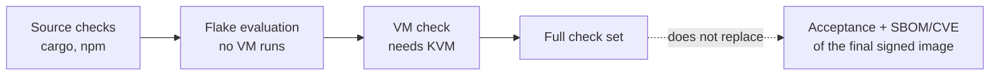

# Select a verification test

<a id="test-suite-nixostests"></a><a id="also-here"></a><a id="also-here-1"></a>

```sh
# from the repository root
nix eval --json .#checks.x86_64-linux --apply builtins.attrNames   # list the current checks
nix build .#checks.x86_64-linux.quickstart -L                      # run one VM check
```



The flake, not a count copied here, defines the suite, including fixtures whose wiring and pins are still being integrated. A fixture file or standalone receipt does not mean the published package exposes it or uses the tested cohort; a configured check is not a passing test or release certificate.

## Source checks

```sh
cargo fmt --all -- --check
cargo clippy --all-targets --locked -- -D warnings
cargo test --workspace --locked
# React console
npm --prefix ui ci
npm --prefix ui test
npm --prefix ui run build
tests/console/run.sh
```

The browser runner needs Node.js and Chromium and uses a temporary loopback API with `--no-apply`: it covers browser interactions and configuration writes, not the network, a deployed firewall, live packets or HA. See the [browser test instructions](https://github.com/Velstra/sentinel/blob/main/tests/console/README.md).

## List and evaluate the current Nix checks

```sh
nix eval --json .#checks.x86_64-linux --apply builtins.attrNames   # names from the current flake
nix flake check --no-build --no-write-lock-file   # evaluates only: runs no VM test, proves no image boots
```

## Run a real VM check

Needs x86_64 Linux, usable `/dev/kvm` and enough RAM for the topology:

```sh
nix build .#checks.x86_64-linux.quickstart -L
nix build .#checks.x86_64-linux.nat -L
nix build .#checks.x86_64-linux.bootfallback -L
nix flake check -L   # everything: builds images and runs many multi-VM topologies
```

Allow substantial disk, memory and time; save logs and output paths before removing artifacts.

> **Warning:** A failure, timeout, interrupted check or unexecuted check is not a pass.

| Area | Check names | Scope |
| --- | --- | --- |
| Image and installation | `verified-boot`, `secureboot`, `install`, `install-iso`, `install-boot`, `install-boot-luks`, `install-boot-raid1` | Boot integrity, installer and installed-image regressions; Secure Boot uses test keys. |
| Update and recovery | `update`, `updatechannel`, `update-release`, `bootfallback`, `boothealth`, `missing-nic-boot`, `reboot` | Slot staging, signed release handling, boot assessment, missing-NIC factory exhaustion and console recovery. Read each fixture's scope before interpreting its result. |
| Active configuration | `commit`, `commitconfirm`, `confirm-crash`, `confirm-failed-recovery`, `cli-edge`, `confighistory`, `refresh-running`, `api` | Apply/save, actual CLI termination, failed recovery admission and explicit retry, offline editing, invalid batches/addresses/durations, stale-session admission and management reads. |
| Authentication lifecycle | `loginlifecycle`, `radius-interop`, `auth-bounds` | SSH/PAM account removal, stable identities, persistent TOTP replay, real FreeRADIUS PAP, source-bound HTTPS login limits and actual viewer/admin write authorization. |
| Management ingress | `management-ingress` | Real IPv4/IPv6 SSH and HTTPS across interfaces; explicit destination ACLs block LAN access while management and same-port forwarded traffic remain available, including after reboot. Binding an address alone is not ingress isolation. |
| Signed metadata | `update-release` | Actual packaged CLI and disposable Ed25519 proofs: image-version floor, signed scope/expiry, replay and sequence substitution, cold-boot persistence, clock rollback and corrupt/missing trust-state refusal. The crypto fixture is deliberately not bootable and proves no slot write. |
| Packet handling | `nat`, `hairpin`, `masq`, `reject`, `rejectudp`, `egress`, `rulescope`, `v6exthdr` | Real traffic through the data plane. A NAT pass does not establish fragment or RELATED-ICMP support. |
| Netfilter comparison | `dataplane-conformance`, `icmp-related`, `tcp-reset-validation` | Matched traffic and policies against an independent nftables reference. The reset check compares socket continuity and firewall state after foreign-tuple, out-of-window, in-window nonexact, checksum-corrupt and valid resets; includes pre-guest wire captures and native challenge-ACK counters. Known differences fail CI; see [conformance scope](dataplane-support.md). |
| Firewall map occupancy | `firewall-capacity` | Real kernel occupancy versus independent `bpftool` counts, expired-slot warnings, authenticated HTTP/CLI parity and missing-agent/restart handling. This is not a connection-limit or eviction-pressure benchmark. |
| Held NAT connection pressure | `nat-capacity-pressure`, `nat-capacity-contract` | Three disposable VMs hold nonce-verified TCP flows up to 20,000; fresh map identities and hash-checked raw snapshots correlate each flow with its NAT/firewall ownership. Lost flows or missing state fail, not an expected-bug pass. Pure probe contracts are separate from the live gate. |
| Kernel fragment mechanics | `kernel-fragment-egress-{6-6,6-12,6-18}`, `kernel-fragment-combined-{6-6,6-12,6-18}` | Isolated reassembly/refragmentation and ingress-domain isolation on three real kernels. These do not execute Sentinel NAT, policy or HA and cannot clear a failing product differential. |
| TCX fragment dispatch | `kernel-fragment-tcx-{6-6,6-12,6-18}` | Actual pinned-Aya attachment and legacy-chain dispatch; deliberately reproduces bypass from PASS and stale readiness after chain loss. Passing hazard controls are not production loader safety or NAT qualification. |
| Guarded ingress handoff | `kernel-fragment-handoff-{6-6,6-12,6-18}` | Reserved-flow reassembly, one-use bounded tickets and original ingress routing context; chain deletion and ticket exhaustion must drop. Does not execute Sentinel NAT/policy or solve ordinary unfragmented admission. |
| Immutable update admission during recovery | `ota-confirmation` | Real EFI/verity boot and transient confirmation/recovery units, including actual partial restore failure. CLI/API Check must be refused before jobs/network traffic; exact retry restores availability. Uses disposable test identities, not production keys; does not certify Stage/CAS. |
| Boot and console write admission | `confirm-special-entrypoints`, `confirm-boot-journal`, `confirm-boot-late` | Failed recovery and live HTTPS transactions block replay; automatic console/network refresh preserves active intent. Includes actual CAKE bandwidth and reboot recovery, not every subsystem or a shared CLI/API journal. |
| Periodic firewall recovery admission | `confirm-refresh` | Real failed rollback and queued recovery cannot replay trial policy over a restored firewall. Fresh TCP traffic and compiled/intent state are checked; normal, armed CLI and ready HTTPS trials retain legitimate refresh. |
| Confirmation diagnostics | `confirm-diagnostics` | Missing timers are silent, genuine stop failures remain visible, and a refused cancellation cannot confirm a live trial. Checks actual PID-1 protection and unchanged intent. |
| Local read-only observation | `observe-readonly` | Six exact SSH/sudo capabilities, protected data redaction, live BGP/NAT and API parity, privilege denials, account revocation and honest daemon failure. Not unrestricted CLI access. |
| API observation error privacy | `api-show-disclosure` | Actual packaged binary and loopback HTTP: malformed private history cannot leak unknown historical secrets to account users or narrowed machine requests. Retains HTTP errors and valid-read redaction. |
| Routing | `bgp`, `bgp-static-reload`, `ospf`, `ospfinterop`, `bfd`, `vrrp`, `staticimport` | Adjacencies, preserved BGP sockets during static-route edits, a third-party OSPFv2 peer and route recovery; not comprehensive protocol certification. |
| HA and synchronization | `ha-pair`, `ha-two-node`, `ha-failover`, `ha-two-node-flow`, `configsync` | Pairing, policy/state synchronization and selected failure cases. HA remains experimental. |
| Nonpreempting HA rejoin | `ha-rejoin`, `ha-rejoin-contract` | Five disposable VMs with a continuously healthy witness and clean config-sync outboxes. Continuous existing/fresh TCP traffic, real VIP SNAT and incumbent role/deadline/NAT observations span the returning member's entire boot. Hard-failover losses are recorded separately; this is not witness-loss, queued-policy replay or final-image certification. |
| Browser | `console`, `console-ux` | Browser interactions against a test API; complements the live packet checks. |
| Compiler/agent boundary | `contract` | Compiled configuration is accepted by the pinned Fabric loader. |

Other protocol checks are development coverage, not support for every option, peer or failure mode ([routing status](../handbook/routing.md#qualification-status), [dataplane support](dataplane-support.md)).

## Release evidence

Record per release check: exact Git revisions, input lockfile, eBPF object hash, image SHA-256, command, result and retained output. The evidence classes above are not interchangeable; never reuse a result from another source cohort.

[ci-public.yml](https://github.com/Velstra/sentinel/blob/main/.github/workflows/ci-public.yml) shows which checks run on a PR; the scheduled dependency audit does not run the VM suite.

## Kernel verifier compatibility

Host Rust tests cannot verify eBPF; the exact object must load into each target kernel in a privileged VM, and an unexecuted lane is not support ([dataplane matrix](dataplane-support.md)).

## Additional fixture catalog

Jump to: [Boot](#image--boot-integrity) · [Config](#config-lifecycle--management) · [Firewall](#firewall-ebpf-data-plane) · [NAT](#nat) · [Routing](#routing-wren-control-plane) · [L2](#interfaces--l2) · [Addressing](#address--name-services) · [WAN](#wan--shaping) · [VPN](#vpn) · [Services](#services)

A task lookup, not a passing-results ledger; the fixture source is authoritative. Rendering, adjacency and replication checks alone do not prove service interoperability or failover; experimental-feature limits apply.

## Image & boot integrity

| Check | Intended fixture scope |
|---|---|
| `verified-boot` | dm-verity store mounts, the UKI boots, a clean boot is **blessed** |
| `secureboot` | boots under **enforcing** Secure Boot |
| `install` | single-disk **and** RAID1 installs check partition and filesystem layout; actual installed-disk boot needs the install-boot fixtures |
| `install-iso` | installer ISO structure and bundled-image installation; not a substitute for booting the installed disk |
| `update` | an A/B update writes + re-types slot B; a counted next-boot entry is selected |
| `updatechannel` | the **crypto gate** in front of the slot writer rejects an unsigned update |
| `reboot` | a **genuine** `machine.reboot()` brings the whole running config back, not just the files |

## Config lifecycle & management

| Check | Intended fixture scope |
|---|---|
| `commit` | `commit` applies hostname/zone/address live; `save` persists across reboot |
| `commitconfirm` | a timed commit auto-reverts unless `confirm`ed — the safety net for editing a firewall over its own link |
| `confighistory` | every `save` archives a revision, `show system commit` lists them, `rollback <N>` restores one |
| `configsync` | a commit on the primary pushes the running config to the backup's API, which applies **and** persists it |
| `api` | CLI/API management operations against the appliance backend. |
| `console` | Browser validation of management operations, staged changes and their outcomes. |
| `contract` | the compiled agent config keeps the shape the data plane reads |
| `shipped` | what the image actually carries |
| `wizard` | the installer's click-through, answered end to end |

## Firewall (eBPF data plane)

| Check | Intended fixture scope |
|---|---|
| `reject` | a rejected TCP port answers with a **RST**, not a silent drop |
| `rejectudp` | a rejected UDP port answers with **ICMP port-unreachable** |
| `log` | per-rule logging fires for a logged drop and a logged pass, and stays quiet otherwise |
| `srcfilter` | a rule's `source` CIDR matches the intended client and only that one |
| `nat` | Packet translations and stateful reverse-path handling. |
| `fwgroups` | address and port groups expand at compile time to the full sources × ports product |
| `fwdomain` | Resolves domain-group membership for firewall matching. |
| `fwschedule` | a rule with a weekly schedule is in the data plane **only** inside its window |
| `v6exthdr` | IPv6 extension headers do not bypass a rule — the chain is walked to the real protocol |
| `icmptype` | Matches ICMP and ICMPv6 rules by message type. |
| `rulescope` | Scopes rules by ingress interface within a zone. |
| `evpn` | Exchanges tenant reachability across peer routing sessions. |
| `macgroup` | Selects configured groups of link-layer addresses. |
| `egress` | Applies the policy in the intended egress direction. |
| `srcprefix` | every source-prefix **length** matches, not just the convenient ones |
| `v6rules` | a rule scoped to IPv6 lands in its own trie and does not open the v4 one |
| `blocklist-direction` | a zone blocklist refuses what a listed address starts, both families, while the LAN still reaches it and gets its answers |

## NAT

| Check | Intended fixture scope |
|---|---|
| `nat` | Packet translations and stateful reverse-path handling. |
| `synproxy` | Exercises the configured SYN proxy with a real connection, and that a LAN client's outbound SYN to the protected port is not proxied, and a server that speaks first answers through the proxy. |
| `synproxy-edge` | SYN proxy on a deny-by-default masquerading edge box: a port-forward that remaps its port, servers that speak first (routed and port-forwarded), and `syn-protect` surviving save, an unrelated commit and a reboot |
| `synproxy-churn` | SYN-proxy records end with their connections: idle routed and port-changing-forward connections survive more short ones (FIN and reset closes) than the table holds, the table drains, and blind forged SYN, FIN and reset packets end no live connection |
| `masq` | masquerade SNATs a private LAN client out of the WAN address |
| `hairpin` | an internal client reaches a port-forwarded service via the box's **own** public IP |
| `npt66` | stateless, checksum-neutral IPv6 prefix translation (RFC 6296) |
| `v6-mss-npt-related` | an IPv6 SYN is MSS-clamped like IPv4; a Packet Too Big behind NPTv6, or quoting an extension header, reaches the inside host's socket; the inside host's port-unreachable names its external address |
| `nat64` | an IPv6-only client reaches an IPv4-only server through the box, DNS64 included |
| `conntracksync` | checks replicated conntrack state; use the causal HA flow fixtures to prove actual connection continuity |

## Routing (Wren control plane)

| Check | Intended fixture scope |
|---|---|
| `bgp` | two appliances peer eBGP and each learns the other's network |
| `policy` | a VyOS-style route-map filters and rewrites what BGP exports |
| `ospf` | an OSPFv2 point-to-point adjacency; each side learns the other's redistributed network |
| `ospf3` | the same over IPv6 (OSPFv3, RFC 5340) |
| `rip` | RIPv2 — a distance-vector paradigm alongside BGP's path-vector and OSPF's link-state |
| `ripng` | RIPng (RFC 2080), the IPv6 sibling |
| `babel` | Babel (RFC 8966) over IPv6 |
| `isis` | IS-IS (ISO 10589 + RFC 1195) — a link-state IGP running directly over L2 |
| `isisauth` | Verifies IS-IS authentication between neighbors. |
| `bfd` | BFD (RFC 5880) under BGP detects a path failure fast |
| `vrrp` | two boxes share a virtual IP; the higher priority owns it and hands it over on loss |
| `staticv6` | static routes are dual-stack — a v6 prefix reaches the kernel IPv6 FIB |
| `multiwan` | health-checked uplink failover plus policy routing across two upstreams |
| `routingimport` | Checks route import policy against received prefixes. |
| `ospfinterop` | Establishes an OSPF adjacency with the test peer and checks exchanged routes. |

## Interfaces & L2

| Check | Intended fixture scope |
|---|---|
| `l2` | a bridge and a bond, synthesised on the same networkd render path as VLANs |
| `c14` | MACVLAN and QinQ, the two remaining networkd-rendered L2 types |
| `macsec` | 802.1AE link encryption comes up from a pre-shared key |
| `l2tp` | a static L2TPv3 Ethernet pseudowire over the underlay |
| `tunnel` | kernel GRE tunnels between two appliances |
| `linkopts` | per-interface MTU (jumbo frames / PPPoE) and MAC cloning reach the link |
| `linkbehaviour` | per-link forwarding, ARP and DHCP-client identity reach the kernel, and a mirror carries traffic |
| `vti` | Brings up a route-based IPsec/VTI path. |
| `wireless` | Verifies wireless configuration rendering; test radio behavior with actual hardware. |
| `wwan` | Verifies modem configuration rendering; carrier and hardware behavior require a modem. |
| `dualstack` | one interface carries an independent static IPv4 **and** IPv6 address |

## Address & name services

| Check | Intended fixture scope |
|---|---|
| `dhcp` | the built-in DHCP server leases to a LAN client |
| `dhcp6` | stateful DHCPv6 leases — the stateful sibling of `ra` |
| `ra` | IPv6 Router Advertisements give a client a SLAAC address |
| `dhcp6pd` | DHCPv6-PD requests a delegated prefix upstream (the German-ISP WAN v6 model) |
| `dhcprelay` | Exercises DHCP relay across client and server segments. |
| `dhcprelay6` | the IPv6 sibling of the relay |
| `dns` | the DNS forwarder resolves for the LAN against an authoritative upstream |
| `ntp` | the box serves time to the LAN from an upstream source |
| `mdns` | the mDNS reflector bridges discovery between two segments |
| `dyndns` | the dyndns2 client updates a provider when the WAN address changes |

## WAN & shaping

| Check | Intended fixture scope |
|---|---|
| `pppoe` | a PPPoE session against a real concentrator, plus MSS clamping |
| `qos` | a CAKE shaper is live in the kernel at the configured bandwidth |

## VPN

| Check | Intended fixture scope |
|---|---|
| `wireguard` | a WireGuard interface and tunnel render to a `Kind=wireguard` netdev with a 0640 key |
| `ipsec` | an IKEv2 site-to-site tunnel establishes and carries traffic between protected subnets |
| `openconnect` | a road-warrior client dials in and reaches a host behind the box |

## Services

| Check | Intended fixture scope |
|---|---|
| `ssh` | `set services ssh` tunes the daemon; `set system login` creates real accounts and keys |
| `snmp` | a read-only v2c poll answers, and the rendered config stays 0640 |
| `lldp` | LLDP neighbours are discovered between two boxes (the daemon is off by default) |
| `pki` | a local CA and a leaf signed by it land under `/var/lib/sentinel/pki` with the right modes |
| `reverseproxy` | TLS terminates on :443 with an on-box leaf and load-balances to a backend |
| `geoip` | Checks country-prefix policy using the test database. |
| `acme` | Issues and installs a certificate in the test environment. |
| `bcastrelay` | Relays the selected UDP broadcast service across configured interfaces. |
| `syslog` | Delivers appliance log records to a remote collector. |
| `alerts` | Delivers a notification when a monitored unit fails. |
| `spoofing` | Compares accepted and rejected sources under source-validation modes. |
| `ids` | Observes the configured detector emitting an event for test traffic. |
| `portal` | Tests guest admission and expiry against the dataplane. |
| `portmap` | Verifies a client mapping against the agent’s live NAT-PMP table. |
