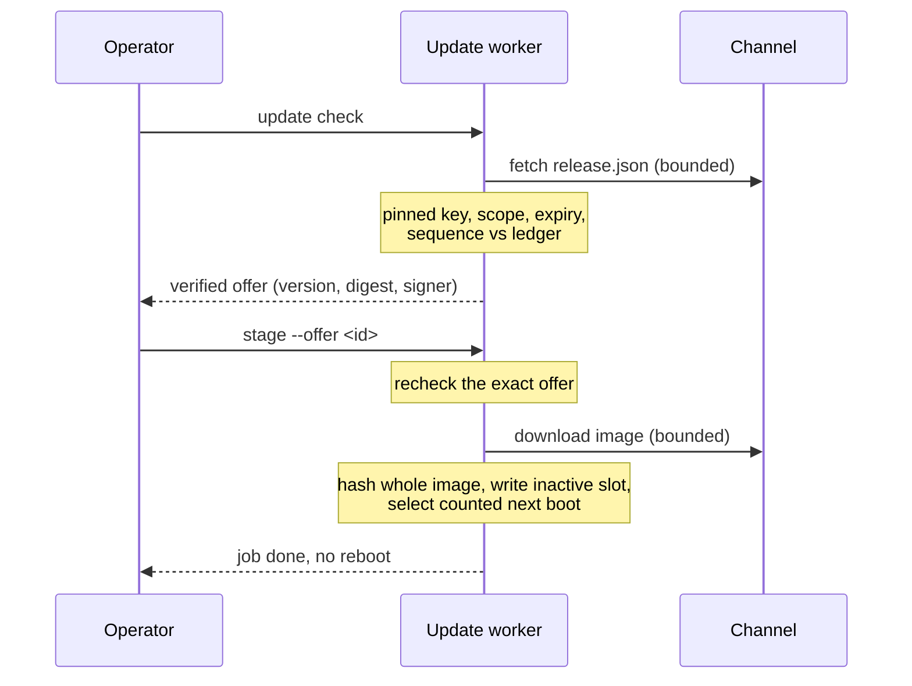
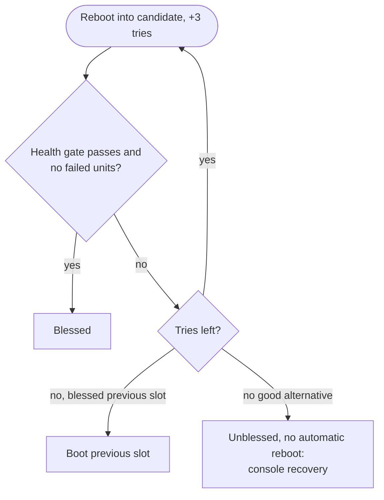

# Update trust and recovery reference

The rules behind [review and stage an update](../operations/update.md); the
design is in [A/B update slots](../architecture/ab-updates.md). A new image is
written to the inactive store slot and the bootloader switches to it.
Automatic fallback requires an intact, previously blessed slot; an
unprovisioned or broken first installation has no such guarantee.

## Signed channel: local CLI or Web UI

On the live A/B appliance, as an administrator:

```shell
sudo sentinel system status
sudo sentinel system update check --wait
sudo sentinel system status
# Review the offered version, image digest and signing identity first.
sudo sentinel system update stage --offer <exact-offer-id>
sudo sentinel system update job <job-id> --wait
```



Output is JSON. Each submission returns a durable job that disconnects and API
restarts do not stop; `--wait` observes it for at most five minutes without
owning or cancelling it. If an outcome is unknown, inspect `system status` by
its request correlation instead of resubmitting. In the Web UI the same steps
are **System → System updates** → **Check signed channel** → **Download &
stage update**, with one shared job history.

Staging does not reboot or claim a successful boot: check boot selection and
cluster readiness, then reboot one member at a time. There is no
trust/downgrade override. Native Enterprise `update check` uses this worker;
the former unreviewed `update install` path is refused.

| Stage is refused | Because |
| --- | --- |
| after a change to configuration, trust or boot identity since the check | it needs a fresh check and review |
| with pending config changes, a remote member selected, a read-only account or a stale observation | none of these can authorize Stage |
| from an off-box/no-apply console | it cannot run OTA jobs |
| while the running image is an unblessed counted trial or not the next default (any slot write: CLI or UI, signed or `--allow-unsigned`) | overwriting the other slot would remove the only known-good fallback |

### Expiry and replay protection

| Check | Rule |
| --- | --- |
| Signed fields | Online offers must carry signed channel, architecture, sequence and validity timestamps. |
| Expiry | Metadata expires within 14 days; expired or wrongly scoped offers are refused. |
| Clock skew | Issue times beyond the five-minute allowance are refused. Synchronize the clock before checking. |
| Ledger | A check persists its highest accepted sequence and clock observation in `/var/lib/sentinel/update-trust`. |
| Fail closed | Lower sequences, changed bytes at the same sequence, unauthorized signing-key changes and substantial clock rollback. |
| Stage | Rechecks the exact offer before writing the inactive slot. |
| Key and sequence scope | Per signing key, not per channel name: a new channel label must be signed by an already pinned key, at a sequence no lower than that key reached under any label. |

> **Warning:** Do not delete `/var/lib/sentinel/update-trust` to clear an
> error: that discards rollback protection. Repair the clock or obtain fresh,
> correctly signed metadata. A missing or corrupt ledger that was once
> published requires investigated recovery, not an automatic reset.

<details><summary>Interrupted first checks, key changes and old readers</summary>

A first check interrupted before its ledger was published (only the lock and
staged files exist) is completed by the next check. Signing-key rotation is not
yet implemented by this ledger, so selecting a channel signed by a different
key needs the same investigated recovery as a key rotation.

Older appliance versions without the slot-write validation must be upgraded
first; new metadata alone cannot protect an old reader. Offline media and
automatic boot fallback follow their own policies below.

</details>

## Community offline/local-image updates

```shell
# from a new raw image (built with `nix build .#sentinel-image`) plus its
# signed digest velstra-sentinel.raw.sha256(.sig) beside it
sudo sentinel update /path/to/velstra-sentinel.raw --commit

# from a USB stick the image was dd'd onto, with the release's proof from
# another medium (a signed manifest, or the signed digest)
sudo sentinel update /dev/sdX --commit --signature /mnt/release/manifest.json.sig
```

Community RAW-image writer only: native Enterprise images refuse it, also with
`--allow-unsigned`. An offline proof authenticates operator-selected bytes, not
their online freshness or subscription entitlement. Without `--commit` the plan
is printed and nothing is written.

| Step | A signed Community local update |
| --- | --- |
| 1 | **verifies** the image's signature (see below) |
| 2 | **refuses** a release older than the running one unless `--allow-downgrade` (when the proof states a version) |
| 3 | detects the **active** slot (via `/dev/mapper/usr`) |
| 4 | reads the image once and hashes it in full against the signed digest; nothing is written unless it matches |
| 5 | writes the new store + verity to the **inactive** slot from that same open file, re-hashed on the way, so an image that changes underneath (a rewritten file, a swapped stick) is refused before the slot is activated |
| 6 | gives that slot the source image's verity partition types and GUIDs |
| 7 | installs the new UKI as `sentinel-<inactive>+3.efi` with **3 boot tries** |
| 8 | makes `loader.conf` prefer the new slot with `preferred sentinel-<inactive>*`, keeping `default sentinel-*` so an exhausted candidate can fall back |

Before any inactive-slot write, signed and unsigned commits require the
**running UEFI systemd-boot version 260 or newer** and no nonempty firmware
default, preferred or one-shot entry override. An image carrying the active
slot's verity/store GUIDs is refused before any write, unsigned sources
included. Unplug a USB donor before reboot: it now shares the candidate's GUIDs
and could be mistaken for the installed slot.

<details><summary>Bootloader and identity details</summary>

Older/non-systemd loaders and malformed or unreadable EFI state are refused.
Sentinel does not silently clear firmware variables: inspect the override named
in the error and review the suggested `bootctl` clearing command before
retrying. Bootloader maintenance is a separate operation, not a package-manager
update on the node. A hard per-slot `default` is unsafe: systemd-boot 260
honors it even when its boot counter reaches zero. Do not re-seal the booted
medium.

</details>

### Local images are signature-checked by default

```shell
sha256sum velstra-sentinel.raw | cut -d ' ' -f 1 > velstra-sentinel.raw.sha256
openssl pkeyutl -sign -inkey release-priv.pem -rawin \
  -in velstra-sentinel.raw.sha256 -out velstra-sentinel.raw.sha256.sig
```

`sentinel update <image>` verifies an Ed25519 proof before writing:
`<image>.sha256` with its detached signature when the digest file exists,
otherwise `<image>.sig`, or the file named by `--signature <file>`. Missing
keys, missing signatures and invalid proofs fail closed; a bad digest proof
never falls back to a raw signature.

| Key source, in order | |
| --- | --- |
| 1 | `--pubkey <pem\|file:path>` on the command line |
| 2 | the saved `[update]` channel's `public-key` |
| 3 | a release key baked into the image at `/etc/sentinel/release.pem` |

Publishers should sign a small digest for multi-GiB images, as above (direct
Ed25519 signing buffers the entire input), on their protected machine, not on
customer nodes. The digest file holds only 64 hex digits and an optional
newline, not a filename. The updater verifies the signed digest, then hashes
the entire image. Legacy direct image signatures work for regular files up to
64 MiB (a private copy is verified and installed); larger images need the
signed digest.

### USB sticks and other block devices

A stick is larger than its image and nothing can sit "beside" `/dev/sdX`, so
prove a block device with `--signature` naming either:

- `…/manifest.json.sig`: the channel's signed release manifest (copy the
  channel directory to a second medium). It names the image's SHA-256 and the
  release version, so the downgrade check applies.
- `…/velstra-sentinel.raw.sha256.sig`: the signed digest (above).

The device is read up to the end of the image its own partition table describes
(the backup GPT header); those bytes must hash to the signed value.

### Downgrades

| Proof | Downgrade check |
| --- | --- |
| Online offer, offline signed manifest | Checked against the running **OS image release**, not just the Sentinel package version. Older releases and unusable image version identities are refused. |
| Signed digest, raw signature | Contains no release version, so cannot rule out a downgrade: refused unless `--allow-downgrade` accepts it explicitly. |

Use a signed manifest for a normal offline update. Only the legacy Community
writer accepts `--allow-downgrade`, as an explicit operator exception. Equal
versions may pass the version check, but identical active partition GUIDs still
cannot be staged. Offline proofs do not consult the online ledger; online
offers, including `file://` channel directories, must satisfy
[expiry and replay protection](#expiry-and-replay-protection).

`--allow-unsigned` skips local signature verification, on Community only. It
does **not** bypass bootloader, identity or identical-image safeguards, does not
permit re-sealing the active image, and is not an OTA trust override.

<details><summary>Manifest <code>product</code> field</summary>

An optional manifest `product` must equal `velstra-sentinel` when present.
Legacy offline manifests may omit it; that compatibility is not proof of a
current online offer.

</details>

## Configure a signed channel

```shell
configure
set update url https://updates.velstra.example/sentinel
set update public-key file:/etc/sentinel/release.pem
commit
save
```

| Field (both required) | Meaning |
| --- | --- |
| `url` | The channel base: an `https://` or local `file://` directory holding `release.json` (or the compatibility manifest/signature pair) and its images. Local channel directories still require signed online freshness. |
| `public-key` | The pinned Ed25519 release-signing key, PEM. `file:<path>` reads it from disk (so the key can live in the immutable image, not the config); an inline PEM also works. |

The whole `[update]` section is local-only: a fleet controller cannot change it
(see the fleet documentation). An `https://` channel is checked against the
system trust store; proxies are not supported. No channel path accepts an
unsigned release or bypasses online freshness.

<details><summary>Fetch environment and the legacy adapter</summary>

The fetch is the pinned curl with `--disable` and an **empty environment**:
`HTTPS_PROXY`/`ALL_PROXY`, `SSLKEYLOGFILE`, `CURL_CA_BUNDLE`/`SSL_CERT_FILE`
and `~/.curlrc` are ignored.

Native Enterprise `sentinel update check` is an alias for the reviewed worker;
`sentinel update install` is refused. Community keeps a legacy
`update check`/`install` adapter, but that is not the reviewed offer/job
workflow; do not use it as an unattended replacement.

</details>

## Named channels and subscriptions

```shell
configure
set update channel community url https://updates.velstra.example/community
set update channel community public-key file:/etc/sentinel/community.pem
set update channel enterprise url https://updates.velstra.example/enterprise
set update channel enterprise public-key file:/etc/sentinel/enterprise.pem
set update channel enterprise subscription-key <key>
set update channel enterprise        # ← selects the active channel
commit
save
```

Each named channel pins its own `url`, `public-key` and optional subscription
credential. `set update channel <name>` selects an existing channel; the single-channel
configuration above is the unnamed `default` channel. A channel name is neither
a separate trust identity (reusing a signing key shares that trust) nor proof
of certification; review the release's verification evidence.

`subscription-key` is a bearer secret. The read API redacts it and
`show subscription` masks all but its last four characters, but saved
configuration and local `show configuration` hold the full credential: protect
them.

### What an expired subscription does — and does not — do

It stops fetching new images from that channel. It does not disable routing,
filtering, saved configuration or the console. Authentication failures are
reported, not treated as unsigned offers. Subscription expiry is not signed
**metadata expiry**: an entitled customer still needs a fresh, scoped offer, and
a metadata refusal never disables the running data plane either.

### `show subscription`

This legacy view reads saved configuration and the legacy adapter's last-check
record, without a network request; `sentinel system status` shows the durable
worker's offers and jobs. `expiry: not reported` means **this view does not
provide subscription entitlement expiry**. It says nothing about the mandatory
expiry in signed metadata; do not infer a license expiry date from a release's
validity window.

## The rollback guarantee



The health gate checks saved configuration against live hardware, reconciled
addresses, configured services, dataplane readiness and XDP attachment; service
activation alone is not success. Fallback is not a guarantee against every
firmware, storage or kernel hang, and both slots share the persisted
configuration: falling back does not repair a bad configuration or remove an
unavailable NIC.

On a Community factory installation, a configured **missing NIC** takes the "no
good alternative" path; it is not treated as ordinary carrier loss or a
temporarily absent DHCP server. Inspect, repair the saved interface
configuration from the recovery console, then reboot explicitly and verify
normal health and blessing:

```shell
sudo sentinel config check --live /var/lib/sentinel/appliance.toml
```

For a deliberate recovery boot, select the verified good entry once in the boot
menu. Do not write a hard per-slot `default`: it can override exhausted
counters. Follow the updater's `preferred`/wildcard policy and review any
firmware override before staging again.

## Reboot to activate

Unlike `commit` (live, never reboots), an OS image update takes effect on the
**next reboot** into the new slot; the running slot serves until then. Schedule
the reboot when convenient.

## Verifying

```shell
nix build .#checks.x86_64-linux.update -L
nix build .#checks.x86_64-linux.bootfallback -L
nix build .#checks.x86_64-linux.missing-nic-boot -L
```

| Check | Exercises |
| --- | --- |
| `update` | A real donor-image A→B boot and normal product blessing. It does not replace the negative/fallback checks. |
| `bootfallback` ([fixture](https://github.com/Velstra/sentinel/blob/main/nix/boot-fallback-test.nix)) | Three failed dataplane boots and fallback to a previously blessed image. |
| `missing-nic-boot` ([fixture](https://github.com/Velstra/sentinel/blob/main/nix/missing-nic-boot-test.nix)) | Exhausted factory trials and product CLI repair. Driver backdoor commands are not proof of an authenticated physical console login. |

These are source-level VM gates: their existence, or a pass on another
candidate, is not certification of the final signed release and its exact
hashes.

## Bounded metadata and atomic channel promotion

The reader prefers `release.json`: `schema = 1`, `manifest` (base64 of the
exact signed bytes) and `signature` (base64 of the 64-byte Ed25519 signature).
The pinned key authenticates the exact manifest bytes before any release field
is trusted; the envelope is not a new trust root. Only an absent endpoint (HTTP
404, or a missing local file) allows fallback to `manifest.json` and
`manifest.json.sig`; malformed, oversized, unauthorized, timed-out or
incorrectly signed envelopes never fall back.

| Limit | Value |
| --- | --- |
| Envelope / decoded manifest | at most 128 KiB / 64 KiB |
| Connection | 10 seconds |
| Metadata | 60 s overall, 15 s without progress |
| Image download | 6 h overall, 60 s without progress, 64 GiB transfer ceiling (native Enterprise resources keep their stricter individual limits) |
| Staging reserve | the greater of 512 MiB or 5% of the state filesystem, plus metadata headroom |
| Concurrent image updates | one; a second writer gets `another update is in progress` |

Limits are enforced during transfer, chunked responses included, with
appliance-pinned curl 8.4 or newer. Incomplete downloads are removed and
failures leave the active slot unchanged.

<details><summary>Publishing a channel migration</summary>

Publishers must keep the old root manifest/signature pair frozen while
upgrading legacy readers, upload immutable versioned resources first, and
promote only the single envelope object last. Both public and native
Enterprise readers must be upgraded before production channel migration. On
Linux the curl child is killed automatically if its update owner exits.

</details>

<details><summary>Staging space and locking</summary>

Channel RAW images are staged sparsely in an anonymous 0600 file on the mounted
ext4 state filesystem (`/var/lib/sentinel`), not in RAM-backed `/tmp` and not in
an operator-selected `TMPDIR`. Every zero byte still counts toward the signed
image digest and exact logical length; only nonzero blocks allocate payload
space. The open descriptor survives whole-image verification and partition
copying and is reclaimed automatically when the updater exits. There is no
persistent image cache to clear after a crash.

The updater refuses an extent that exceeds its staging budget. Concurrent
unrelated filesystem writers can still consume space; such allocation or sync
failures safely refuse the update. A genuine signed dense image can need more
staging space than a sparse release. Missing/unmounted/volatile/read-only state
and insufficient capacity are explicit errors; the updater never deletes
configuration, archives, logs or a fallback slot to make room. The recommended
32 GiB appliance disk has room for state and releases; a smaller disk that
boots is no guarantee that every future release will fit. The bounded ESP copy
is verified before any inactive-slot payload is overwritten.

The update lock covers signed local and deliberately unsigned local writes
too. It does not block ordinary configuration commits or metadata checks while
a download is in progress.

The persistent subscription identity is published only after its private
contents are complete and synced. Concurrent first use converges on one
identity; corrupt or insecure existing files are refused rather than silently
replaced with a new subscription seat.

</details>

No deployed node is changed by a source update: fresh image and OTA/rollback
qualification are required before rollout.
